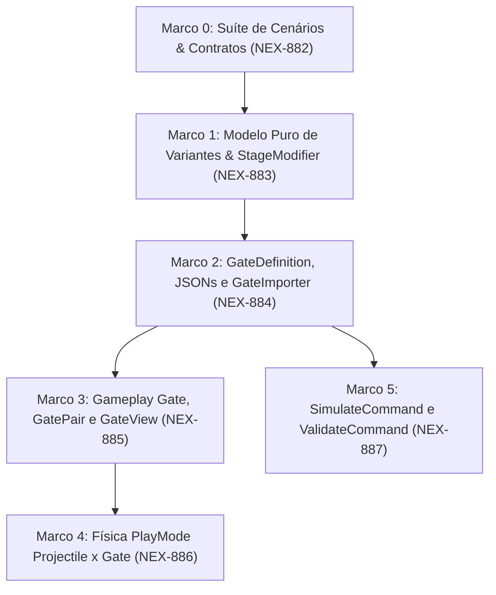

# Plano de Implementação: M17 · Portões vivos (evoluem com tiro, amaldiçoados, guardados)
> Data: 2026-10-12
> Issue: NEX-652
> Status: Em Execução

## 1. Contexto & Arquitetura
- **Resumo**: Implementar `GateDefinition` orientada a dados (`Content/Source/Gates/*.json` → `Assets/_Game/Data/Gates/*.asset`) combinando `PerkDefinition` e variantes polimórficas `IGateVariant` via `[SerializeReference]`: `StaticGateVariant`, `ShootToUpgradeGateVariant(initialValue, step, hitsPerStep, cap)`, `CursedGateVariant(bonusPerkId, stageModifier, durationDistance)` e `GuardedGateVariant(enemyWaveId, guardArchetypeId, guardCount, guardDistanceOffset)`. Atualizar `Gate`, `GatePair` e `GateView` para que portões evolutivos na camada `Pickup` recebam projéteis (`IDamageable`), exibam a evolução do valor e cor em tempo real, apliquem modificadores temporários de estágio (`IStageModifier` / `StageModifierController`), publiquem `GatePassedEvent` no `IEventBus` e sejam simulados e validados em `SimulateCommand` e `ValidateCommand`.
- **Stack**: Unity 6, C#, ScriptableObjects (`[SerializeReference]`), JSON (`Content/Source/Gates/`), Harness CLI (`tools/unity`).
- **Verificação disponível**: Suíte de testes confiável (`test-edit` e `test-play` via harness CLI `tools/unity`, além de `import-content`, `validate` e `simulate`).

## 2. Armadilhas do Repositório

| Armadilha | Onde morde (arquivo/passo) | Regra a respeitar |
|---|---|---|
| Bloqueio indevido de projéteis por portões não-evolutivos | `Gate.cs` / `Projectile.cs` — Passo 3 e 4 | `Projectile.HandleTrigger` consome o projétil ao encontrar `IDamageable` com `IsAlive == true`. `Gate` DEVE reportar `IDamageable.IsAlive == true` exclusivamente quando a variante for `ShootToUpgrade` e o `GatePair` não estiver consumido (`!IsConsumed`). Portões `Static`, `Cursed`, `Guarded` ou já consumidos devem retornar `IsAlive == false` para não bloquear tiros destinados aos zumbis atrás do portão. |
| Dependência unidirecional de assemblies (`asmdef`) | `Game.Core` / `Game.Data` — Passo 0, 1 e 2 | `Game.Core` tem `noEngineReferences: true` (exceto onde tipos puros residem sem `MonoBehaviour`/`ScriptableObject`). `IGateVariant`, `IStageModifier`, `StageModifierController` e `GatePassedEvent` vivem em `Game.Core`; `GateDefinition` e `GateCatalog` (ScriptableObjects) vivem em `Game.Data`. |
| Ordem de importação no `Cli.ImportContent()` | `Cli.cs` / `GateImporter.cs` — Passo 2 | `GateImporter.ImportAll` valida se `perkId` (e `bonusPerkId` no `Cursed`) existem no catálogo de Perks; portanto, deve rodar obrigatoriamente **depois** de `PerkImporter.ImportAll` e `EnemyImporter.ImportAll` dentro de `Cli.ImportContent()`. |
| Destruição de objetos em testes EditMode | Testes EditMode — Passos 0 a 5 | Todo `GameObject` ou `ScriptableObject` instanciado em testes EditMode deve ser destruído com `UnityEngine.Object.DestroyImmediate` no `[TearDown]`. |
| Ruído de regeneração de assets e cenas | Todos os passos | Reverter com `git checkout --` qualquer modificação colateral em `Assets/_Game/Data/` ou `Assets/_Game/Scenes/` que não pertença ao escopo do Marco antes de commitar. |
| Comentários narrativos proibidos | Todos os arquivos C# | PROIBIDO adicionar comentários que narram o que a linha seguinte faz; comentar apenas o "porquê" de invariantes não óbvias. |

## 3. Árvore de Arquivos
- [NOVO] `Assets/_Game/Scripts/Core/Gates/GateVariantType.cs`
- [NOVO] `Assets/_Game/Scripts/Core/Gates/IGateVariant.cs`
- [NOVO] `Assets/_Game/Scripts/Core/Gates/GateRuntimeState.cs`
- [NOVO] `Assets/_Game/Scripts/Core/Gates/IStageModifier.cs`
- [NOVO] `Assets/_Game/Scripts/Core/Gates/StageModifierSpec.cs`
- [NOVO] `Assets/_Game/Scripts/Core/Gates/StageModifierController.cs`
- [NOVO] `Assets/_Game/Scripts/Core/Gates/Variants/StaticGateVariant.cs`
- [NOVO] `Assets/_Game/Scripts/Core/Gates/Variants/ShootToUpgradeGateVariant.cs`
- [NOVO] `Assets/_Game/Scripts/Core/Gates/Variants/CursedGateVariant.cs`
- [NOVO] `Assets/_Game/Scripts/Core/Gates/Variants/GuardedGateVariant.cs`
- [NOVO] `Assets/_Game/Scripts/Core/Events/GatePassedEvent.cs`
- [NOVO] `Assets/_Game/Scripts/Data/Gates/GateDefinition.cs`
- [NOVO] `Assets/_Game/Scripts/Data/Gates/GateCatalog.cs`
- [NOVO] `Assets/_Game/Scripts/Editor/GateImporter.cs`
- [NOVO] `Content/Source/Gates/gate_static_add_5.json`
- [NOVO] `Content/Source/Gates/gate_upgrade_minus5_to_15.json`
- [NOVO] `Content/Source/Gates/gate_cursed_triple_frenzy.json`
- [NOVO] `Content/Source/Gates/gate_guarded_multiply_2.json`
- [MODIFICADO] `Assets/_Game/Scripts/Editor/Cli.cs`
- [MODIFICADO] `Assets/_Game/Scripts/Gameplay/Gate.cs`
- [MODIFICADO] `Assets/_Game/Scripts/Gameplay/GatePair.cs`
- [MODIFICADO] `Assets/_Game/Scripts/Presentation/GateView.cs`
- [MODIFICADO] `Assets/_Game/Scripts/Editor/Tools/SimulateCommand.cs`
- [MODIFICADO] `Assets/_Game/Scripts/Editor/Tools/ValidateCommand.cs`
- [NOVO] `Assets/_Game/Scripts/Tests/EditMode/LivingGatesCoreTests.cs`
- [NOVO] `Assets/_Game/Scripts/Tests/EditMode/GateImporterTests.cs`
- [NOVO] `Assets/_Game/Scripts/Tests/EditMode/LivingGatesGameplayTests.cs`
- [NOVO] `Assets/_Game/Scripts/Tests/PlayMode/LivingGatesPlayModeTests.cs`
- [NOVO] `Assets/_Game/Scripts/Tests/EditMode/LivingGatesSimulationAndValidationTests.cs`

## 4. Contratos e Interfaces

```csharp
namespace Game.Core.Gates
{
    public enum GateVariantType
    {
        Static = 0,
        ShootToUpgrade = 1,
        Cursed = 2,
        Guarded = 3
    }

    public interface IStageModifier
    {
        string SourceId { get; }
        float EnemySpeedMultiplier { get; }
        float EnemyContactDamageMultiplier { get; }
    }

    [System.Serializable]
    public struct StageModifierSpec : IStageModifier
    {
        public string sourceId;
        public float enemySpeedMultiplier;
        public float enemyContactDamageMultiplier;

        public string SourceId => sourceId;
        public float EnemySpeedMultiplier => enemySpeedMultiplier;
        public float EnemyContactDamageMultiplier => enemyContactDamageMultiplier;
    }

    public interface IGateVariant
    {
        GateVariantType VariantType { get; }
        bool AcceptsProjectiles { get; }
        GateRuntimeState CreateInitialState(string defaultDisplayText);
    }

    public sealed class GateRuntimeState
    {
        public GateVariantType VariantType { get; }
        public bool AcceptsProjectiles { get; }
        public int CurrentValue { get; private set; }
        public int CurrentHits { get; private set; }
        public string DisplayText { get; private set; }
        public bool IsNegative => VariantType == GateVariantType.ShootToUpgrade && CurrentValue < 0;
        public bool IsCursed => VariantType == GateVariantType.Cursed;
    }

    public sealed class StageModifierController
    {
        public int ActiveCount { get; }
        public float CurrentEnemySpeedMultiplier { get; }
        public float CurrentEnemyContactDamageMultiplier { get; }
        public void Activate(IStageModifier modifier, float startDistance, float durationDistance);
        public void TickDistance(float currentDistance);
    }
}

namespace Game.Core.Events
{
    public readonly struct GatePassedEvent
    {
        public string GateId { get; }
        public string PerkId { get; }
        public Game.Core.Gates.GateVariantType Variant { get; }
        public int LaneIndex { get; }
        public int AppliedValue { get; }
    }
}

namespace Game.Data
{
    public class GateDefinition : UnityEngine.ScriptableObject
    {
        public string Id { get; }
        public string DisplayName { get; }
        public string PerkId { get; }
        public PerkDefinition Perk { get; }
        public Game.Core.Gates.IGateVariant Variant { get; }
    }
}
```

## 4.5 Linear overlay
- **História (issue-pai):** `NEX-652`
- **Sub-issues deste plano:**
  - `NEX-882`: `Marco 0: Suíte de Cenários & E2E Specs [NEX-652]`
  - `NEX-883`: `Marco 1: Implementar modelo puro de variantes de portão e modificadores de estágio em Game.Core [NEX-652]`
  - `NEX-884`: `Marco 2: Implementar GateDefinition, GateCatalog, JSONs canônicos e GateImporter [NEX-652]`
  - `NEX-885`: `Marco 3: Integrar variantes vivas em Gate, GatePair e GateView com emissão de GatePassedEvent [NEX-652]`
  - `NEX-886`: `Marco 4: Provar colisão seletiva de projéteis com portões na camada Pickup em PlayMode [NEX-652]`
  - `NEX-887`: `Marco 5: Integrar portões vivos no SimulateCommand e regras de validação no ValidateCommand [NEX-652]`
- **PRs (modelo C):** história = `jamilzerati/nex-652-story-m17-portoes-vivos-evoluem-com-tiro-amaldicoados`; draft PR **→ `main`**. Cada tarefa ramifica da branch da história e abre PR **→ branch da história**.

## 4.6 Grafo de Dependências

| De | Para | Tipo | Por quê |
|---|---|---|---|
| Marco 0 (`NEX-882`) | Marco 1 (`NEX-883`) | implementação | Marco 1 implementa os tipos e métodos exercitados pela suíte Red criada no Marco 0 em `LivingGatesCoreTests.cs`. |
| Marco 1 (`NEX-883`) | Marco 2 (`NEX-884`) | implementação | Marco 2 (`GateDefinition` e `GateImporter`) instancia e serializa via `[SerializeReference]` as classes concretas `StaticGateVariant`, `ShootToUpgradeGateVariant`, `CursedGateVariant` e `GuardedGateVariant` implementadas no Marco 1. |
| Marco 2 (`NEX-884`) | Marco 3 (`NEX-885`) | implementação | Marco 3 (`Gate`, `GatePair`, `GateView`) consome `GateDefinition`, `GateRuntimeState` e `StageModifierController` para processar tiros, aplicar o efeito da variante e publicar `GatePassedEvent`. |
| Marco 3 (`NEX-885`) | Marco 4 (`NEX-886`) | implementação | Marco 4 executa testes integrados em PlayMode com física real 3D (`Projectile` × `Gate` × `EnemyController`), dependendo do comportamento `IDamageable` de `Gate` e `GatePair` entregue no Marco 3. |
| Marco 2 (`NEX-884`) | Marco 5 (`NEX-887`) | implementação | Marco 5 (`SimulateCommand` e `ValidateCommand`) carrega e valida assets `GateDefinition` gerados pelo `GateImporter` do Marco 2 e simula as variantes sem tocar arquivos de `Gate`/`GateView` dos Marcos 3 e 4. |



## 5. Divisão de Execução por Passo

| Faixa | Passos | Por quê |
|---|---|---|
| **Modelo forte, obrigatório** | 0, 1, 2, 3, 4, 5 | Envolve aritmética de degraus e teto (`hitsPerStep`, `step`, `cap`), transição de sinal negativo para positivo, expiração de modificadores por distância percorrida, seletividade de colisão na camada física `Pickup`, desserialização polimórfica `[SerializeReference]` e simulação determinística de bots (`Guloso` vs `Fujao`). |

## 6. Checklist de Execução

- [x] **Passo 0 (Marco 0)**: `Suíte de Cenários & E2E Specs` [NEX-882]
  - **Ação**: Criar contratos e stubs em `Game.Core.Gates` (`GateVariantType`, `IGateVariant`, `GateRuntimeState`, `IStageModifier`, `StageModifierSpec`, `StageModifierController`, variantes `StaticGateVariant`, `ShootToUpgradeGateVariant`, `CursedGateVariant`, `GuardedGateVariant`), evento `GatePassedEvent` em `Game.Core.Events` e a suíte Red de testes comportamentais em `Assets/_Game/Scripts/Tests/EditMode/LivingGatesCoreTests.cs`.
  - **Lógica de Negócios / Responsabilidade**: Fixar as assinaturas públicas de domínio puro em `Game.Core` sem referências a `UnityEngine` e comprovar o estado Red dos cenários de evolução por tiro, teto (`cap`), piso de tropa e expiração de `IStageModifier` por distância.
  - **Dependências / Pré-requisitos**: nenhuma (raiz).
  - **Seam Público**: `Game.Core.Gates.IGateVariant`, `Game.Core.Gates.StageModifierController`, `Game.Core.Events.GatePassedEvent`.
  - **AC**: AC-2, AC-4, AC-6 (CT-2, CT-3, CT-5, CT-7)
  - **Marco de PR**: Marco 0 + `NEX-882`
  - **Runtime**: hard

- [x] **Passo 1 (Marco 1)**: `Assets/_Game/Scripts/Core/Gates/` [NEX-883]
  - **Ação**: Modificar `GateRuntimeState.cs`, `StageModifierController.cs`, `StaticGateVariant.cs`, `ShootToUpgradeGateVariant.cs`, `CursedGateVariant.cs` e `GuardedGateVariant.cs` para tornar verdes todos os testes de `LivingGatesCoreTests.cs`.
  - **Lógica de Negócios / Responsabilidade**: Calcular a progressão exata `initialValue + (CurrentHits / hitsPerStep) * step` limitada a `cap`; formatar o texto dinâmico (`-5`, `+0`, `+15`); aplicar o valor evoluído ao `ISquad` respeitando o mínimo de 1 soldado; gerenciar ativação, combinação multiplicativa e expiração automática de `IStageModifier` ao atingir `startDistance + durationDistance`.
  - **Dependências / Pré-requisitos**: `implementação`: Marco 0 (`NEX-882`). `interface`: nenhuma.
  - **Seam Público**: `ShootToUpgradeGateVariant.RegisterHit`, `ShootToUpgradeGateVariant.ApplyToSquad`, `StageModifierController.TickDistance`.
  - **AC**: AC-2, AC-4 (CT-2, CT-3, CT-5)
  - **Marco de PR**: Marco 1 + `NEX-883`
  - **Runtime**: hard

- [x] **Passo 2 (Marco 2)**: `Assets/_Game/Scripts/Data/Gates/GateDefinition.cs` e `Assets/_Game/Scripts/Editor/GateImporter.cs` [NEX-884]
  - **Ação**: Criar `GateDefinition.cs`, `GateCatalog.cs`, os 4 arquivos JSON em `Content/Source/Gates/`, `GateImporter.cs` (integrado a `Cli.ImportContent()` após `PerkImporter` e `EnemyImporter`) e a suíte `Assets/_Game/Scripts/Tests/EditMode/GateImporterTests.cs`.
  - **Lógica de Negócios / Responsabilidade**: Importar definições de portões vivos em ScriptableObjects com `[SerializeReference] IGateVariant`, validar referências a `PerkDefinition` (`perkId` e `bonusPerkId`), rejeitar parâmetros inválidos (`hitsPerStep <= 0`, `step == 0`, `durationDistance <= 0`, `guardCount <= 0`) e gerar os assets canônicos via `tools/unity import-content`. Respeitar a armadilha de ordem de importação em `Cli.cs`.
  - **Dependências / Pré-requisitos**: `implementação`: Marco 0 (`NEX-882`), Marco 1 (`NEX-883`). `interface`: nenhuma.
  - **Seam Público**: `Game.Data.GateDefinition`, `Game.Data.GateCatalog`, `Game.Editor.GateImporter.ImportAll`.
  - **AC**: AC-1 (CT-1)
  - **Marco de PR**: Marco 2 + `NEX-884`
  - **Runtime**: hard

- [x] **Passo 3 (Marco 3)**: `Assets/_Game/Scripts/Gameplay/Gate.cs`, `GatePair.cs` e `Assets/_Game/Scripts/Presentation/GateView.cs` [NEX-885]
  - **Ação**: Modificar [TELA] `Gate.cs`, `GatePair.cs` e `GateView.cs` e criar `Assets/_Game/Scripts/Tests/EditMode/LivingGatesGameplayTests.cs`.
  - **Lógica de Negócios / Responsabilidade**: Implementar `IDamageable` em `Gate` com `IsAlive == true` somente quando a variante aceita projéteis (`ShootToUpgrade`) e o `GatePair` não foi consumido (respeitando a armadilha de seletividade física). Ao receber `TakeDamage`, avançar `GateRuntimeState` e notificar `GateView` para atualizar o texto (`+N`/`-N`) e cor (`NegativeColor` → `PositiveColor`, ou `CursedColor` para `Cursed`). Ao atravessar `GatePair.TryTrigger`, aplicar a variante (valor evoluído ou ativação de `Cursed` no `StageModifierController`), publicar `GatePassedEvent` e `GateTriggeredEvent`.
  - **Dependências / Pré-requisitos**: `implementação`: Marco 0 (`NEX-882`), Marco 2 (`NEX-884`). `interface`: nenhuma.
  - **Seam Público**: `Game.Gameplay.Gate.TakeDamage`, `Game.Gameplay.GatePair.TryTrigger`, `Game.Presentation.GateView.RefreshFromGate`.
  - **AC**: AC-2, AC-3, AC-4, AC-6 (CT-2, CT-3, CT-4, CT-5, CT-7)
  - **Marco de PR**: Marco 3 + `NEX-885`
  - **Runtime**: hard

- [ ] **Passo 4 (Marco 4)**: `Assets/_Game/Scripts/Tests/PlayMode/LivingGatesPlayModeTests.cs` [NEX-886]
  - **Ação**: Criar `Assets/_Game/Scripts/Tests/PlayMode/LivingGatesPlayModeTests.cs` exercitando a simulação física real (`WaitForFixedUpdate`) entre `Projectile` (`PlayerProjectileLayer`), `Gate` (`PickupLayer`) e `EnemyController` (`EnemyLayer`).
  - **Lógica de Negócios / Responsabilidade**: Provar em PlayMode que projéteis reais colidem com portões `ShootToUpgrade` na camada `Pickup`, reciclam o projétil e evoluem o valor/visual do portão, enquanto projéteis disparados na direção de portões `Static`, `Cursed`, `Guarded` ou já consumidos atravessam o portão sem reciclagem e atingem o zumbi posicionado atrás dele.
  - **Dependências / Pré-requisitos**: `implementação`: Marco 0 (`NEX-882`), Marco 3 (`NEX-885`). `interface`: nenhuma.
  - **Seam Público**: `Game.Gameplay.Projectile`, `Game.Gameplay.Gate`, `Game.Gameplay.CollisionLayers`.
  - **AC**: AC-2, AC-3 (CT-4)
  - **Marco de PR**: Marco 4 + `NEX-886`
  - **Runtime**: hard

- [ ] **Passo 5 (Marco 5)**: `Assets/_Game/Scripts/Editor/Tools/SimulateCommand.cs` e `ValidateCommand.cs` [NEX-887]
  - **Ação**: Modificar `SimulateCommand.cs` e `ValidateCommand.cs` e criar `Assets/_Game/Scripts/Tests/EditMode/LivingGatesSimulationAndValidationTests.cs`.
  - **Lógica de Negócios / Responsabilidade**: Adicionar validação de todos os `GateDefinition` em `Assets/_Game/Data/Gates` dentro de `ValidateCommand.Run`. No `SimulateCommand`, interpretar eventos de portão com variantes `ShootToUpgrade` (calculando acertos da tropa durante a aproximação e aplicando o valor evoluído para o bot `Guloso`), `Cursed` (aplicando o bônus e o multiplicador temporário de velocidade de inimigos pelos próximos `durationDistance` metros) e `Guarded` (simulando o combate contra a onda de guarda para o bot `Guloso` enquanto o bot `Fujao` desvia para o portão fraco).
  - **Dependências / Pré-requisitos**: `implementação`: Marco 0 (`NEX-882`), Marco 2 (`NEX-884`). `interface`: nenhuma.
  - **Seam Público**: `Game.Editor.Tools.SimulateCommand.SimulateSingleRun`, `Game.Editor.Tools.ValidateCommand.ValidateGates`.
  - **AC**: AC-1, AC-5 (CT-1, CT-6)
  - **Marco de PR**: Marco 5 + `NEX-887`
  - **Runtime**: hard

## 7. Rascunho das Tarefas

### `Marco 0: Suíte de Cenários & E2E Specs [NEX-652]` (`NEX-882`)
- **Objetivo**: Definir contratos puros de `Game.Core.Gates` (`IGateVariant`, `GateVariantType`, `GateRuntimeState`, `IStageModifier`, `StageModifierController`, `GatePassedEvent`) e criar a suíte Red `LivingGatesCoreTests.cs`.
- **Arquivos**: `Assets/_Game/Scripts/Core/Gates/*`, `Assets/_Game/Scripts/Core/Events/GatePassedEvent.cs`, `Assets/_Game/Scripts/Tests/EditMode/LivingGatesCoreTests.cs`.
- **Pronto quando**: Contratos compilam sem erros em `Game.Core` e os cenários `CT-2`, `CT-3`, `CT-5` e `CT-7` existem e falham em estado Red controlado.
```yaml
dispatch:
  story: NEX-652
  marco: 0
  runtime: hard
  verify:
    - tools/unity compile
```

### `Marco 1: Implementar modelo puro de variantes de portão e modificadores de estágio em Game.Core [NEX-652]` (`NEX-883`)
- **Objetivo**: Implementar a matemática de evolução por tiros (`ShootToUpgradeGateVariant`), modificadores temporários por distância (`CursedGateVariant`, `StageModifierController`) e metadados de guarda (`GuardedGateVariant`).
- **Arquivos**: `Assets/_Game/Scripts/Core/Gates/GateRuntimeState.cs`, `StageModifierController.cs`, `Variants/*.cs`.
- **Pronto quando**: Todos os testes de `LivingGatesCoreTests.cs` (`CT-2`, `CT-3`, `CT-5`, `CT-7`) passam em `tools/unity test-edit`.
```yaml
dispatch:
  story: NEX-652
  marco: 1
  runtime: hard
  verify:
    - tools/unity compile
    - tools/unity test-edit
```

### `Marco 2: Implementar GateDefinition, GateCatalog, JSONs canônicos e GateImporter [NEX-652]` (`NEX-884`)
- **Objetivo**: Criar `GateDefinition` e `GateCatalog` em `Game.Data`, os 4 JSONs em `Content/Source/Gates/`, `GateImporter` em `Game.Editor` com gancho em `Cli.ImportContent()` e testes em `GateImporterTests.cs`.
- **Arquivos**: `Assets/_Game/Scripts/Data/Gates/*`, `Assets/_Game/Scripts/Editor/GateImporter.cs`, `Assets/_Game/Scripts/Editor/Cli.cs`, `Content/Source/Gates/*.json`, `Assets/_Game/Scripts/Tests/EditMode/GateImporterTests.cs`.
- **Pronto quando**: `tools/unity import-content` gera os assets em `Assets/_Game/Data/Gates/` com 0 erros e `GateImporterTests` (`CT-1`) passa em `tools/unity test-edit`.
```yaml
dispatch:
  story: NEX-652
  marco: 2
  runtime: hard
  verify:
    - tools/unity import-content
    - tools/unity compile
    - tools/unity test-edit
```

### `Marco 3: Integrar variantes vivas em Gate, GatePair e GateView com emissão de GatePassedEvent [NEX-652]` (`NEX-885`)
- **Objetivo**: Conectar `GateDefinition` e `GateRuntimeState` em `Gate` (`IDamageable` seletivo), `GatePair` (`GatePassedEvent` e ativação de `Cursed`) e `GateView` (atualização visual de valor e cor), cobrindo com `LivingGatesGameplayTests.cs`.
- **Arquivos**: `Assets/_Game/Scripts/Gameplay/Gate.cs`, `GatePair.cs`, `Assets/_Game/Scripts/Presentation/GateView.cs`, `Assets/_Game/Scripts/Tests/EditMode/LivingGatesGameplayTests.cs`.
- **Pronto quando**: `LivingGatesGameplayTests` (`CT-2`, `CT-3`, `CT-4`, `CT-5`, `CT-7`) passa integralmente em `tools/unity test-edit`.
```yaml
dispatch:
  story: NEX-652
  marco: 3
  runtime: hard
  verify:
    - tools/unity compile
    - tools/unity test-edit
```

### `Marco 4: Provar colisão seletiva de projéteis com portões na camada Pickup em PlayMode [NEX-652]` (`NEX-886`)
- **Objetivo**: Criar `LivingGatesPlayModeTests.cs` verificando no motor de física 3D que `Projectile` evolui portões `ShootToUpgrade` e atravessa portões `Static`, `Cursed`, `Guarded` e consumidos para atingir inimigos atrás deles.
- **Arquivos**: `Assets/_Game/Scripts/Tests/PlayMode/LivingGatesPlayModeTests.cs`.
- **Pronto quando**: `LivingGatesPlayModeTests` (`CT-4`) passa em `tools/unity test-play`.
```yaml
dispatch:
  story: NEX-652
  marco: 4
  runtime: hard
  verify:
    - tools/unity compile
    - tools/unity test-play
```

### `Marco 5: Integrar portões vivos no SimulateCommand e regras de validação no ValidateCommand [NEX-652]` (`NEX-887`)
- **Objetivo**: Estender `ValidateCommand` para auditar `GateDefinition` assets e `SimulateCommand` para simular `ShootToUpgrade`, `Cursed` e `Guarded` entre os bots `Guloso` e `Fujao`, cobrindo com `LivingGatesSimulationAndValidationTests.cs`.
- **Arquivos**: `Assets/_Game/Scripts/Editor/Tools/SimulateCommand.cs`, `ValidateCommand.cs`, `Assets/_Game/Scripts/Tests/EditMode/LivingGatesSimulationAndValidationTests.cs`.
- **Pronto quando**: `LivingGatesSimulationAndValidationTests` (`CT-1`, `CT-6`), `tools/unity validate` e `tools/unity simulate` passam com 0 erros.
```yaml
dispatch:
  story: NEX-652
  marco: 5
  runtime: hard
  verify:
    - tools/unity compile
    - tools/unity test-edit
    - tools/unity validate
    - tools/unity simulate
```

## Grafo de Execução (workflow-graph/v1)

```workflow-graph/v1
{
  "version": "workflow-graph/v1",
  "story": "NEX-652",
  "revision": "1",
  "approved": true,
  "approvalEvidence": "docs/planos/2026-10-12-NEX-652-portoes-vivos-evoluem-amaldicoados-guardados.md",
  "repo": "D:/Projects/game/ZumbiRunner",
  "githubRepo": "JamilZerati/ZumbiRunner",
  "target": "jamilzerati/nex-652-story-m17-portoes-vivos-evoluem-com-tiro-amaldicoados",
  "priority": 2,
  "tasks": [
    { "id": "NEX-882", "marco": 1, "cwd": "D:/Projects/worktrees/ZumbiRunner/nex-882", "branch": "jamilzerati/nex-882-marco-0-suite-de-cenarios-e2e-specs-nex-652", "files": ["Assets/_Game/Scripts/Core/Gates/GateVariantType.cs", "Assets/_Game/Scripts/Core/Gates/IGateVariant.cs", "Assets/_Game/Scripts/Core/Gates/GateRuntimeState.cs", "Assets/_Game/Scripts/Core/Gates/IStageModifier.cs", "Assets/_Game/Scripts/Core/Gates/StageModifierSpec.cs", "Assets/_Game/Scripts/Core/Gates/StageModifierController.cs", "Assets/_Game/Scripts/Core/Gates/Variants/StaticGateVariant.cs", "Assets/_Game/Scripts/Core/Gates/Variants/ShootToUpgradeGateVariant.cs", "Assets/_Game/Scripts/Core/Gates/Variants/CursedGateVariant.cs", "Assets/_Game/Scripts/Core/Gates/Variants/GuardedGateVariant.cs", "Assets/_Game/Scripts/Core/Events/GatePassedEvent.cs", "Assets/_Game/Scripts/Tests/EditMode/LivingGatesCoreTests.cs"], "resources": ["unity:ZumbiRunner"], "dependsOn": [], "gates": [{ "id": "unity-compile", "command": ["powershell", "-NoProfile", "-ExecutionPolicy", "Bypass", "-File", "tools/unity.ps1", "compile"] }] },
    { "id": "NEX-883", "marco": 2, "cwd": "D:/Projects/worktrees/ZumbiRunner/nex-883", "branch": "jamilzerati/nex-883-marco-1-implementar-modelo-puro-de-variantes-de-portao-e", "files": ["Assets/_Game/Scripts/Core/Gates/GateRuntimeState.cs", "Assets/_Game/Scripts/Core/Gates/StageModifierController.cs", "Assets/_Game/Scripts/Core/Gates/Variants/StaticGateVariant.cs", "Assets/_Game/Scripts/Core/Gates/Variants/ShootToUpgradeGateVariant.cs", "Assets/_Game/Scripts/Core/Gates/Variants/CursedGateVariant.cs", "Assets/_Game/Scripts/Core/Gates/Variants/GuardedGateVariant.cs"], "resources": ["unity:ZumbiRunner"], "dependsOn": [{ "task": "NEX-882", "type": "implementation" }], "gates": [{ "id": "unity-test-edit", "command": ["powershell", "-NoProfile", "-ExecutionPolicy", "Bypass", "-File", "tools/unity.ps1", "test-edit"] }] },
    { "id": "NEX-884", "marco": 3, "cwd": "D:/Projects/worktrees/ZumbiRunner/nex-884", "branch": "jamilzerati/nex-884-marco-2-implementar-gatedefinition-gatecatalog-jsons", "files": ["Assets/_Game/Scripts/Data/Gates/GateDefinition.cs", "Assets/_Game/Scripts/Data/Gates/GateCatalog.cs", "Assets/_Game/Scripts/Editor/GateImporter.cs", "Assets/_Game/Scripts/Editor/Cli.cs", "Content/Source/Gates/gate_static_add_5.json", "Content/Source/Gates/gate_upgrade_minus5_to_15.json", "Content/Source/Gates/gate_cursed_triple_frenzy.json", "Content/Source/Gates/gate_guarded_multiply_2.json", "Assets/_Game/Scripts/Tests/EditMode/GateImporterTests.cs"], "resources": ["unity:ZumbiRunner"], "dependsOn": [{ "task": "NEX-882", "type": "implementation" }, { "task": "NEX-883", "type": "implementation" }], "gates": [{ "id": "unity-import-content", "command": ["powershell", "-NoProfile", "-ExecutionPolicy", "Bypass", "-File", "tools/unity.ps1", "import-content"] }, { "id": "unity-test-edit", "command": ["powershell", "-NoProfile", "-ExecutionPolicy", "Bypass", "-File", "tools/unity.ps1", "test-edit"] }] },
    { "id": "NEX-885", "marco": 4, "cwd": "D:/Projects/worktrees/ZumbiRunner/nex-885", "branch": "jamilzerati/nex-885-marco-3-integrar-variantes-vivas-em-gate-gatepair-e-gateview", "files": ["Assets/_Game/Scripts/Gameplay/Gate.cs", "Assets/_Game/Scripts/Gameplay/GatePair.cs", "Assets/_Game/Scripts/Presentation/GateView.cs", "Assets/_Game/Scripts/Tests/EditMode/LivingGatesGameplayTests.cs"], "resources": ["unity:ZumbiRunner"], "dependsOn": [{ "task": "NEX-882", "type": "implementation" }, { "task": "NEX-884", "type": "implementation" }], "gates": [{ "id": "unity-test-edit", "command": ["powershell", "-NoProfile", "-ExecutionPolicy", "Bypass", "-File", "tools/unity.ps1", "test-edit"] }] },
    { "id": "NEX-886", "marco": 5, "cwd": "D:/Projects/worktrees/ZumbiRunner/nex-886", "branch": "jamilzerati/nex-886-marco-4-provar-colisao-seletiva-de-projeteis-com-portoes-na", "files": ["Assets/_Game/Scripts/Tests/PlayMode/LivingGatesPlayModeTests.cs"], "resources": ["unity:ZumbiRunner"], "dependsOn": [{ "task": "NEX-882", "type": "implementation" }, { "task": "NEX-885", "type": "implementation" }], "gates": [{ "id": "unity-test-play", "command": ["powershell", "-NoProfile", "-ExecutionPolicy", "Bypass", "-File", "tools/unity.ps1", "test-play"] }] },
    { "id": "NEX-887", "marco": 6, "cwd": "D:/Projects/worktrees/ZumbiRunner/nex-887", "branch": "jamilzerati/nex-887-marco-5-integrar-portoes-vivos-no-simulatecommand-e-regras", "files": ["Assets/_Game/Scripts/Editor/Tools/SimulateCommand.cs", "Assets/_Game/Scripts/Editor/Tools/ValidateCommand.cs", "Assets/_Game/Scripts/Tests/EditMode/LivingGatesSimulationAndValidationTests.cs"], "resources": ["unity:ZumbiRunner"], "dependsOn": [{ "task": "NEX-882", "type": "implementation" }, { "task": "NEX-884", "type": "implementation" }], "gates": [{ "id": "unity-test-edit", "command": ["powershell", "-NoProfile", "-ExecutionPolicy", "Bypass", "-File", "tools/unity.ps1", "test-edit"] }, { "id": "unity-validate", "command": ["powershell", "-NoProfile", "-ExecutionPolicy", "Bypass", "-File", "tools/unity.ps1", "validate"] }, { "id": "unity-simulate", "command": ["powershell", "-NoProfile", "-ExecutionPolicy", "Bypass", "-File", "tools/unity.ps1", "simulate"] }] }
  ]
}
```
