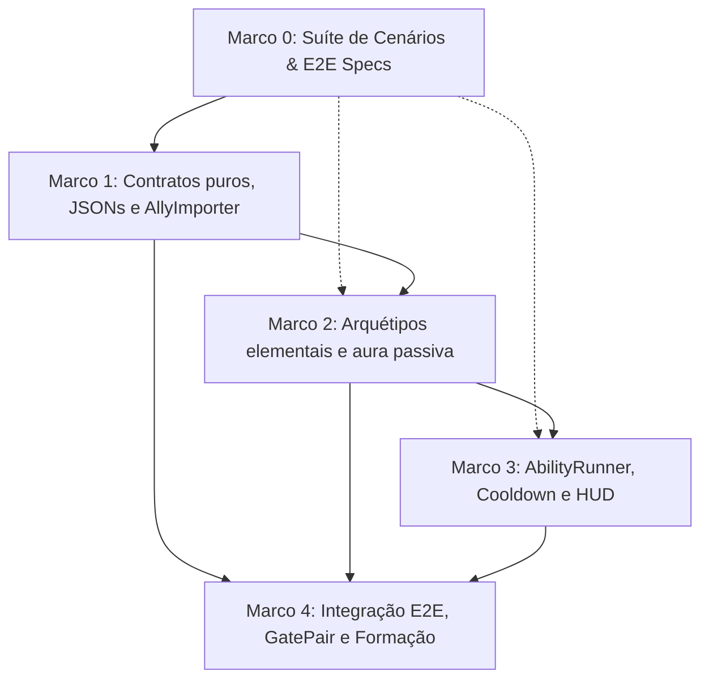

# Plano de Implementação: M8 · Heróis e pets (habilidade auto/manual por toggle)
> Data: 2026-10-13
> Issue: NEX-513
> Status: Cenários validados — Suíte Red comprovada em 2026-10-13

## 1. Contexto & Arquitetura
- **Resumo**: Implementar o sistema de Heróis e Pets (M8) no Horde Runner. A formação do jogador passa a incorporar aliados de campo recrutados durante a corrida via portões de perk (`RecruitAllyPerkEffect`) ou recompensas de Boss, com a proibição absoluta de venda direta por dinheiro real ou medalhas (Decisão 9 do GDD). O sistema compreende: (1) Dois heróis arquétipos: **Piromante** (ataque ígneo contínuo que inflige `Burn` e habilidade ativa de área *Inferno*) e **Criomante** (ataque glacial que inflige `Freeze` escalonando para `Frozen`/Estilhaço e habilidade ativa *Nevasca Polar*); (2) Um pet: **Cão Guardião** (`guard_dog`) concedendo aura passiva contínua na formação (+15% de poder de fogo na `StatCollection`); (3) Separação rígida de dano: a tropa (`ISquad`) mantém sua contagem independente, o dano da tropa não abate HP do herói, o herói possui HP próprio e sua morte entra em nocaute sem falhar a corrida; o pet é imune a dano; (4) Gestão de recarga temporal via `AbilityRunner` acoplada à política `IHeroAbilityTriggerPolicy` (Auto/Manual por toggle persistido em `PlayerPrefsAbilitySettings`, unificado com a M16); (5) HUD de aliados (`AllyHudView`) com indicador de recarga radial, botão de acionamento manual e badge de aura do pet.
- **Stack**: Unity 6 (6000.6.3f1), C# (.NET Standard), ScriptableObjects, JSON de conteúdo (`Content/Source/Allies/` e `Content/Source/Perks/`), Harness CLI (`tools/unity`).
- **Verificação disponível**: Suíte de testes automatizada confiável (`tools/unity compile`, `test-edit`, `import-content`, `validate`, `simulate`).

## 2. Armadilhas do Repositório

| Armadilha | Onde morde (arquivo/passo) | Regra a respeitar |
|---|---|---|
| C# Puro em `Game.Core` | `Game.Core.Allies` — Passos 0 e 1 | `Game.Core` possui `noEngineReferences: true`. `IAllyInstance`, `AllyInstance`, `IAllyRoster`, `AllyRoster`, `AbilityRunner`, `RecruitAllyPerkEffect` e eventos DEVEM residir estritamente em `Game.Core` sem qualquer dependência de UnityEngine. Usar `Math.Min`/`Math.Max`, nunca `Mathf`. |
| Retrocompatibilidade de `PerkContext` | `PerkContext.cs` / `GatePair.cs` — Passos 0 e 1 | `PerkContext` é uma struct readonly utilizada em dezenas de testes preexistentes. A inclusão de `IAllyRoster` DEVE ser opcional no construtor (`IAllyRoster roster = null`), preservando 100% dos 729 testes já existentes sem quebras. |
| Separação Estrita de Dano e HP | `ISquad.cs` / `AllyInstance.cs` — Passo 2 | Dano sofrido pela tropa decrementa soldados via `ISquad.Remove()`, mas NUNCA afeta a vida de heróis (`CurrentHealth`). Dano sofrido pelo herói reduz exclusivamente seu HP individual. Nocaute de herói não remove soldados nem causa derrota do General. Pets têm `IsDamageable = false`. |
| Idempotência no Recrutamento | `AllyRoster.cs` / `RecruitAllyPerkEffect.cs` — Passo 1 | Atravessar múltiplos portões do mesmo aliado não duplica a entidade na formação. O segundo recrutamento restaura a vida atual do aliado (`CurrentHealth = MaxHealth`) e retorna a instância já existente. |
| Reutilização de Políticas de Disparo da M16 | `Game.Core.Abilities` — Passo 3 | Não duplicar enums ou políticas. Reutilizar `IHeroAbilityTriggerPolicy`, `HeroAbilityTriggerMode`, `AutoHeroAbilityTriggerPolicy`, `ManualHeroAbilityTriggerPolicy` e `PlayerPrefsAbilitySettings` já validados na M16. |
| Pooling e Zero GC Alloc em Combate | `AllyUnit.cs` / Projéteis — Passos 2 e 4 | Disparos básicos e habilidades de área devem operar sem instanciar objetos no frame (`ObjectPool<T>` ou reutilização de instâncias) para evitar picos de Garbage Collection na taxa de quadros de 60 FPS. |
| Descarte de Objetos em EditMode | Testes EditMode — Todos os passos | Todo `GameObject` ou `ScriptableObject` instanciado durante testes EditMode DEVE ser destruído via `UnityEngine.Object.DestroyImmediate` no `[TearDown]`. |

## 3. Árvore de Arquivos
- [NOVO] `Assets/_Game/Scripts/Core/Allies/AllyArchetype.cs`
- [NOVO] `Assets/_Game/Scripts/Core/Allies/IAllyInstance.cs`
- [NOVO] `Assets/_Game/Scripts/Core/Allies/AllyInstance.cs`
- [NOVO] `Assets/_Game/Scripts/Core/Allies/IAllyRoster.cs`
- [NOVO] `Assets/_Game/Scripts/Core/Allies/AllyRoster.cs`
- [NOVO] `Assets/_Game/Scripts/Core/Allies/AbilityRunner.cs`
- [NOVO] `Assets/_Game/Scripts/Core/Perks/Effects/RecruitAllyPerkEffect.cs`
- [MODIFICADO] `Assets/_Game/Scripts/Core/Perks/PerkContext.cs`
- [NOVO] `Assets/_Game/Scripts/Core/Events/AllyRecruitedEvent.cs`
- [NOVO] `Assets/_Game/Scripts/Core/Events/AllyDamagedEvent.cs`
- [NOVO] `Assets/_Game/Scripts/Core/Events/AllyKnockedOutEvent.cs`
- [NOVO] `Assets/_Game/Scripts/Core/Events/AllyAbilityFiredEvent.cs`
- [NOVO] `Assets/_Game/Scripts/Data/Allies/AllyDefinition.cs`
- [NOVO] `Assets/_Game/Scripts/Data/Allies/AllyCatalog.cs`
- [NOVO] `Assets/_Game/Scripts/Editor/AllyImporter.cs`
- [MODIFICADO] `Assets/_Game/Scripts/Editor/PerkImporter.cs`
- [NOVO] `Content/Source/Allies/pyromancer.json`
- [NOVO] `Content/Source/Allies/cryomancer.json`
- [NOVO] `Content/Source/Allies/guard_dog.json`
- [NOVO] `Content/Source/Perks/recruit_pyromancer.json`
- [NOVO] `Content/Source/Perks/recruit_cryomancer.json`
- [NOVO] `Content/Source/Perks/recruit_guard_dog.json`
- [NOVO] `Assets/_Game/Scripts/Gameplay/Allies/HeroUnit.cs`
- [NOVO] `Assets/_Game/Scripts/Gameplay/Allies/PetUnit.cs`
- [MODIFICADO] `Assets/_Game/Scripts/Gameplay/GatePair.cs`
- [NOVO] `Assets/_Game/Scripts/Presentation/AllyHudView.cs`
- [NOVO] `Assets/_Game/Scripts/Tests/EditMode/AllyScenariosTests.cs`
- [NOVO] `Assets/_Game/Scripts/Tests/EditMode/AllyImporterTests.cs`
- [NOVO] `Assets/_Game/Scripts/Tests/EditMode/AllyGameplayTests.cs`

## 4. Contratos e Interfaces

```csharp
namespace Game.Core.Allies
{
    public enum AllyArchetype
    {
        Hero = 0,
        Pet = 1
    }

    public interface IAllyInstance
    {
        string Id { get; }
        string DisplayName { get; }
        AllyArchetype Archetype { get; }
        int MaxHealth { get; }
        int CurrentHealth { get; }
        bool IsAlive { get; }
        bool IsPet { get; }
        bool HasActiveAbility { get; }
        AbilityRunner Ability { get; }
        bool TakeDamage(int damage);
        void Heal(int amount);
        void RestoreFullHealth();
    }

    public interface IAllyRoster
    {
        IReadOnlyList<IAllyInstance> Allies { get; }
        int HeroCount { get; }
        int PetCount { get; }
        bool TryAddAlly(IAllyInstance ally, out IAllyInstance registeredAlly);
        bool TryGetAlly(string id, out IAllyInstance ally);
        bool ContainsAlly(string id);
        void Clear();
    }

    public sealed class AbilityRunner
    {
        public string AbilityName { get; }
        public float CooldownSeconds { get; }
        public float CooldownRemaining { get; private set; }
        public bool IsReady => CooldownRemaining <= 0f;
        public float FillAmount => CooldownSeconds <= 0f ? 1f : 1f - (CooldownRemaining / CooldownSeconds);

        public AbilityRunner(string abilityName, float cooldownSeconds, float initialCooldown = 0f);
        public void Tick(float deltaTime);
        public bool TryTrigger(in Game.Core.Abilities.AbilityTriggerContext context,
                              Game.Core.Abilities.IHeroAbilityTriggerPolicy policy,
                              System.Action onTriggered);
        public void ResetCooldown();
    }
}

namespace Game.Core.Perks.Effects
{
    public sealed class RecruitAllyPerkEffect : IPerkEffect
    {
        public string AllyId { get; }
        public string Description => $"Recrutar aliado {AllyId}";

        public RecruitAllyPerkEffect(string allyId);
        public void Apply(PerkContext context);
    }
}

namespace Game.Core.Events
{
    public readonly struct AllyRecruitedEvent
    {
        public string AllyId { get; }
        public string DisplayName { get; }
        public bool IsPet { get; }
        public bool WasRestored { get; }

        public AllyRecruitedEvent(string allyId, string displayName, bool isPet, bool wasRestored);
    }

    public readonly struct AllyDamagedEvent
    {
        public string AllyId { get; }
        public int DamageTaken { get; }
        public int RemainingHp { get; }

        public AllyDamagedEvent(string allyId, int damageTaken, int remainingHp);
    }

    public readonly struct AllyKnockedOutEvent
    {
        public string AllyId { get; }

        public AllyKnockedOutEvent(string allyId);
    }

    public readonly struct AllyAbilityFiredEvent
    {
        public string AllyId { get; }
        public string AbilityName { get; }

        public AllyAbilityFiredEvent(string allyId, string abilityName);
    }
}

namespace Game.Data.Allies
{
    public class AllyDefinition : UnityEngine.ScriptableObject
    {
        public string Id;
        public string DisplayName;
        public Game.Core.Allies.AllyArchetype Archetype;
        public int MaxHealth;
        public float AttackInterval;
        public int AttackDamage;
        public string StatusApplied;
        public string AbilityName;
        public float AbilityCooldown;
        public int AbilityDamage;
        public float PetStatModifierValue;
    }
}
```

## 4.5 Linear overlay
- **História (issue-pai):** `NEX-513`
- **Sub-issues deste plano:**
  - `NEX-962`: `Marco 0: Suíte de Cenários & E2E Specs de Heróis e Pets [NEX-513]`
  - `NEX-963`: `Marco 1: Contratos IAllyRoster, IAllyInstance, RecruitAllyPerkEffect, JSONs e AllyImporter [NEX-513]`
  - `NEX-964`: `Marco 2: Arquétipos Pyromancer, Cryomancer e GuardDog, ataques elementais e aura passiva [NEX-513]`
  - `NEX-965`: `Marco 3: AbilityRunner, cooldowns temporais e política de disparo conectada à HUD [NEX-513]`
  - `NEX-966`: `Marco 4: Integração E2E com GatePair, formação visual e simulação [NEX-513]`
- **PRs (modelo C):** história = `jamilzerati/nex-513-story-m8-herois-e-pets-habilidade-automanual-por-toggle`; draft PR **→ `main`**. Cada tarefa ramifica da branch da história e abre PR **→ branch da história**.

## 4.6 Grafo de Dependências

| De | Para | Tipo | Por quê |
|---|---|---|---|
| Marco 0 | Marco 1 | implementação | Marco 1 implementa os contratos puros que atendem aos testes Red e stubs de contratos |
| Marco 0 | Marco 2 | interface | Marco 2 implementa regras de status e arquétipos usando a interface `IAllyInstance` |
| Marco 0 | Marco 3 | interface | Marco 3 implementa `AbilityRunner` e integra com `IHeroAbilityTriggerPolicy` |
| Marco 1 | Marco 2 | implementação | Marco 2 consome instâncias e dados carregados por `AllyDefinition` e `IAllyRoster` |
| Marco 1 | Marco 4 | implementação | Marco 4 consome `RecruitAllyPerkEffect` e `PerkContext.Roster` no `GatePair` |
| Marco 2 | Marco 3 | implementação | Marco 3 conecta os dados de habilidade e cooldown aos heróis ativos |
| Marco 2 | Marco 4 | implementação | Marco 4 posiciona os heróis e pets na formação visual da pista |
| Marco 3 | Marco 4 | implementação | Marco 4 integra a `AllyHudView` ao ciclo de vida da corrida e input de toque |



## 5. Divisão de Execução por Passo

| Faixa | Passos | Por quê |
|---|---|---|
| **Risco de falha silenciosa** | Passos 0, 1, 2, 3 | Cálculos de vida independente, acúmulo de status Burn/Freeze, cálculo de aura na StatCollection e temporizador de cooldown. |
| **Falha visível** | Passos 4 | Posicionamento na formação visual, layout da HUD, colisão física com portão e testes de integração. |

## 6. Checklist de Execução

- [x] **Passo 0 (Marco 0)**: `Suíte de Cenários & E2E Specs de Heróis e Pets` [NEX-962]
  - **Ação**: Criar testes comportamentais Red em `AllyScenariosTests.cs` cobrindo todos os cenários CT-1 a CT-9 e declarar os stubs de interfaces necessários.
  - **Lógica de Negócios / Responsabilidade**: Definir contratos públicos (`IAllyInstance`, `IAllyRoster`, `AbilityRunner`, `RecruitAllyPerkEffect`), garantindo pureza C# (zero referências a UnityEngine em `Game.Core`). Testes devem comprovar estado Red sem quebrar os 729 testes preexistentes.
  - **Dependências / Pré-requisitos**: nenhuma (raiz).
  - **Seam Público**: `Game.Core.Allies.IAllyRoster`, `Game.Core.Allies.IAllyInstance`, `Game.Core.Allies.AbilityRunner`
  - **AC**: AC-1 a AC-9 (CT-1 a CT-9)
  - **Marco de PR**: Marco 0
  - **Effort**: medium

- [x] **Passo 1 (Marco 1)**: `Contratos IAllyRoster, IAllyInstance, RecruitAllyPerkEffect, JSONs e AllyImporter` [NEX-963]
  - **Ação**: Implementar `AllyInstance`, `AllyRoster`, `RecruitAllyPerkEffect`, estender `PerkContext` com `IAllyRoster`, criar JSONs canônicos em `Content/Source/Allies/` e `Content/Source/Perks/`, `AllyDefinition`, `AllyImporter.cs` e estender `PerkImporter.cs`.
  - **Lógica de Negócios / Responsabilidade**: Recrutamento de aliados idempotente (segundo recrutamento cura o aliado existente sem duplicar slot), importação automatizada de dados e validação de schema.
  - **Dependências / Pré-requisitos**: `implementação`: Marco 0.
  - **Seam Público**: `Game.Core.Allies.AllyRoster`, `Game.Core.Perks.Effects.RecruitAllyPerkEffect`, `Game.Editor.AllyImporter`
  - **AC**: AC-1, AC-2, AC-6 (CT-1, CT-5, CT-8)
  - **Marco de PR**: Marco 1
  - **Effort**: high

- [x] **Passo 2 (Marco 2)**: `Arquétipos Pyromancer, Cryomancer e GuardDog, ataques elementais e aura passiva` [NEX-964]
  - **Ação**: Implementar `HeroUnit.cs`, `PetUnit.cs`, aplicação de status `Burn` e `Freeze` no ataque e aura passiva contínua na `StatCollection` (+15% de dano da tropa).
  - **Lógica de Negócios / Responsabilidade**: Separação estrita de dano (dano da tropa não fere herói; herói com HP zerado entra em nocaute sem falhar a corrida; pet imune a dano). Piromante aplica `BurnStatus`, Criomante aplica `FreezeStatus` compatível com Estilhaço.
  - **Dependências / Pré-requisitos**: `implementação`: Marco 1. `interface`: Marco 0.
  - **Consome contrato:** `IAllyInstance` (fake: em testes de unidade).
  - **Seam Público**: `Game.Gameplay.Allies.HeroUnit`, `Game.Gameplay.Allies.PetUnit`
  - **AC**: AC-3, AC-4, AC-5, AC-9 (CT-2, CT-3, CT-4, CT-9)
  - **Marco de PR**: Marco 2
  - **Effort**: high

- [ ] **Passo 3 (Marco 3)**: `AbilityRunner, cooldowns temporais e política de disparo conectada à HUD` [NEX-965]
  - **Ação**: Implementar `AbilityRunner.cs`, integrar com `IHeroAbilityTriggerPolicy` (`Auto` / `Manual`) e criar `AllyHudView.cs` com indicador de recarga radial e botão de ativação manual.
  - **Lógica de Negócios / Responsabilidade**: Recarga temporal contínua por `Tick(dt)`. Em modo `Auto`, dispara assim que pronto e inimigos estão na pista. Em modo `Manual`, aguarda input do jogador via `ManualTriggerRequested()`. Toggle persistido em `PlayerPrefsAbilitySettings`.
  - **Dependências / Pré-requisitos**: `implementação`: Marco 2. `interface`: Marco 0.
  - **Seam Público**: `Game.Core.Allies.AbilityRunner`, `Game.Presentation.AllyHudView`
  - **AC**: AC-7, AC-8 (CT-6, CT-7)
  - **Marco de PR**: Marco 3
  - **Effort**: high

- [ ] **Passo 4 (Marco 4)**: `Integração E2E com GatePair, formação visual e simulação` [NEX-966]
  - **Ação**: Conectar `IAllyRoster` ao `GatePair.TryTrigger`, posicionar unidades de aliados nas alas laterais da formação visual (`SquadVisualController` ou controller de aliados), integrar ao loop de jogo e validar suíte completa.
  - **Lógica de Negócios / Responsabilidade**: Ponto central de montagem: travessia de portão instancia e recruta aliados, posiciona na formação, atualiza HUD e processa ataques e habilidades no combate.
  - **Dependências / Pré-requisitos**: `implementação`: Marco 1, Marco 2, Marco 3.
  - **Seam Público**: `Game.Gameplay.GatePair`, `Game.Tests.EditMode.AllyGameplayTests`
  - **AC**: AC-1 a AC-9 (Integração E2E)
  - **Marco de PR**: Marco 4
  - **Effort**: high

## 7. Rascunho das Tarefas

### `Marco 0: Suíte de Cenários & E2E Specs de Heróis e Pets [NEX-513]` (`NEX-962`)
- **Objetivo**: Criar testes comportamentais Red em `AllyScenariosTests.cs` cobrindo CT-1 a CT-9 e definir stubs dos contratos puros `IAllyInstance`, `IAllyRoster`, `AbilityRunner`, `RecruitAllyPerkEffect`.
- **Arquivos**: `Assets/_Game/Scripts/Core/Allies/IAllyInstance.cs`, `Assets/_Game/Scripts/Core/Allies/IAllyRoster.cs`, `Assets/_Game/Scripts/Core/Allies/AbilityRunner.cs`, `Assets/_Game/Scripts/Core/Perks/Effects/RecruitAllyPerkEffect.cs`, `Assets/_Game/Scripts/Tests/EditMode/AllyScenariosTests.cs`.
- **Pronto quando**: Suíte `AllyScenariosTests.cs` compila e falha de maneira controlada (Red) nos cenários não implementados, preservando os 729 testes preexistentes verdes.
```yaml
dispatch:
  story: NEX-513
  marco: 0
  runtime: medium
  verify:
    - tools/unity compile
    - tools/unity test-edit
```

### `Marco 1: Contratos IAllyRoster, IAllyInstance, RecruitAllyPerkEffect, JSONs e AllyImporter [NEX-513]` (`NEX-963`)
- **Objetivo**: Implementar `AllyInstance`, `AllyRoster`, `RecruitAllyPerkEffect`, estender `PerkContext` com `IAllyRoster`, criar JSONs canônicos em `Content/Source/Allies/`, importador `AllyImporter.cs` e suporte a `recruit_ally` em `PerkImporter.cs`.
- **Arquivos**: `Assets/_Game/Scripts/Core/Allies/AllyInstance.cs`, `Assets/_Game/Scripts/Core/Allies/AllyRoster.cs`, `Assets/_Game/Scripts/Core/Perks/PerkContext.cs`, `Assets/_Game/Scripts/Data/Allies/AllyDefinition.cs`, `Assets/_Game/Scripts/Editor/AllyImporter.cs`, `Assets/_Game/Scripts/Editor/PerkImporter.cs`, `Content/Source/Allies/*.json`, `Content/Source/Perks/recruit_*.json`, `Assets/_Game/Scripts/Tests/EditMode/AllyImporterTests.cs`.
- **Pronto quando**: CT-1, CT-5 e CT-8 passam 100% verde provando recrutamento idempotente e importação de JSONs.
```yaml
dispatch:
  story: NEX-513
  marco: 1
  runtime: high
  verify:
    - tools/unity compile
    - tools/unity import-content
    - tools/unity test-edit
```

### `Marco 2: Arquétipos Pyromancer, Cryomancer e GuardDog, ataques elementais e aura passiva [NEX-513]` (`NEX-964`)
- **Objetivo**: Implementar `HeroUnit.cs`, `PetUnit.cs`, ataques elementais com aplicação de `Burn` e `Freeze`, aura passiva contínua na `StatCollection` (+15%) e isolamento de HP de herói vs tropa.
- **Arquivos**: `Assets/_Game/Scripts/Gameplay/Allies/HeroUnit.cs`, `Assets/_Game/Scripts/Gameplay/Allies/PetUnit.cs`, `Assets/_Game/Scripts/Core/Events/AllyDamagedEvent.cs`, `Assets/_Game/Scripts/Core/Events/AllyKnockedOutEvent.cs`, `Assets/_Game/Scripts/Tests/EditMode/AllyGameplayTests.cs`.
- **Pronto quando**: CT-2, CT-3, CT-4 e CT-9 passam 100% verde provando dano independente, aplicação de status e nocaute.
```yaml
dispatch:
  story: NEX-513
  marco: 2
  runtime: high
  verify:
    - tools/unity compile
    - tools/unity test-edit
```

### `Marco 3: AbilityRunner, cooldowns temporais e política de disparo conectada à HUD [NEX-513]` (`NEX-965`)
- **Objetivo**: Implementar lógica completa de `AbilityRunner`, sincronizar com `IHeroAbilityTriggerPolicy` (`Auto`/`Manual`), eventos `AllyAbilityFiredEvent` e componente `AllyHudView.cs`.
- **Arquivos**: `Assets/_Game/Scripts/Core/Allies/AbilityRunner.cs`, `Assets/_Game/Scripts/Presentation/AllyHudView.cs`, `Assets/_Game/Scripts/Core/Events/AllyAbilityFiredEvent.cs`, `Assets/_Game/Scripts/Tests/EditMode/AllyGameplayTests.cs`.
- **Pronto quando**: CT-6 e CT-7 passam 100% verde validando disparo automático em alvos e retenção manual aguardando botão.
```yaml
dispatch:
  story: NEX-513
  marco: 3
  runtime: high
  verify:
    - tools/unity compile
    - tools/unity test-edit
```

### `Marco 4: Integração E2E com GatePair, formação visual e simulação [NEX-513]` (`NEX-966`)
- **Objetivo**: Integrar `IAllyRoster` ao `GatePair.TryTrigger`, gerenciar posicionamento visual na formação da tropa e validar fluxo E2E completo de recrutamento e combate.
- **Arquivos**: `Assets/_Game/Scripts/Gameplay/GatePair.cs`, `Assets/_Game/Scripts/Gameplay/SquadController.cs`, `Assets/_Game/Scripts/Tests/EditMode/AllyGameplayTests.cs`.
- **Pronto quando**: Todos os testes (incluindo CT-1 a CT-9 e os 729 testes de regressão) passam 100% verde no batchmode.
```yaml
dispatch:
  story: NEX-513
  marco: 4
  runtime: high
  verify:
    - tools/unity compile
    - tools/unity test-edit
```
