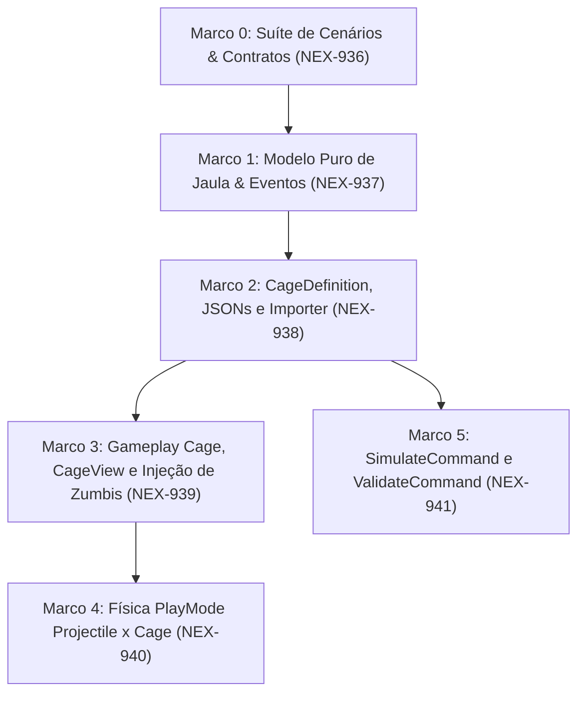

# Plano de Implementação: M18 · Resgate de sobreviventes (jaulas)
> Data: 2026-10-13
> Issue: NEX-653
> Status: Pronto para Execução via /executar

## 1. Contexto & Arquitetura
- **Resumo**: Implementar a mecânica de Jaula de Sobreviventes orientada a dados na pista do Horde Runner. A jaula posiciona-se na pista com HP configurável e número de ocupantes. Localizada na camada física `Pickup`, intercepta tiros da tropa (`PlayerProjectile`) implementando `IDamageable`. Quando destruída a tiros (`CurrentHp <= 0`) antes da passagem do General, resgata os sobreviventes somando `+N` à tropa (`ISquad`), emite `SurvivorsRescuedEvent` e acumula `rescued` no `RunResult` para a economia de Recrutas da meta. Quando ultrapassada intacta (`generalZ >= cageZ`), é perdida, emite `SurvivorsLostEvent` e injeta `+N` zumbis Andarilhos (`walker`) na próxima horda daquela lane. O sistema é coberto por testes EditMode e PlayMode e integrado aos comandos `SimulateCommand` e `ValidateCommand`.
- **Stack**: Unity 6, C# (.NET Standard), ScriptableObjects, JSON (`Content/Source/Cages/`), Harness CLI (`tools/unity`).
- **Verificação disponível**: Suíte de testes confiável (`test-edit` e `test-play` via harness CLI `tools/unity`, além de `compile`, `import-content`, `validate` e `simulate`).

## 2. Armadilhas do Repositório

| Armadilha | Onde morde (arquivo/passo) | Regra a respeitar |
|---|---|---|
| Seletividade física na camada `Pickup` | `Cage.cs` / `Projectile.cs` — Passos 3 e 4 | `Projectile.HandleTrigger` recicla o projétil ao colidir com `IDamageable` cujo `IsAlive == true`. `Cage` DEVE retornar `IsAlive == true` enquanto `CurrentHp > 0`, não foi aberta e não foi perdida. Ao abrir ou ser perdida, desativa colisor e retorna `IsAlive == false` imediatamente. |
| Injeção tardia de zumbis perdidos | `LevelDirector.cs` / `HordeSpawner.cs` — Passo 3 | A conversão de sobreviventes perdidos em horda ocorre na *próxima* horda daquela mesma lane. O contador de zumbis pendentes por lane deve ser consumido na próxima chamada de `SpawnWave(laneIndex, ...)` e não disparar spawn instantâneo fora do tempo da pista. |
| C# Puro em `Game.Core` | `Game.Core.Rescue` — Passos 0 e 1 | `Game.Core` possui `noEngineReferences: true`. `CageRuntimeState`, `ICageState`, `SurvivorsRescuedEvent` e `SurvivorsLostEvent` devem residir em `Game.Core` sem qualquer referência a classes do Unity. |
| Destruição de objetos em testes EditMode | Testes EditMode — Passos 0 a 5 | Todo `GameObject` ou `ScriptableObject` instanciado durante testes EditMode DEVE ser destruído via `UnityEngine.Object.DestroyImmediate` no `[TearDown]`. |
| Ruído de regeneração de assets | Todos os passos | Nunca versionar modificações acidentais em `Assets/_Game/Data/` ou `Assets/_Game/Scenes/` fora do escopo estrito da tarefa; restaurar via `git checkout --`. |
| Comentários proibidos | Todos os arquivos | PROIBIDO adicionar comentários que narram a linha seguinte; comentar apenas invariantes de negócio não óbvias. |

## 3. Árvore de Arquivos
- [NOVO] `Assets/_Game/Scripts/Core/Rescue/ICageState.cs`
- [NOVO] `Assets/_Game/Scripts/Core/Rescue/CageRuntimeState.cs`
- [NOVO] `Assets/_Game/Scripts/Core/Events/SurvivorsRescuedEvent.cs`
- [NOVO] `Assets/_Game/Scripts/Core/Events/SurvivorsLostEvent.cs`
- [NOVO] `Assets/_Game/Scripts/Data/Cages/CageDefinition.cs`
- [NOVO] `Assets/_Game/Scripts/Data/Cages/CageCatalog.cs`
- [NOVO] `Assets/_Game/Scripts/Data/Cages/CageSpawnSpec.cs`
- [NOVO] `Assets/_Game/Scripts/Editor/CageImporter.cs`
- [NOVO] `Content/Source/Cages/cage_standard_3.json`
- [MODIFICADO] `Assets/_Game/Scripts/Data/SegmentDefinition.cs`
- [MODIFICADO] `Assets/_Game/Scripts/Editor/Cli.cs`
- [NOVO] `Assets/_Game/Scripts/Gameplay/Rescue/Cage.cs`
- [NOVO] `Assets/_Game/Scripts/Presentation/CageView.cs`
- [MODIFICADO] `Assets/_Game/Scripts/Gameplay/LevelDirector.cs`
- [MODIFICADO] `Assets/_Game/Scripts/Gameplay/Enemies/HordeSpawner.cs`
- [MODIFICADO] `Assets/_Game/Scripts/Editor/Tools/SimulateCommand.cs`
- [MODIFICADO] `Assets/_Game/Scripts/Editor/Tools/ValidateCommand.cs`
- [NOVO] `Assets/_Game/Scripts/Tests/EditMode/CageCoreTests.cs`
- [NOVO] `Assets/_Game/Scripts/Tests/EditMode/CageImporterTests.cs`
- [NOVO] `Assets/_Game/Scripts/Tests/EditMode/CageGameplayTests.cs`
- [NOVO] `Assets/_Game/Scripts/Tests/PlayMode/CagePlayModeTests.cs`
- [NOVO] `Assets/_Game/Scripts/Tests/EditMode/CageSimulationAndValidationTests.cs`

## 4. Contratos e Interfaces

```csharp
namespace Game.Core.Rescue
{
    public interface ICageState
    {
        string CageId { get; }
        int LaneIndex { get; }
        int MaxHp { get; }
        int CurrentHp { get; }
        int SurvivorCount { get; }
        string LostEnemyArchetypeId { get; }
        bool IsOpen { get; }
        bool IsLost { get; }
        bool TakeDamage(int damage);
        bool MarkLost();
    }

    public sealed class CageRuntimeState : ICageState
    {
        public string CageId { get; }
        public int LaneIndex { get; }
        public int MaxHp { get; }
        public int CurrentHp { get; private set; }
        public int SurvivorCount { get; }
        public string LostEnemyArchetypeId { get; }
        public bool IsOpen { get; private set; }
        public bool IsLost { get; private set; }

        public CageRuntimeState(string cageId, int laneIndex, int maxHp, int survivorCount, string lostEnemyArchetypeId = "walker");
        public bool TakeDamage(int damage);
        public bool MarkLost();
    }
}

namespace Game.Core.Events
{
    public readonly struct SurvivorsRescuedEvent
    {
        public int Count { get; }
        public int LaneIndex { get; }
        public string CageId { get; }

        public SurvivorsRescuedEvent(int count, int laneIndex, string cageId);
    }

    public readonly struct SurvivorsLostEvent
    {
        public int Count { get; }
        public int LaneIndex { get; }
        public string CageId { get; }

        public SurvivorsLostEvent(int count, int laneIndex, string cageId);
    }
}

namespace Game.Data
{
    public class CageDefinition : UnityEngine.ScriptableObject
    {
        public string Id;
        public string DisplayName;
        public int MaxHp;
        public int SurvivorCount;
        public string LostEnemyArchetypeId;
    }

    [System.Serializable]
    public class CageSpawnSpec
    {
        public string CageId;
        public int LaneIndex;
        public float DistanceOffset;
        public int CustomHp;
        public int CustomSurvivors;
    }
}
```

## 4.5 Linear overlay
- **História (issue-pai):** `NEX-653`
- **Sub-issues deste plano:**
  - `NEX-936`: `Marco 0: Suíte de Cenários & Contratos de Resgate e Jaulas [NEX-653]`
  - `NEX-937`: `Marco 1: Implementar modelo puro de estado de jaula e acumulador de recrutas [NEX-653]`
  - `NEX-938`: `Marco 2: Implementar CageDefinition, CageCatalog, JSONs canônicos e CageImporter [NEX-653]`
  - `NEX-939`: `Marco 3: Implementar componente Cage, CageView, colisão Pickup e injeção de zumbis perdidos [NEX-653]`
  - `NEX-940`: `Marco 4: Teste PlayMode de física de projéteis contra jaula na camada Pickup [NEX-653]`
  - `NEX-941`: `Marco 5: Integrar jaulas no SimulateCommand e regras de validação no ValidateCommand [NEX-653]`
- **PRs (modelo C):** história = `jamilzerati/nex-653-story-m18-resgate-de-sobreviventes-jaulas`; draft PR **→ `main`**. Cada tarefa ramifica da branch da história e abre PR **→ branch da história**.

## 4.6 Grafo de Dependências

| De | Para | Tipo | Por quê |
|---|---|---|---|
| Marco 0 (`NEX-936`) | Marco 1 (`NEX-937`) | implementação | Marco 1 implementa a lógica concreta de `CageRuntimeState` e eventos exercitados pelos testes Red de `CageCoreTests.cs`. |
| Marco 1 (`NEX-937`) | Marco 2 (`NEX-938`) | implementação | Marco 2 (`CageDefinition` e `CageImporter`) instancia e referencia os contratos puros entregues no Marco 1. |
| Marco 2 (`NEX-938`) | Marco 3 (`NEX-939`) | implementação | Marco 3 (`Cage`, `CageView`, `LevelDirector`) consome `CageDefinition`, `CageRuntimeState` e os sinais de eventos. |
| Marco 3 (`NEX-939`) | Marco 4 (`NEX-940`) | implementação | Marco 4 executa teste integrado PlayMode com colisão física real 3D (`Projectile` × `Cage`), dependendo do componente `Cage` do Marco 3. |
| Marco 2 (`NEX-938`) | Marco 5 (`NEX-941`) | implementação | Marco 5 (`SimulateCommand` e `ValidateCommand`) valida `CageDefinition` gerados pelo `CageImporter` e simula decisões de combate/resgate. |



## 5. Divisão de Execução por Passo

| Faixa | Passos | Por quê |
|---|---|---|
| **Modelo forte, obrigatório** | 0, 1, 2, 3, 4, 5 | Envolve contagem de vida da jaula, seletividade de colisão física `Pickup`, cálculo de recrutas na partida, injeção de zumbis na horda seguinte e heurística de decisão dos bots no simulador determinístico. |

## 6. Checklist de Execução

- [x] **Passo 0 (Marco 0)**: `Suíte de Cenários & Contratos de Resgate e Jaulas` [NEX-936]
  - **Ação**: Criar interfaces e stubs em `Game.Core.Rescue` (`ICageState`, `CageRuntimeState`), eventos `SurvivorsRescuedEvent` e `SurvivorsLostEvent` em `Game.Core.Events` e a suíte Red em `Assets/_Game/Scripts/Tests/EditMode/CageCoreTests.cs`.
  - **Lógica de Negócios / Responsabilidade**: Definir contratos públicos puros em C# sem UnityEngine e comprovar o estado Red dos cenários de dano, abertura de jaula, contagem de sobreviventes e detecção de perda.
  - **Dependências / Pré-requisitos**: nenhuma (raiz).
  - **Seam Público**: `Game.Core.Rescue.ICageState`, `Game.Core.Rescue.CageRuntimeState`, `Game.Core.Events.SurvivorsRescuedEvent`, `Game.Core.Events.SurvivorsLostEvent`.
  - **AC**: AC-2, AC-3, AC-4 (CT-2, CT-3, CT-4)
  - **Marco de PR**: Marco 0 + `NEX-936`
  - **Runtime**: hard

- [x] **Passo 1 (Marco 1)**: `Assets/_Game/Scripts/Core/Rescue/CageRuntimeState.cs` [NEX-937]
  - **Ação**: Implementar completamente `CageRuntimeState.cs` tornando verdes todos os testes de `CageCoreTests.cs`, e adicionar acúmulo de sobreviventes resgatados em `RunResult`.
  - **Lógica de Negócios / Responsabilidade**: Processar `TakeDamage(damage)`, transição irreversível para `IsOpen` ao zerar HP, transição para `IsLost` ao ser marcada como perdida e proteção contra dano após abertura/perda.
  - **Dependências / Pré-requisitos**: `implementação`: Marco 0 (`NEX-936`). `interface`: nenhuma.
  - **Seam Público**: `CageRuntimeState.TakeDamage`, `CageRuntimeState.MarkLost`.
  - **AC**: AC-2, AC-3 (CT-2, CT-3)
  - **Marco de PR**: Marco 1 + `NEX-937`
  - **Runtime**: hard

- [ ] **Passo 2 (Marco 2)**: `Assets/_Game/Scripts/Data/Cages/` e `Assets/_Game/Scripts/Editor/CageImporter.cs` [NEX-938]
  - **Ação**: Criar `CageDefinition.cs`, `CageCatalog.cs`, `CageSpawnSpec.cs`, `Content/Source/Cages/cage_standard_3.json`, estender `SegmentDefinition.cs`, implementar `CageImporter.cs` (integrado a `Cli.ImportContent()`) e criar `Assets/_Game/Scripts/Tests/EditMode/CageImporterTests.cs`.
  - **Lógica de Negócios / Responsabilidade**: Importar jaulas a partir de JSONs canônicos, validar `maxHp > 0`, `survivorCount > 0` e arquétipo de zumbi existente, e associar jaulas a segmentos do nível.
  - **Dependências / Pré-requisitos**: `implementação`: Marco 0 (`NEX-936`), Marco 1 (`NEX-937`). `interface`: nenhuma.
  - **Seam Público**: `Game.Data.CageDefinition`, `Game.Data.CageCatalog`, `Game.Editor.CageImporter.ImportAll`.
  - **AC**: AC-1 (CT-1)
  - **Marco de PR**: Marco 2 + `NEX-938`
  - **Runtime**: hard

- [ ] **Passo 3 (Marco 3)**: `Assets/_Game/Scripts/Gameplay/Rescue/Cage.cs`, `CageView.cs` e `LevelDirector.cs` [NEX-939]
  - **Ação**: Criar [TELA] `Cage.cs` na camada `Pickup` implementando `IDamageable`, `CageView.cs` para exibir HP e sobreviventes presos, estender `LevelDirector.cs` e `HordeSpawner.cs` para acumular `RunResult.Rescued` e injetar zumbis extras em `SpawnWave` após `SurvivorsLostEvent`, e criar `Assets/_Game/Scripts/Tests/EditMode/CageGameplayTests.cs`.
  - **Lógica de Negócios / Responsabilidade**: Receber tiros de projéteis (`TakeDamage`), ao abrir adicionar soldados à tropa (`SquadController`) e emitir `SurvivorsRescuedEvent`; ao cruzar a linha do General com `CurrentHp > 0`, emitir `SurvivorsLostEvent`, registrar zumbis pendentes para a próxima horda da lane e acumular `Rescued` no `RunResult`.
  - **Dependências / Pré-requisitos**: `implementação`: Marco 0 (`NEX-936`), Marco 2 (`NEX-938`). `interface`: nenhuma.
  - **Seam Público**: `Game.Gameplay.Cage.TakeDamage`, `Game.Gameplay.Cage.CheckEscape`, `Game.Gameplay.LevelDirector.RescuedSurvivorsCount`.
  - **AC**: AC-2, AC-3, AC-4 (CT-2, CT-3, CT-4)
  - **Marco de PR**: Marco 3 + `NEX-939`
  - **Runtime**: hard

- [ ] **Passo 4 (Marco 4)**: `Assets/_Game/Scripts/Tests/PlayMode/CagePlayModeTests.cs` [NEX-940]
  - **Ação**: Criar `Assets/_Game/Scripts/Tests/PlayMode/CagePlayModeTests.cs` exercitando colisão física real 3D (`WaitForFixedUpdate`) entre `Projectile` e `Cage` na camada `Pickup`.
  - **Lógica de Negócios / Responsabilidade**: Provar que projéteis reais colidem com a jaula na camada `Pickup`, são consumidos/reciclados, subtraem HP da jaula, abrem a jaula e integram soldados ao pelotão.
  - **Dependências / Pré-requisitos**: `implementação`: Marco 0 (`NEX-936`), Marco 3 (`NEX-939`). `interface`: nenhuma.
  - **Seam Público**: `Game.Gameplay.Projectile`, `Game.Gameplay.Cage`, `Game.Gameplay.CollisionLayers`.
  - **AC**: AC-2, AC-6 (CT-6)
  - **Marco de PR**: Marco 4 + `NEX-940`
  - **Runtime**: hard

- [ ] **Passo 5 (Marco 5)**: `Assets/_Game/Scripts/Editor/Tools/SimulateCommand.cs` e `ValidateCommand.cs` [NEX-941]
  - **Ação**: Modificar `SimulateCommand.cs` e `ValidateCommand.cs` e criar `Assets/_Game/Scripts/Tests/EditMode/CageSimulationAndValidationTests.cs`.
  - **Lógica de Negócios / Responsabilidade**: Validar todos os `CageDefinition` dentro de `ValidateCommand.Run`. No `SimulateCommand`, simular encontros com jaulas: o bot `Guloso` foca na jaula e resgata sobreviventes se tiver dano suficiente; o bot `Fujao` desvia e sofre com horda aumentada. Preencher `result.Rescued` no relatório do simulador.
  - **Dependências / Pré-requisitos**: `implementação`: Marco 0 (`NEX-936`), Marco 2 (`NEX-938`). `interface`: nenhuma.
  - **Seam Público**: `Game.Editor.Tools.SimulateCommand.SimulateSingleRun`, `Game.Editor.Tools.ValidateCommand.ValidateCages`.
  - **AC**: AC-1, AC-5 (CT-1, CT-5)
  - **Marco de PR**: Marco 5 + `NEX-941`
  - **Runtime**: hard

## 7. Rascunho das Tarefas

### `Marco 0: Suíte de Cenários & Contratos de Resgate e Jaulas [NEX-653]` (`NEX-936`)
- **Objetivo**: Definir contratos puros de `Game.Core.Rescue` (`ICageState`, `CageRuntimeState`), eventos `SurvivorsRescuedEvent` e `SurvivorsLostEvent` em `Game.Core.Events` e criar a suíte Red `CageCoreTests.cs`.
- **Arquivos**: `Assets/_Game/Scripts/Core/Rescue/*`, `Assets/_Game/Scripts/Core/Events/Survivors*.cs`, `Assets/_Game/Scripts/Tests/EditMode/CageCoreTests.cs`.
- **Pronto quando**: Contratos compilam em `Game.Core` com zero referências a UnityEngine e os cenários `CT-2`, `CT-3` e `CT-4` falham em estado Red controlado.
```yaml
dispatch:
  story: NEX-653
  marco: 0
  runtime: hard
  verify:
    - tools/unity compile
    - tools/unity test-edit
```

### `Marco 1: Implementar modelo puro de estado de jaula e acumulador de recrutas [NEX-653]` (`NEX-937`)
- **Objetivo**: Implementar a lógica de dano, resgate e perda em `CageRuntimeState` e acúmulo de recrutas em `RunResult`.
- **Arquivos**: `Assets/_Game/Scripts/Core/Rescue/CageRuntimeState.cs`, `Assets/_Game/Scripts/Core/State/RunResult.cs`.
- **Pronto quando**: Todos os testes em `CageCoreTests.cs` passam verde (`SUCCESS n/n`).
```yaml
dispatch:
  story: NEX-653
  marco: 1
  runtime: hard
  verify:
    - tools/unity compile
    - tools/unity test-edit
```

### `Marco 2: Implementar CageDefinition, CageCatalog, JSONs canônicos e CageImporter [NEX-653]` (`NEX-938`)
- **Objetivo**: Criar ScriptableObjects de dados de jaula, importador JSON, integração a `SegmentDefinition` e suíte `CageImporterTests.cs`.
- **Arquivos**: `Assets/_Game/Scripts/Data/Cages/*`, `Assets/_Game/Scripts/Data/SegmentDefinition.cs`, `Assets/_Game/Scripts/Editor/CageImporter.cs`, `Assets/_Game/Scripts/Editor/Cli.cs`, `Content/Source/Cages/cage_standard_3.json`, `Assets/_Game/Scripts/Tests/EditMode/CageImporterTests.cs`.
- **Pronto quando**: `tools/unity import-content` gera os assets em `Assets/_Game/Data/Cages/` e `CageImporterTests.cs` passa 100% verde.
```yaml
dispatch:
  story: NEX-653
  marco: 2
  runtime: hard
  verify:
    - tools/unity compile
    - tools/unity import-content
    - tools/unity test-edit
```

### `Marco 3: Implementar componente Cage, CageView, colisão Pickup e injeção de zumbis perdidos [NEX-653]` (`NEX-939`)
- **Objetivo**: Implementar componente `Cage` na camada `Pickup` (`IDamageable`), `CageView`, ultrapassagem por Z, injeção de zumbis em `HordeSpawner` e acúmulo de recrutas no `LevelDirector`.
- **Arquivos**: `Assets/_Game/Scripts/Gameplay/Rescue/Cage.cs`, `Assets/_Game/Scripts/Presentation/CageView.cs`, `Assets/_Game/Scripts/Gameplay/LevelDirector.cs`, `Assets/_Game/Scripts/Gameplay/Enemies/HordeSpawner.cs`, `Assets/_Game/Scripts/Tests/EditMode/CageGameplayTests.cs`.
- **Pronto quando**: Testes em `CageGameplayTests.cs` passam provando resgate a tiros, injeção de zumbis na perda e acúmulo de recrutas em `LevelDirector.EndRun`.
```yaml
dispatch:
  story: NEX-653
  marco: 3
  runtime: hard
  verify:
    - tools/unity compile
    - tools/unity test-edit
```

### `Marco 4: Teste PlayMode de física de projéteis contra jaula na camada Pickup [NEX-653]` (`NEX-940`)
- **Objetivo**: Criar suíte PlayMode exercitando simulação física real de projéteis atingindo a jaula.
- **Arquivos**: `Assets/_Game/Scripts/Tests/PlayMode/CagePlayModeTests.cs`.
- **Pronto quando**: `tools/unity test-play` executa e passa 100% verde comprovando colisão PhysX de projéteis contra jaula.
```yaml
dispatch:
  story: NEX-653
  marco: 4
  runtime: hard
  verify:
    - tools/unity compile
    - tools/unity test-play
```

### `Marco 5: Integrar jaulas no SimulateCommand e regras de validação no ValidateCommand [NEX-653]` (`NEX-941`)
- **Objetivo**: Adicionar suporte a jaulas no simulador batchmode (`SimulateCommand`), validação em `ValidateCommand` e testes `CageSimulationAndValidationTests.cs`.
- **Arquivos**: `Assets/_Game/Scripts/Editor/Tools/SimulateCommand.cs`, `Assets/_Game/Scripts/Editor/Tools/ValidateCommand.cs`, `Assets/_Game/Scripts/Tests/EditMode/CageSimulationAndValidationTests.cs`.
- **Pronto quando**: `tools/unity validate` e `tools/unity simulate` executam com sucesso e a suíte passa 100% verde.
```yaml
dispatch:
  story: NEX-653
  marco: 5
  runtime: hard
  verify:
    - tools/unity compile
    - tools/unity test-edit
    - tools/unity validate
    - tools/unity simulate
```
