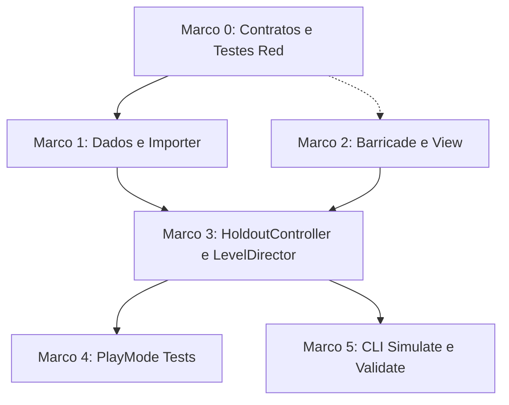

# Plano de Implementação: M30 · Trechos de Barricada (segurar ondas protegendo sobreviventes)
> Data: 2026-10-13
> Issue: NEX-742
> Status: Pronto para Execução via /executar

## 1. Contexto & Arquitetura
- **Resumo**: Implementar os trechos de Barricada (M30 · Holdout) no Horde Runner, inspirados na arquitetura de defesa estacionária REA (`TeamStateDefense.luac` / `LastStandGate.luac` de Top Lords / Last War v1.0.39). Ao adentrar em um segmento `Holdout`, o avanço longitudinal Z da pista pausa (`TrackScroller.IsPaused = true`), enquanto a movimentação lateral X entre lanes (`LaneMover`) permanece totalmente ativa. Ondas de zumbis descem simultaneamente por todas as lanes em direção à Barricada fortificada posicionada em $Z$. Na lane ocupada pelo General e sua tropa, os zumbis colidem com o pelotão e sofrem disparos/combate de atrito; nas lanes desguarnecidas, os zumbis alcançam a barricada e causam dano por segundo contínuo (`contactDps`) na integridade da Barricada (`CurrentHp`). Se a defesa resistir até o final da duração do segmento, a corrida retoma e sobreviventes proporcionais ao HP restante da barricada são resgatados como membros da tropa e recrutas para a meta. Se o HP da barricada for zerado, os sobreviventes morrem (`SurvivorsLostEvent`), o General prossegue sem derrota instantânea, mas perde a 3ª estrela de vitória no `RunResult` (`HoldoutsHeld`).
- **Stack**: Unity 6, C# (.NET Standard), ScriptableObjects, JSON (`Content/Source/Holdouts/`), Harness CLI (`tools/unity`).
- **Verificação disponível**: Suíte de testes confiável (`compile`, `test-edit`, `test-play`, `import-content`, `validate`, `simulate` via harness CLI `tools/unity`).

## 2. Armadilhas do Repositório

| Armadilha | Onde morde (arquivo/passo) | Regra a respeitar |
|---|---|---|
| Pausa do avanço sem congelar o tempo de simulação | `TrackScroller.cs` / `HoldoutController.cs` — Passos 2 e 3 | A pista longitudinal deve ter seu deslocamento Z pausado (`IsPaused = true`), mas `Time.deltaTime`, física, tiros e `LaneMover` DEVEM continuar atualizando ativamente. Nunca usar `Time.timeScale = 0`. |
| C# Puro em `Game.Core` | `Game.Core.Holdout` — Passos 0 e 1 | `Game.Core` possui `noEngineReferences: true`. `HoldoutRuntimeState`, `IHoldoutState`, `HoldoutStartedEvent` e `HoldoutEndedEvent` devem residir estritamente em `Game.Core` sem qualquer dependência de UnityEngine. Usar `(int)System.Math.Ceiling` ou `MathF.Ceiling`, nunca `Mathf`. |
| Invariante de Dano Cumulativo por Zumbi | `Barricade.cs` / `HoldoutController.cs` — Passo 2 | Nas lanes não ocupadas pela tropa, múltiplos zumbis em contato com a barricada devem somar seu `contactDps`. Ao eliminar um zumbi ou mover a tropa para a lane, o dano daquele zumbi cessa imediatamente. |
| Arredondamento do Resgate Proporcional | `HoldoutRuntimeState.cs` — Passo 0 | O cálculo de sobreviventes deve ser `(int)Math.Ceiling(TotalSurvivors * ((double)CurrentHp / MaxHp))`, garantindo que com qualquer HP > 0 pelo menos 1 sobrevivente seja salvo se o total for > 0, e 0 apenas se `CurrentHp <= 0`. |
| Perda de Estrela no RunResult | `LevelDirector.cs` — Passo 3 | A derrota de uma barricada não causa Game Over, mas define que nem todos os holdouts foram mantidos (`HoldoutsHeld < HoldoutsAttempted`), forçando que a run termine com no máximo 2 estrelas. |
| Destruição de objetos em testes EditMode | Testes EditMode — Todos os passos | Todo `GameObject` ou `ScriptableObject` instanciado durante testes EditMode DEVE ser destruído via `UnityEngine.Object.DestroyImmediate` no `[TearDown]`. |
| Ruído de regeneração de assets | Todos os passos | Não versionar modificações acidentais em `Assets/_Game/Data/` ou `Assets/_Game/Scenes/` fora do escopo estrito; restaurar via `git checkout --`. |

## 3. Árvore de Arquivos
- [NOVO] `Assets/_Game/Scripts/Core/Holdout/IHoldoutState.cs`
- [NOVO] `Assets/_Game/Scripts/Core/Holdout/HoldoutRuntimeState.cs`
- [NOVO] `Assets/_Game/Scripts/Core/Events/HoldoutStartedEvent.cs`
- [NOVO] `Assets/_Game/Scripts/Core/Events/HoldoutEndedEvent.cs`
- [NOVO] `Assets/_Game/Scripts/Data/Holdout/HoldoutDefinition.cs`
- [NOVO] `Assets/_Game/Scripts/Data/Holdout/HoldoutCatalog.cs`
- [NOVO] `Assets/_Game/Scripts/Data/Holdout/HoldoutSegmentSpec.cs`
- [NOVO] `Assets/_Game/Scripts/Editor/HoldoutImporter.cs`
- [NOVO] `Content/Source/Holdouts/holdout_standard.json`
- [MODIFICADO] `Assets/_Game/Scripts/Data/SegmentDefinition.cs`
- [MODIFICADO] `Assets/_Game/Scripts/Core/State/RunResult.cs`
- [NOVO] `Assets/_Game/Scripts/Gameplay/Holdout/Barricade.cs`
- [NOVO] `Assets/_Game/Scripts/Gameplay/Holdout/HoldoutController.cs`
- [NOVO] `Assets/_Game/Scripts/Presentation/BarricadeView.cs`
- [MODIFICADO] `Assets/_Game/Scripts/Gameplay/LevelDirector.cs`
- [MODIFICADO] `Assets/_Game/Scripts/Editor/Tools/SimulateCommand.cs`
- [MODIFICADO] `Assets/_Game/Scripts/Editor/Tools/ValidateCommand.cs`
- [NOVO] `Assets/_Game/Scripts/Tests/EditMode/HoldoutCoreTests.cs`
- [NOVO] `Assets/_Game/Scripts/Tests/EditMode/HoldoutImporterTests.cs`
- [NOVO] `Assets/_Game/Scripts/Tests/EditMode/HoldoutGameplayTests.cs`
- [NOVO] `Assets/_Game/Scripts/Tests/EditMode/HoldoutSimulationAndValidationTests.cs`
- [NOVO] `Assets/_Game/Scripts/Tests/PlayMode/HoldoutPlayModeTests.cs`

## 4. Contratos e Interfaces

```csharp
namespace Game.Core.Holdout
{
    public enum HoldoutStatus
    {
        Inactive = 0,
        Defense = 1,
        Victory = 2,
        BarricadeDestroyed = 3
    }

    public interface IHoldoutState
    {
        string HoldoutId { get; }
        int MaxHp { get; }
        int CurrentHp { get; }
        int TotalSurvivors { get; }
        int SurvivorsSaved { get; }
        float DurationSeconds { get; }
        float TimeRemaining { get; }
        HoldoutStatus Status { get; }
        bool IsActive { get; }
        bool IsVictory { get; }
        bool IsBarricadeDestroyed { get; }
    }

    public sealed class HoldoutRuntimeState : IHoldoutState
    {
        public string HoldoutId { get; }
        public int MaxHp { get; }
        public int CurrentHp { get; private set; }
        public int TotalSurvivors { get; }
        public int SurvivorsSaved { get; private set; }
        public float DurationSeconds { get; }
        public float TimeRemaining { get; private set; }
        public HoldoutStatus Status { get; private set; }

        public bool IsActive => Status == HoldoutStatus.Defense;
        public bool IsVictory => Status == HoldoutStatus.Victory;
        public bool IsBarricadeDestroyed => Status == HoldoutStatus.BarricadeDestroyed;

        public HoldoutRuntimeState(string holdoutId, int maxHp, int totalSurvivors, float durationSeconds);
        public void StartDefense();
        public bool TakeDamage(int damage);
        public void Tick(float deltaTime);
        public void ConcludeHoldout(bool timeoutOrCleared);
    }
}

namespace Game.Core.Events
{
    public readonly struct HoldoutStartedEvent
    {
        public string HoldoutId { get; }
        public int MaxHp { get; }
        public int TotalSurvivors { get; }
        public float DurationSeconds { get; }

        public HoldoutStartedEvent(string holdoutId, int maxHp, int totalSurvivors, float durationSeconds);
    }

    public readonly struct HoldoutEndedEvent
    {
        public string HoldoutId { get; }
        public int SurvivorsSaved { get; }
        public int RemainingHp { get; }
        public bool BarricadeHeld { get; }

        public HoldoutEndedEvent(string holdoutId, int survivorsSaved, int remainingHp, bool barricadeHeld);
    }
}

namespace Game.Data
{
    public class HoldoutDefinition : UnityEngine.ScriptableObject
    {
        public string Id { get; }
        public string DisplayName { get; }
        public int MaxHp { get; }
        public int TotalSurvivors { get; }
        public float DurationSeconds { get; }
        public float ZombieContactDps { get; }
        public float WaveIntervalSeconds { get; }
        public int ZombiesPerWavePerLane { get; }
        public void SetData(string id, string name, int hp, int survivors, float duration, float contactDps, float waveInterval, int zombiesPerLane);
    }

    [System.Serializable]
    public class HoldoutSegmentSpec
    {
        public string HoldoutId;
        public int CustomMaxHp;
        public int CustomSurvivors;
        public float CustomDuration;
    }
}
```

## 4.5 Linear overlay
- **História (issue-pai):** `NEX-742`
- **Sub-issues deste plano:**
  - `NEX-954`: `Marco 0: Suíte de Cenários & Contratos de Barricada e Holdout [NEX-742]`
  - `NEX-955`: `Marco 1: Implementar HoldoutDefinition, HoldoutCatalog, JSON canônico e HoldoutImporter [NEX-742]`
  - `NEX-956`: `Marco 2: Implementar componente Barricade, BarricadeView e dano por contato de zumbis [NEX-742]`
  - `NEX-957`: `Marco 3: Implementar HoldoutController, pausa da pista no LevelDirector e integração de fluxo [NEX-742]`
  - `NEX-958`: `Marco 4: Teste PlayMode de ciclo de defesa e física de zumbis contra barricada [NEX-742]`
  - `NEX-959`: `Marco 5: Integrar trechos de barricada no SimulateCommand e regras no ValidateCommand [NEX-742]`
- **PRs (modelo C):** história = `jamilzerati/nex-742-story-m30-trechos-de-barricada-segurar-ondas-protegendo`; draft PR **→ `main`**. Cada tarefa ramifica da branch da história e abre PR **→ branch da história**.

## 4.6 Grafo de Dependências

| De | Para | Tipo | Por quê |
|---|---|---|---|
| Marco 0 | Marco 1 | implementação | Marco 1 usa contratos de eventos e tipos base definidos no Marco 0 |
| Marco 0 | Marco 2 | interface | Marco 2 implementa componentes usando `IHoldoutState` |
| Marco 1 | Marco 3 | implementação | Marco 3 consome `HoldoutDefinition` e `HoldoutSegmentSpec` no `LevelDirector` |
| Marco 2 | Marco 3 | implementação | Marco 3 coordena a `Barricade` e `TrackScroller` em tempo de jogo |
| Marco 3 | Marco 4 | implementação | Marco 4 valida o fluxo completo em PlayMode com física |
| Marco 3 | Marco 5 | implementação | Marco 5 integra `HoldoutController` e `HoldoutDefinition` aos comandos CLI |



## 5. Divisão de Execução por Passo

| Faixa | Passos | Por quê |
|---|---|---|
| **Risco de falha silenciosa** | Passos 0, 1, 3, 5 | Cálculos de vida proporcional de sobreviventes, IDs de holdout, pausa sem descompassar distância e contagem de estrelas. |
| **Falha visível** | Passos 2, 4 | Colisão física, criação de GameObjects, compilação de shaders/views e testes de PlayMode. |

## 6. Checklist de Execução

- [x] **Passo 0 (Marco 0)**: `Suíte de Cenários & Contratos de Barricada e Holdout` [NEX-954]
  - **Ação**: Criar contratos puros em `Game.Core.Holdout`, eventos `HoldoutStartedEvent` e `HoldoutEndedEvent`, e testes unitários Red em `HoldoutCoreTests.cs`.
  - **Lógica de Negócios / Responsabilidade**: Definir modelo puro `HoldoutRuntimeState`, transições entre `Defense`, `Victory` e `BarricadeDestroyed`, cálculo de sobreviventes salvos com `(int)Math.Ceiling`, garantindo pureza C# (zero referências a UnityEngine).
  - **Dependências / Pré-requisitos**: nenhuma (raiz).
  - **Seam Público**: `Game.Core.Holdout.HoldoutRuntimeState`
  - **AC**: AC-1, AC-3, AC-4 (CT-1, CT-2, CT-3, CT-4)
  - **Marco de PR**: Marco 0
  - **Effort**: medium

- [x] **Passo 1 (Marco 1)**: `HoldoutDefinition, HoldoutCatalog, JSON canônico e HoldoutImporter` [NEX-955]
  - **Ação**: Criar ScriptableObjects `HoldoutDefinition`, `HoldoutCatalog`, `HoldoutSegmentSpec`, JSON canônico `Content/Source/Holdouts/holdout_standard.json`, importador `HoldoutImporter.cs` e testes `HoldoutImporterTests.cs`.
  - **Lógica de Negócios / Responsabilidade**: Estruturar os dados de holdout com validação de schema e geração automática de assets via `tools/unity import-content`.
  - **Dependências / Pré-requisitos**: `implementação`: Marco 0.
  - **Seam Público**: `Game.Data.HoldoutDefinition`, `Game.Editor.HoldoutImporter`
  - **AC**: AC-1, AC-5 (CT-8)
  - **Marco de PR**: Marco 1
  - **Effort**: hard

- [x] **Passo 2 (Marco 2)**: `Componente Barricade, BarricadeView e dano por contato de zumbis` [NEX-956]
  - **Ação**: Implementar `Barricade.cs`, `BarricadeView.cs`, detecção de zumbis alcançando as lanes desguarnecidas e aplicação de dano contínuo à barricada.
  - **Lógica de Negócios / Responsabilidade**: Gerenciar colisores da barricada por lane, aplicar `ZombieContactDps` para zumbis ativos que atingem a coordenada $Z$ nas lanes onde o General NÃO está, cessando dano quando a tropa se move para cobrir a lane.
  - **Dependências / Pré-requisitos**: `interface`: Marco 0.
  - **Seam Público**: `Game.Gameplay.Barricade`
  - **AC**: AC-2, AC-4 (CT-2, CT-4)
  - **Marco de PR**: Marco 2
  - **Effort**: hard

- [x] **Passo 3 (Marco 3)**: `HoldoutController, pausa da pista no LevelDirector e integração de fluxo` [NEX-957]
  - **Ação**: Implementar `HoldoutController.cs`, estender `LevelDirector.cs` para suportar `SegmentType.Holdout`, controlar `TrackScroller.IsPaused`, publicar eventos de início/fim e atualizar o cálculo de estrelas no `RunResult` (`HoldoutsHeld`).
  - **Lógica de Negócios / Responsabilidade**: Ponto central de montagem do trecho: orquestra pausa de $Z$, ondas simultâneas, transição de estado, resgate proporcional somado à tropa na vitória, e perda de sobreviventes + perda de 3ª estrela no colapso.
  - **Dependências / Pré-requisitos**: `implementação`: Marco 1, Marco 2.
  - **Seam Público**: `Game.Gameplay.HoldoutController`, `Game.Gameplay.LevelDirector`
  - **AC**: AC-1, AC-2, AC-3, AC-4 (CT-5, CT-6)
  - **Marco de PR**: Marco 3
  - **Effort**: hard

- [x] **Passo 4 (Marco 4)**: `Teste PlayMode de ciclo de defesa e física de zumbis contra barricada` [NEX-958]
  - **Ação**: Criar suíte PlayMode `HoldoutPlayModeTests.cs` exercitando colisão física, marcha de zumbis em lanes desguarnecidas ferindo a barricada e defesa com a tropa.
  - **Lógica de Negócios / Responsabilidade**: Comprovar a integração em runtime no Unity com física real e ciclo de vida de MonoBehaviours.
  - **Dependências / Pré-requisitos**: `implementação`: Marco 3.
  - **Seam Público**: `Game.Tests.PlayMode.HoldoutPlayModeTests`
  - **AC**: AC-1, AC-2, AC-3 (CT-7)
  - **Marco de PR**: Marco 4
  - **Effort**: hard

- [x] **Passo 5 (Marco 5)**: `Integrar trechos de barricada no SimulateCommand e regras no ValidateCommand` [NEX-959]
  - **Ação**: Estender `SimulateCommand.cs` para suportar trechos de holdout no simulador headless e `ValidateCommand.cs` para validar integridade de níveis com barricadas, cobertos por `HoldoutSimulationAndValidationTests.cs`.
  - **Lógica de Negócios / Responsabilidade**: Garantir cobertura das ferramentas CLI exigidas pela arquitetura do projeto (`validate` e `simulate` verdes).
  - **Dependências / Pré-requisitos**: `implementação`: Marco 3.
  - **Seam Público**: `Game.Editor.Tools.SimulateCommand`, `Game.Editor.Tools.ValidateCommand`
  - **AC**: AC-5 (CT-8)
  - **Marco de PR**: Marco 5
  - **Effort**: hard

## 7. Rascunho das Tarefas

### `Marco 0: Suíte de Cenários & Contratos de Barricada e Holdout [NEX-742]` (`NEX-954`)
- **Objetivo**: Criar contratos puros em `Game.Core.Holdout` (`HoldoutRuntimeState`, `IHoldoutState`), eventos `HoldoutStartedEvent` e `HoldoutEndedEvent`, e suíte de testes unitários Red `HoldoutCoreTests.cs`.
- **Arquivos**: `Assets/_Game/Scripts/Core/Holdout/IHoldoutState.cs`, `Assets/_Game/Scripts/Core/Holdout/HoldoutRuntimeState.cs`, `Assets/_Game/Scripts/Core/Events/HoldoutStartedEvent.cs`, `Assets/_Game/Scripts/Core/Events/HoldoutEndedEvent.cs`, `Assets/_Game/Scripts/Tests/EditMode/HoldoutCoreTests.cs`.
- **Pronto quando**: `HoldoutCoreTests.cs` compila e passa 100% verde provando cálculo de integridade, dano e sobreviventes salvos.
```yaml
dispatch:
  story: NEX-742
  marco: 0
  runtime: medium
  verify:
    - tools/unity compile
    - tools/unity test-edit
```

### `Marco 1: Implementar HoldoutDefinition, HoldoutCatalog, JSON canônico e HoldoutImporter [NEX-742]` (`NEX-955`)
- **Objetivo**: Criar ScriptableObjects `HoldoutDefinition`, `HoldoutCatalog`, `HoldoutSegmentSpec`, JSON `Content/Source/Holdouts/holdout_standard.json`, `HoldoutImporter` e `HoldoutImporterTests.cs`.
- **Arquivos**: `Assets/_Game/Scripts/Data/Holdout/HoldoutDefinition.cs`, `Assets/_Game/Scripts/Data/Holdout/HoldoutCatalog.cs`, `Assets/_Game/Scripts/Data/Holdout/HoldoutSegmentSpec.cs`, `Assets/_Game/Scripts/Editor/HoldoutImporter.cs`, `Content/Source/Holdouts/holdout_standard.json`, `Assets/_Game/Scripts/Tests/EditMode/HoldoutImporterTests.cs`.
- **Pronto quando**: `tools/unity import-content` gera os assets em `Assets/_Game/Data/Holdouts/` e `HoldoutImporterTests.cs` passa 100% verde.
```yaml
dispatch:
  story: NEX-742
  marco: 1
  runtime: hard
  verify:
    - tools/unity compile
    - tools/unity import-content
    - tools/unity test-edit
```

### `Marco 2: Implementar componente Barricade, BarricadeView e dano por contato de zumbis [NEX-742]` (`NEX-956`)
- **Objetivo**: Implementar componente `Barricade`, `BarricadeView`, detecção de zumbis em lanes desguarnecidas e aplicação de `contactDps`.
- **Arquivos**: `Assets/_Game/Scripts/Gameplay/Holdout/Barricade.cs`, `Assets/_Game/Scripts/Presentation/BarricadeView.cs`, `Assets/_Game/Scripts/Tests/EditMode/HoldoutGameplayTests.cs`.
- **Pronto quando**: Testes unitários validam dano à barricada nas lanes descobertas e cessação de dano ao cobrir a lane.
```yaml
dispatch:
  story: NEX-742
  marco: 2
  runtime: hard
  verify:
    - tools/unity compile
    - tools/unity test-edit
```

### `Marco 3: Implementar HoldoutController, pausa da pista no LevelDirector e integração de fluxo [NEX-742]` (`NEX-957`)
- **Objetivo**: Implementar `HoldoutController`, estender `LevelDirector` para suportar `SegmentType.Holdout`, controlar `TrackScroller.IsPaused`, distribuir resgate ou perda e registrar estrelas no `RunResult`.
- **Arquivos**: `Assets/_Game/Scripts/Gameplay/Holdout/HoldoutController.cs`, `Assets/_Game/Scripts/Gameplay/LevelDirector.cs`, `Assets/_Game/Scripts/Core/State/RunResult.cs`, `Assets/_Game/Scripts/Data/SegmentDefinition.cs`, `Assets/_Game/Scripts/Tests/EditMode/HoldoutGameplayTests.cs`.
- **Pronto quando**: Testes comprovam pausa da pista, troca de lane mantida, resgate proporcional somado à tropa e perda de 3ª estrela no colapso.
```yaml
dispatch:
  story: NEX-742
  marco: 3
  runtime: hard
  verify:
    - tools/unity compile
    - tools/unity test-edit
```

### `Marco 4: Teste PlayMode de ciclo de defesa e física de zumbis contra barricada [NEX-742]` (`NEX-958`)
- **Objetivo**: Criar suíte PlayMode exercitando simulação física real de zumbis atacando barricada e tropa defendendo.
- **Arquivos**: `Assets/_Game/Scripts/Tests/PlayMode/HoldoutPlayModeTests.cs`.
- **Pronto quando**: `tools/unity test-play` executa e passa 100% verde comprovando colisão e ciclo de vida MonoBehaviour.
```yaml
dispatch:
  story: NEX-742
  marco: 4
  runtime: hard
  verify:
    - tools/unity compile
    - tools/unity test-play
```

### `Marco 5: Integrar trechos de barricada no SimulateCommand e regras no ValidateCommand [NEX-742]` (`NEX-959`)
- **Objetivo**: Adicionar suporte a trechos de barricada no simulador batchmode (`SimulateCommand`), validação em `ValidateCommand` e testes `HoldoutSimulationAndValidationTests.cs`.
- **Arquivos**: `Assets/_Game/Scripts/Editor/Tools/SimulateCommand.cs`, `Assets/_Game/Scripts/Editor/Tools/ValidateCommand.cs`, `Assets/_Game/Scripts/Tests/EditMode/HoldoutSimulationAndValidationTests.cs`.
- **Pronto quando**: `tools/unity validate` e `tools/unity simulate` executam com sucesso e a suíte passa 100% verde.
```yaml
dispatch:
  story: NEX-742
  marco: 5
  runtime: hard
  verify:
    - tools/unity compile
    - tools/unity test-edit
    - tools/unity validate
    - tools/unity simulate
```
