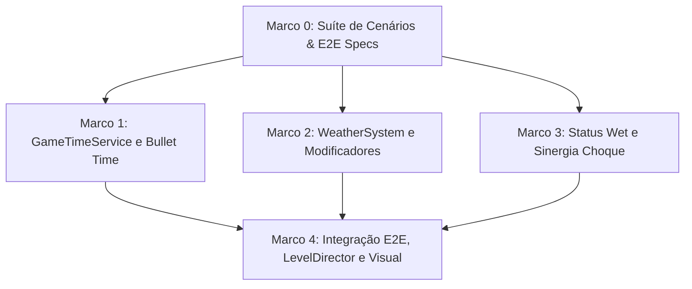

# Plano de Implementação: M9 · Clima e efeitos de tempo
> Data: 2026-10-14
> Issue: NEX-514
> Status: Pronto para Execução via /executar

## 1. Contexto & Arquitetura
- **Resumo**: Implementar o sistema de Clima e Efeitos Temporais (Story M9 · NEX-514) no Horde Runner. A corrida passa a apresentar variações atmosféricas e temporais dinâmicas por segmento de pista: (1) O `GameTimeService` desacopla as escalas temporais de aliados (`AllyTimeScale`) e inimigos (`EnemyTimeScale`), permitindo a mecânica cinematográfica de *bullet time* (onde inimigos são desacelerados para 0.2x enquanto aliados mantêm tempo regular de 1.0x); (2) O `WeatherSystem` gerencia o ciclo climático de 4 climas canônicos (`Rain`, `Blizzard`, `Heatwave`, `Fog`) aplicando e removendo modificadores globais via `StageModifierController` com `SourceId = "clima:<tipo>"`; (3) A chuva interage com a física e status do combate através do status persistente `Wet` (Molhado); quando alvos molhados recebem dano elétrico (`DamageType.Lightning` ou `ShockStatus`), a sinergia `electrocute` dobra a propagação da cadeia de choque (`ChainCount * 2`), multiplica o dano por 2.0x e consome o status `Wet`; (4) Todos os contratos e modelos de domínio residem estritamente em `Game.Core` sem dependências do namespace `UnityEngine`.
- **Stack**: Unity 6 (6000.6.3f1), C# (.NET Standard), ScriptableObjects, JSON de conteúdo (`Content/Source/Weather/`, `Content/Source/Statuses/`, `Content/Source/Interactions/`), Harness CLI (`tools/unity`).
- **Verificação disponível**: Suíte de testes automatizada confiável (`tools/unity compile`, `test-edit`, `import-content`, `validate`, `simulate`).

## 2. Armadilhas do Repositório

| Armadilha | Onde morde (arquivo/passo) | Regra a respeitar |
|---|---|---|
| Pureza C# em `Game.Core` | `Game.Core.Time` e `Game.Core.Weather` — Passos 0, 1 e 2 | `Game.Core` possui `noEngineReferences: true`. `IGameTimeService`, `GameTimeService`, `IWeatherSystem`, `WeatherSystem`, `WeatherStageModifier` e `WetStatus` DEVEM residir estritamente em `Game.Core` sem referências a `UnityEngine`. Usar `Math.Max`/`Math.Min`, nunca `Mathf`. |
| Idempotência do Bullet Time | `GameTimeService.cs` — Passo 1 | Ativações sucessivas de *bullet time* enquanto um efeito anterior estiver ativo NÃO podem multiplicar ou acumular reduções (ex.: 0.2 * 0.2 = 0.04). Devem apenas renovar o cronômetro para a nova duração e fixar as escalas declaradas. |
| Restauração Confiável de Escalas | `GameTimeService.cs` — Passo 1 | Ao expirar a duração do *bullet time*, as escalas temporais devem retornar exatamente aos valores base configurados (1.0x), disparando `BulletTimeEndedEvent` sem deixar o jogo permanentemente lento. |
| Compatibilidade de `IStageModifier` | `IStageModifier.cs` / `StageModifierController.cs` — Passo 2 | Preservar assinaturas existentes (`EnemySpeedMultiplier`, `EnemyContactDamageMultiplier`). A adição de `SquadRangeMultiplier` deve possuir valor default `1f` em `StageModifierSpec` para não quebrar os testes preexistentes de portões amaldiçoados. |
| Ciclo de Vida do Clima por Distância | `WeatherSystem.cs` / `LevelDirector.cs` — Passos 2 e 4 | O clima ativo possui início e duração delimitados por distância métrica (`durationDistance`). O retorno para `Clear` e a remoção de modificadores devem ocorrer automaticamente ao atingir a distância final. |
| Consumo Atômico de Status na Sinergia | `ShockStatus.cs` / `StatusEffectController.cs` — Passo 3 | A sinergia `electrocute` consome o status `Wet` no momento da detonação da cadeia de choque. O consumo deve ser atômico para evitar que múltiplos saltos da mesma cadeia processem a amplificação recursivamente no mesmo alvo. |
| Descarte de Objetos em EditMode | Testes EditMode — Todos os passos | Todo `GameObject` ou `ScriptableObject` criado nos testes DEVE ser descartado via `UnityEngine.Object.DestroyImmediate` no `[TearDown]`. |

## 3. Árvore de Arquivos
- [NOVO] `Assets/_Game/Scripts/Core/Time/TimeTarget.cs`
- [NOVO] `Assets/_Game/Scripts/Core/Time/IGameTimeService.cs`
- [NOVO] `Assets/_Game/Scripts/Core/Time/GameTimeService.cs`
- [NOVO] `Assets/_Game/Scripts/Core/Events/BulletTimeStartedEvent.cs`
- [NOVO] `Assets/_Game/Scripts/Core/Events/BulletTimeEndedEvent.cs`
- [NOVO] `Assets/_Game/Scripts/Core/Weather/WeatherType.cs`
- [NOVO] `Assets/_Game/Scripts/Core/Weather/IWeatherSystem.cs`
- [NOVO] `Assets/_Game/Scripts/Core/Weather/WeatherSystem.cs`
- [NOVO] `Assets/_Game/Scripts/Core/Weather/WeatherStageModifier.cs`
- [NOVO] `Assets/_Game/Scripts/Core/Events/WeatherChangedEvent.cs`
- [MODIFICADO] `Assets/_Game/Scripts/Core/Gates/IStageModifier.cs`
- [MODIFICADO] `Assets/_Game/Scripts/Core/Gates/StageModifierSpec.cs`
- [MODIFICADO] `Assets/_Game/Scripts/Core/Gates/StageModifierController.cs`
- [MODIFICADO] `Assets/_Game/Scripts/Core/Status/StatusKind.cs`
- [MODIFICADO] `Assets/_Game/Scripts/Core/Status/EffectInteraction.cs`
- [MODIFICADO] `Assets/_Game/Scripts/Core/Status/Effects/ShockStatus.cs`
- [MODIFICADO] `Assets/_Game/Scripts/Core/Status/StatusEffectController.cs`
- [NOVO] `Assets/_Game/Scripts/Core/Status/Effects/WetStatus.cs`
- [NOVO] `Assets/_Game/Scripts/Data/Weather/WeatherDefinition.cs`
- [NOVO] `Assets/_Game/Scripts/Data/Weather/WeatherCatalog.cs`
- [NOVO] `Assets/_Game/Scripts/Editor/WeatherImporter.cs`
- [NOVO] `Content/Source/Weather/rain.json`
- [NOVO] `Content/Source/Weather/blizzard.json`
- [NOVO] `Content/Source/Weather/heatwave.json`
- [NOVO] `Content/Source/Weather/fog.json`
- [NOVO] `Content/Source/Statuses/wet.json`
- [NOVO] `Content/Source/Interactions/electrocute.json`
- [MODIFICADO] `Assets/_Game/Scripts/Gameplay/LevelDirector.cs`
- [MODIFICADO] `Assets/_Game/Scripts/Gameplay/Enemies/EnemyController.cs`
- [MODIFICADO] `Assets/_Game/Scripts/Gameplay/Combat/CombatDirector.cs`
- [NOVO] `Assets/_Game/Scripts/Presentation/WeatherVisualController.cs`
- [NOVO] `Assets/_Game/Scripts/Tests/EditMode/WeatherScenariosTests.cs`
- [NOVO] `Assets/_Game/Scripts/Tests/EditMode/GameTimeServiceTests.cs`
- [NOVO] `Assets/_Game/Scripts/Tests/EditMode/WeatherImporterTests.cs`
- [NOVO] `Assets/_Game/Scripts/Tests/EditMode/WeatherStatusTests.cs`
- [NOVO] `Assets/_Game/Scripts/Tests/EditMode/WeatherGameplayTests.cs`

## 4. Contratos e Interfaces

```csharp
namespace Game.Core.Time
{
    public enum TimeTarget
    {
        Global = 0,
        Ally = 1,
        Enemy = 2
    }

    public interface IGameTimeService
    {
        float GlobalTimeScale { get; set; }
        float AllyTimeScale { get; set; }
        float EnemyTimeScale { get; set; }
        bool IsBulletTimeActive { get; }
        float BulletTimeRemaining { get; }

        float GetDeltaTime(TimeTarget target, float unscaledDeltaTime);
        void ActivateBulletTime(float durationSeconds, float enemyScale = 0.2f, float allyScale = 1.0f);
        void CancelBulletTime();
        void Tick(float unscaledDeltaTime);
    }
}

namespace Game.Core.Weather
{
    public enum WeatherType
    {
        Clear = 0,
        Rain = 1,
        Blizzard = 2,
        Heatwave = 3,
        Fog = 4
    }

    public interface IWeatherSystem
    {
        WeatherType CurrentWeather { get; }
        float WeatherRemainingDistance { get; }
        bool IsWeatherActive { get; }

        void SetWeather(WeatherType type, float durationDistance, Game.Core.Gates.StageModifierController stageModifiers = null);
        void ClearWeather(Game.Core.Gates.StageModifierController stageModifiers = null);
        void TickDistance(float currentDistance, Game.Core.Gates.StageModifierController stageModifiers = null);
    }

    public sealed class WeatherStageModifier : Game.Core.Gates.IStageModifier
    {
        public string SourceId { get; }
        public float EnemySpeedMultiplier { get; }
        public float EnemyContactDamageMultiplier { get; }
        public float SquadRangeMultiplier { get; }

        public WeatherStageModifier(WeatherType type, float enemySpeed = 1f, float enemyContact = 1f, float squadRange = 1f);
    }
}

namespace Game.Core.Events
{
    public readonly struct BulletTimeStartedEvent
    {
        public float DurationSeconds { get; }
        public float EnemyScale { get; }
        public float AllyScale { get; }

        public BulletTimeStartedEvent(float durationSeconds, float enemyScale, float allyScale);
    }

    public readonly struct BulletTimeEndedEvent
    {
    }

    public readonly struct WeatherChangedEvent
    {
        public Game.Core.Weather.WeatherType PreviousWeather { get; }
        public Game.Core.Weather.WeatherType NewWeather { get; }
        public float DurationDistance { get; }

        public WeatherChangedEvent(Game.Core.Weather.WeatherType previous, Game.Core.Weather.WeatherType next, float duration);
    }
}

namespace Game.Data.Weather
{
    public class WeatherDefinition : UnityEngine.ScriptableObject
    {
        public string Id;
        public Game.Core.Weather.WeatherType Type;
        public string DisplayName;
        public float EnemySpeedMultiplier;
        public float EnemyContactDamageMultiplier;
        public float SquadRangeMultiplier;
        public string AppliedStatus;
    }
}
```

## 4.5 Linear overlay
- **História (issue-pai):** `NEX-514`
- **Sub-issues deste plano:**
  - `NEX-968`: `Marco 0: Suíte de Cenários & E2E Specs de Clima e Efeitos de Tempo [NEX-514]`
  - `NEX-969`: `Marco 1: GameTimeService, escalas temporais desacopladas e bullet time [NEX-514]`
  - `NEX-970`: `Marco 2: WeatherSystem, WeatherStageModifier, catálogo e importação de JSONs [NEX-514]`
  - `NEX-971`: `Marco 3: Status Wet, sinergia electrocute com choque e consumo de status [NEX-514]`
  - `NEX-972`: `Marco 4: Integração E2E com LevelDirector, visual de clima e simulação de combate [NEX-514]`
- **PRs (modelo C):** história = `jamilzerati/nex-514-story-m9-clima-e-efeitos-de-tempo`; draft PR **→ `main`**. Cada tarefa ramifica da branch da história e abre PR **→ branch da história**.

## 4.6 Grafo de Dependências

| De | Para | Tipo | Por quê |
|---|---|---|---|
| Marco 0 | Marco 1 | implementação | Marco 1 implementa o serviço temporal puro que atende aos testes Red de CT-1, CT-2 e CT-3 |
| Marco 0 | Marco 2 | implementação | Marco 2 implementa o WeatherSystem e completa o stub WeatherStageModifier criado no Marco 0 |
| Marco 0 | Marco 3 | implementação | Marco 3 implementa a lógica do status Wet e completa o stub WetStatus criado no Marco 0 |
| Marco 1 | Marco 4 | implementação | Marco 4 integra os deltas de GameTimeService nos loops de tick dos inimigos e da tropa |
| Marco 2 | Marco 4 | implementação | Marco 4 acopla o WeatherSystem ao avanço de pista do LevelDirector e ao WeatherVisualController |
| Marco 3 | Marco 4 | implementação | Marco 3 fornece o status Wet e sinergia de choque prontos para simulação E2E sob chuva |



## 5. Divisão de Execução por Passo

| Faixa | Passos | Por quê |
|---|---|---|
| **Risco de falha silenciosa** | Passos 0, 1, 2, 3 | Fatores multiplicativos de tempo (`AllyTimeScale`, `EnemyTimeScale`), multiplicadores de clima no `StageModifierController`, duplicação de cadeia de choque e consumo de status sem efeito colateral visível imediato. |
| **Falha visível** | Passo 4 | Gatilhos de eventos no `LevelDirector`, animações/partículas visuais de chuva/neve e validação de simulação completa. |

## 6. Checklist de Execução

- [ ] **Passo 0 (Marco 0)**: `Suíte de Cenários & E2E Specs de Clima e Efeitos de Tempo` [NEX-968]
  - **Ação**: Criar testes comportamentais Red em `WeatherScenariosTests.cs` cobrindo todos os cenários CT-1 a CT-10 e declarar stubs dos contratos e enums em `Game.Core.Time` e `Game.Core.Weather`.
  - **Lógica de Negócios / Responsabilidade**: Definir contratos públicos (`IGameTimeService`, `IWeatherSystem`, `WeatherStageModifier`, `WetStatus`), garantindo pureza C# (zero referências a UnityEngine em `Game.Core`). Testes devem comprovar estado Red sem quebrar os 754 testes preexistentes.
  - **Dependências / Pré-requisitos**: nenhuma (raiz).
  - **Seam Público**: `Game.Core.Time.IGameTimeService`, `Game.Core.Weather.IWeatherSystem`, `Game.Core.Status.StatusKind.Wet`
  - **AC**: AC-1 a AC-8 (CT-1 a CT-10)
  - **Marco de PR**: Marco 0
  - **Effort**: medium

- [ ] **Passo 1 (Marco 1)**: `GameTimeService, escalas temporais desacopladas e bullet time` [NEX-969]
  - **Ação**: Implementar `GameTimeService.cs`, eventos `BulletTimeStartedEvent` e `BulletTimeEndedEvent` e testes unitários em `GameTimeServiceTests.cs`.
  - **Lógica de Negócios / Responsabilidade**: Cálculo determinístico de `GetDeltaTime(target, unscaledDt)`, ativação idempotente de *bullet time* com escalas parametrizadas (padrão inimigos 0.2x, aliados 1.0x), temporizador de expiração por `Tick(unscaledDt)` e restauração segura aos valores base (1.0x).
  - **Dependências / Pré-requisitos**: `implementação`: Marco 0.
  - **Seam Público**: `Game.Core.Time.GameTimeService`
  - **AC**: AC-1, AC-2 (CT-1, CT-2, CT-3)
  - **Marco de PR**: Marco 1
  - **Effort**: high

- [ ] **Passo 2 (Marco 2)**: `WeatherSystem, WeatherStageModifier, catálogo e importação de JSONs` [NEX-970]
  - **Ação**: Implementar `WeatherSystem.cs`, `WeatherStageModifier.cs`, estender `IStageModifier`/`StageModifierSpec`/`StageModifierController` com `SquadRangeMultiplier`, criar JSONs canônicos em `Content/Source/Weather/` (`rain.json`, `blizzard.json`, `heatwave.json`, `fog.json`), `WeatherDefinition`, `WeatherCatalog` e `WeatherImporter.cs`.
  - **Lógica de Negócios / Responsabilidade**: Gestão de clima ativo com `SourceId = "clima:<tipo>"`. Multiplicadores individuais: Blizzard (EnemySpeed 0.8x), Heatwave (EnemyContactDamage 1.2x), Fog (SquadRange 0.75x), Rain (Wet baseline). Desativação automática ao ultrapassar `durationDistance`.
  - **Dependências / Pré-requisitos**: `implementação`: Marco 0.
  - **Seam Público**: `Game.Core.Weather.WeatherSystem`, `Game.Editor.WeatherImporter`
  - **AC**: AC-3, AC-4, AC-7 (CT-4, CT-5, CT-9)
  - **Marco de PR**: Marco 2
  - **Effort**: high

- [ ] **Passo 3 (Marco 3)**: `Status Wet, sinergia electrocute com choque e consumo de status` [NEX-971]
  - **Ação**: Implementar `WetStatus.cs`, adicionar `StatusKind.Wet`, adicionar `InteractionTrigger.ShockHit` em `EffectInteraction.cs`, estender `ShockStatus.cs` para dobrar `ChainCount` e dano na presença de `Wet`, estender `StatusEffectController.ResolveHit` para suportar detonação de sinergia de choque, criar JSONs `Content/Source/Statuses/wet.json` e `Content/Source/Interactions/electrocute.json` e testes em `WeatherStatusTests.cs`.
  - **Lógica de Negócios / Responsabilidade**: Status persistente `Wet` potencializado em alvos na chuva. Ao receber impacto elétrico, ativa a sinergia `electrocute`, dobra o dano (2.0x), dobra o número de alvos da cadeia de raios e consome atômica e irreversivelmente o status `Wet`.
  - **Dependências / Pré-requisitos**: `implementação`: Marco 0.
  - **Consome contrato:** `IStatusEffect` (fake em testes de unidade).
  - **Seam Público**: `Game.Core.Status.Effects.WetStatus`, `Game.Core.Status.Effects.ShockStatus`, `Game.Core.Status.StatusEffectController`
  - **AC**: AC-5 (CT-6, CT-7)
  - **Marco de PR**: Marco 3
  - **Effort**: high

- [ ] **Passo 4 (Marco 4)**: `Integração E2E com LevelDirector, visual de clima e simulação de combate` [NEX-972]
  - **Ação**: Integrar `WeatherSystem` ao `LevelDirector` (reconhecendo eventos de clima em `SegmentDefinition`), conectar `GameTimeService` aos loops de `EnemyController` e `SquadController`, aplicar `SquadRangeMultiplier` do `StageModifierController` no cálculo de alcance do `CombatDirector`, implementar `WeatherVisualController.cs` para apresentação visual/partículas e validar a simulação E2E completa.
  - **Lógica de Negócios / Responsabilidade**: Ponto central de montagem: avanço de pista dispara início e término de clima; *bullet time* desacelera zumbis em tempo real; neblina reduz alcance de tiro da tropa; sinergia molhado + choque opera no loop de gameplay sem exceções ou quebras em frame.
  - **Dependências / Pré-requisitos**: `implementação`: Marco 1, Marco 2, Marco 3.
  - **Seam Público**: `Game.Gameplay.LevelDirector`, `Game.Presentation.WeatherVisualController`, `Game.Tests.EditMode.WeatherGameplayTests`
  - **AC**: AC-6, AC-8 (CT-8, CT-10)
  - **Marco de PR**: Marco 4
  - **Effort**: max

## 7. Rascunho das Tarefas

### `Marco 0: Suíte de Cenários & E2E Specs de Clima e Efeitos de Tempo [NEX-514]` (`NEX-968`)
```dispatch
effort: medium
```
```track
level: tarefa
plan: docs/planos/2026-10-14-NEX-514-clima-e-efeitos-de-tempo.md
marco: 0
steps: Passo 0 (Marco 0)
needs: cenarios
```
**Objetivo:** Criar testes comportamentais Red em `WeatherScenariosTests.cs` cobrindo CT-1 a CT-10 e definir stubs dos contratos e enums puros `IGameTimeService`, `IWeatherSystem`, `WeatherStageModifier`, `WetStatus`.
**Cobre:** AC-1 a AC-8 (História NEX-514)
**Seam:** `Game.Core.Time.IGameTimeService`, `Game.Core.Weather.IWeatherSystem`, `Game.Core.Status.StatusKind.Wet`
**Pronto quando:**
- [ ] CT-1 a CT-10 comprovados em estado Red controlado
- [ ] Stubs dos contratos compilam sem quebrar os 754 testes preexistentes
- [ ] `tools/unity compile` e `test-edit` executam sem erros
**Não fazer:** Não implementar a lógica final dos serviços nem tocar arquivos fora de `Game.Core` e `Tests/EditMode`.
**Contexto:** História NEX-514 §2 RN-1 a RN-6 · §5 AC-1 a AC-8 · Plano Passo 0

### `Marco 1: GameTimeService, escalas temporais desacopladas e bullet time [NEX-514]` (`NEX-969`)
```dispatch
effort: high
```
```track
level: tarefa
plan: docs/planos/2026-10-14-NEX-514-clima-e-efeitos-de-tempo.md
marco: 1
steps: Passo 1 (Marco 1)
needs: executar
```
**Objetivo:** Implementar `GameTimeService.cs` com cálculo de deltaTimes desacoplados para aliados e inimigos, ativação idempotente de bullet time com restauração automática e eventos de bus associados.
**Cobre:** AC-1, AC-2 (História NEX-514)
**Seam:** `Game.Core.Time.GameTimeService`
**Pronto quando:**
- [ ] CT-1, CT-2 e CT-3 passam 100% verde
- [ ] Escalas temporais desacopladas e bullet time verificados com precisão
- [ ] `tools/unity compile` e `test-edit` executam 100% verdes
**Não fazer:** Não tocar arquivos de gameplay (`LevelDirector`, `EnemyController`) nem referenciar `UnityEngine`.
**Contexto:** História NEX-514 §2 RN-1, RN-2 · §5 AC-1, AC-2 · Plano Passo 1

### `Marco 2: WeatherSystem, WeatherStageModifier, catálogo e importação de JSONs [NEX-514]` (`NEX-970`)
```dispatch
effort: high
```
```track
level: tarefa
plan: docs/planos/2026-10-14-NEX-514-clima-e-efeitos-de-tempo.md
marco: 2
steps: Passo 2 (Marco 2)
needs: executar
```
**Objetivo:** Implementar `WeatherSystem.cs`, `WeatherStageModifier.cs`, estender `IStageModifier`/`StageModifierController` com `SquadRangeMultiplier`, criar JSONs canônicos em `Content/Source/Weather/`, catálogo `WeatherCatalog.cs` e importador `WeatherImporter.cs`.
**Cobre:** AC-3, AC-4, AC-7 (História NEX-514)
**Seam:** `Game.Core.Weather.WeatherSystem`, `Game.Editor.WeatherImporter`
**Pronto quando:**
- [ ] CT-4, CT-5 e CT-9 passam 100% verde
- [ ] Modificadores de clima operando com `SourceId = clima:<tipo>`
- [ ] JSONs canônicos importados e validados pelo `WeatherImporter`
- [ ] `tools/unity compile`, `import-content` e `test-edit` passam sem falhas
**Não fazer:** Não quebrar assinaturas de `IStageModifier` ou testes existentes de portões vivos.
**Contexto:** História NEX-514 §2 RN-3, RN-4 · §5 AC-3, AC-4, AC-7 · Plano Passo 2

### `Marco 3: Status Wet, sinergia electrocute com choque e consumo de status [NEX-514]` (`NEX-971`)
```dispatch
effort: high
```
```track
level: tarefa
plan: docs/planos/2026-10-14-NEX-514-clima-e-efeitos-de-tempo.md
marco: 3
steps: Passo 3 (Marco 3)
needs: executar
```
**Objetivo:** Implementar `WetStatus.cs`, adicionar `StatusKind.Wet`, `InteractionTrigger.ShockHit`, detonação de sinergia `electrocute` (cadeia x2 e dano x2) em `ShockStatus.cs` e `StatusEffectController.cs`, e JSONs canônicos.
**Cobre:** AC-5 (História NEX-514)
**Seam:** `Game.Core.Status.Effects.WetStatus`, `Game.Core.Status.Effects.ShockStatus`, `Game.Core.Status.StatusEffectController`
**Pronto quando:**
- [ ] CT-6 e CT-7 passam 100% verde
- [ ] Impacto de choque em alvo com status Wet dobra a cadeia de saltos e o dano, consumindo Wet
- [ ] `tools/unity compile` e `test-edit` passam 100% verde
**Não fazer:** Não propagar dano infinito recursivo na cadeia de choque nem referenciar `UnityEngine`.
**Contexto:** História NEX-514 §2 RN-5 · §5 AC-5 · Plano Passo 3

### `Marco 4: Integração E2E com LevelDirector, visual de clima e simulação de combate [NEX-514]` (`NEX-972`)
```dispatch
effort: max
```
```track
level: tarefa
plan: docs/planos/2026-10-14-NEX-514-clima-e-efeitos-de-tempo.md
marco: 4
steps: Passo 4 (Marco 4)
needs: executar
```
**Objetivo:** Integrar `WeatherSystem` ao `LevelDirector`, conectar `GameTimeService` aos controladores de inimigo e tropa, aplicar `SquadRangeMultiplier` no `CombatDirector`, criar `WeatherVisualController.cs` e validar simulação E2E completa.
**Cobre:** AC-6, AC-8 (História NEX-514)
**Seam:** `Game.Gameplay.LevelDirector`, `Game.Presentation.WeatherVisualController`, `Game.Tests.EditMode.WeatherGameplayTests`
**Pronto quando:**
- [ ] CT-8 e CT-10 passam 100% verde
- [ ] Toda a suíte de testes (CT-1 a CT-10 e os 754 testes de regressão) passa 100% verde
- [ ] `tools/unity compile`, `test-edit` e `test-play` executam com 0 erros
**Não fazer:** Não alterar regras das fatias anteriores (holdout, jaulas, portões) nem quebrar determinismo no simulador.
**Contexto:** História NEX-514 §2 RN-1 a RN-6 · §5 AC-6, AC-8 · Plano Passo 4
