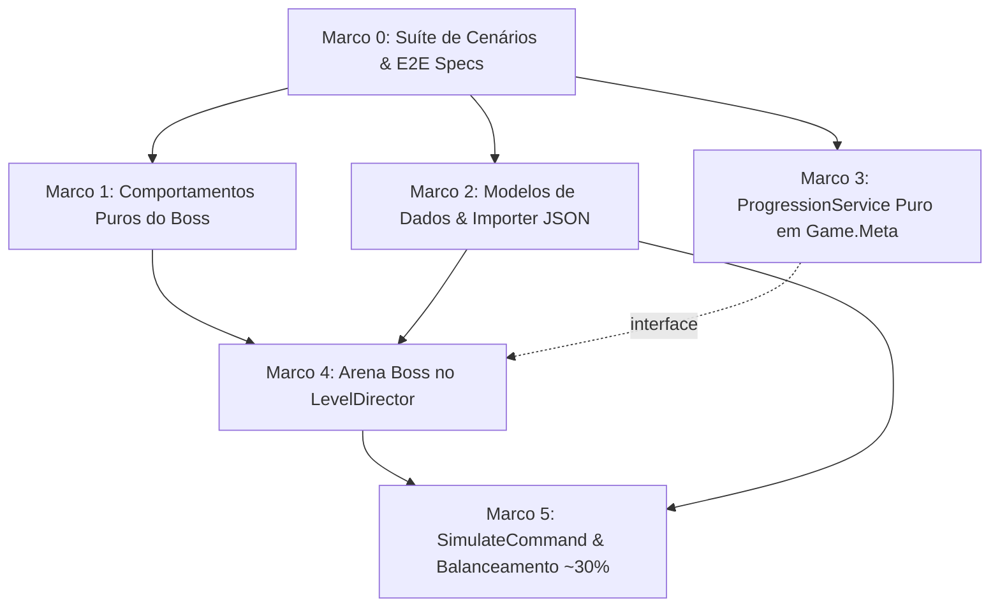

# Plano de Implementação: M11 · Fases Boss e desbloqueio de conteúdo
> Data: 2026-10-19
> Issue: NEX-516
> Status: Pronto para Execução via /executar

## 1. Contexto & Arquitetura
- **Resumo**: Implementar a Story M11 (NEX-516) no Horde Runner, introduzindo fases Boss e o sistema de desbloqueio de conteúdo atrelado à vitória contra chefes. A mecânica concretiza a Decisão de Produto 3 do GDD: fases difíceis são o motor de progressão. O chefe atua com padrões dinâmicos de movimentação e ataque por lane, baseados na engenharia reversa REA do APK de referência Top Lords/Last War v1.0.39 (`ParkourStage.Runtime.dll`). A vitória destrava armas, heróis ou mundos no `Game.Meta` via `ProgressionService` e `IRewardSink` de forma estritamente idempotente. O balanceamento é calibrado e comprovado no `SimulateCommand` atingindo a meta de ~30% de taxa de vitória para o bot guloso.
- **Stack**: Unity 6 (6000.6.3f1), C# puro (.NET Standard / C# 9+), JSON local, Harness CLI (`tools/unity`).
- **Verificação disponível**: Suíte automatizada de testes EditMode (`tools/unity compile`, `tools/unity test-edit`).

## 2. Referência Técnica REA (Top Lords / Last War v1.0.39)
> **Origem da evidência**: engenharia reversa via REA do pacote `com.gamespark.topking.gp` v1.0.39 (`ParkourStage.Runtime.dll`, evidência `ev_c234f9e587ce1c6b0188be09839db0f400a9d7e813dc1762d41c0a6f9df05429`, e `LWScripts.data`).

### 1. Movimento Paramétrico Puro (`PlaneMoveUtil`)
- `CalPingPongMoveHDeltaValue`: Varredura horizontal determinística entre lanes com limites e velocidade lateral contínua sem depender de física rígida.
- `CalCircleMoveDeltaV2` / `CalEllipseMoveDeltaV2`: Trajetórias de mergulho (dive) e retorno após telégrafo.

### 2. Máquina de Estados do Boss e da Tropa (`ParkourBattle`)
- Transição da tropa ao alcançar a arena do chefe: avanço desacelera ou trava para o confronto (`TeamStateBoss.luac`).
- Estados do Chefe (`AisillaBoss.luac` / `Boss.luac`):
  - `AisillaBossIdleState`: Varredura contínua entre lanes e mira.
  - `AisillaBossDiveState`: Aviso no chão durante 1,0 s na lane alvo seguido de investida pesada.
  - `GenSummonMonsterBatchTask`: Invocação de lotes de lacaios em limiares de HP ou intervalos de tempo.
  - `AisillaBossDieState`: Morte do chefe libera a pista de multiplicador (`BonusDash`) e dispara o recibo de vitória.

## 3. Armadilhas do Repositório

| Armadilha | Onde morde (arquivo/passo) | Regra a respeitar |
|---|---|---|
| Pureza de `Game.Meta` | `ProgressionService.cs` — Passo 3 | `Game.Meta` possui `"noEngineReferences": true`. Nenhuma classe em `Game.Meta` pode referenciar `UnityEngine`, `Mathf` ou `MonoBehaviour`. Usar `System.Math` e C# puro. |
| Invariante de Asmdefs | `LevelDirector.cs` — Passo 4 | `Game.Gameplay` **NUNCA** referencia `Game.Meta`. A comunicação da vitória do Boss com a meta ocorre via `RunResult`, `IEventBus` e orquestração na composição. |
| Fuga Acidental do Boss | `LevelDirector.cs` — Passo 4 | O método `CheckTrackedEnemies` recicla zumbis comuns que fiquem a ≥ 5,0 m atrás do General. O Boss NÃO pode ser reciclado por fuga enquanto a arena de combate estiver ativa. |
| Idempotência de Concessão | `ProgressionService.cs` — Passo 3 | O `grantId` do desbloqueio (`unlock_boss_{levelId}_{contentId}`) deve ser unívoco no `IRewardSink` para impedir duplicação ao rejogar a fase Boss. |
| Meta de Balanceamento | `SimulateCommand.cs` — Passo 5 | A fase Boss deve atingir ~30% de taxa de vitória do bot guloso (faixa aceitável: 20% a 40%) com seed 42 em 10 runs, sem quebrar o balanceamento das fases normais (~70%). |

## 4. Árvore de Arquivos Planejada

```
Assets/_Game/Scripts/Core/Boss/
[NOVO] BossCombatRuntimeState.cs
[NOVO] Events/BossSpawnedEvent.cs
[NOVO] Events/BossTelegraphEvent.cs
[NOVO] Events/BossDefeatedEvent.cs

Assets/_Game/Scripts/Data/Enemies/Behaviors/
[NOVO] BossPingPongBehavior.cs
[NOVO] BossLaneTelegraphDiveBehavior.cs
[NOVO] BossSummonWaveBehavior.cs

Assets/_Game/Scripts/Data/
[MODIFICAÇÃO] SegmentDefinition.cs (Adiciona SegmentType.Boss e BossSegmentSpec)
[MODIFICAÇÃO] LevelDefinition.cs (Adiciona IsBossStage e BossId)

Assets/_Game/Scripts/Editor/
[MODIFICAÇÃO] EnemyImporter.cs (Deserialização de BossPingPong, BossLaneTelegraphDive, BossSummonWave)
[MODIFICAÇÃO] LevelImporter.cs (Suporte a SegmentType.Boss)
[MODIFICAÇÃO] Tools/SimulateCommand.cs (Processamento de SegmentType.Boss)

Assets/_Game/Scripts/Gameplay/
[MODIFICAÇÃO] LevelDirector.cs (Orquestração de arena Boss, bloqueio de fuga e transição)

Assets/_Game/Scripts/Meta/Progression/
[NOVO] IProgressionService.cs
[NOVO] ProgressionService.cs
[NOVO] ProgressionCatalog.cs
[NOVO] ContentUnlockDefinition.cs

Content/Source/Enemies/
[NOVO] boss_colossus.json

Content/Source/Levels/
[NOVO] level_05_boss.json

Assets/_Game/Scripts/Tests/EditMode/
[NOVO] BossScenariosTests.cs (Marco 0)
[NOVO] BossBehaviorTests.cs (Marco 1)
[NOVO] BossDataImporterTests.cs (Marco 2)
[NOVO] ProgressionServiceTests.cs (Marco 3)
[NOVO] BossGameplayTests.cs (Marco 4)
[NOVO] BossSimulationAndValidationTests.cs (Marco 5)
```

## 4.5 Linear overlay
- **História (issue-pai):** `NEX-516`
- **Sub-issues deste plano:**
  - Marco 0 (`NEX-1094`): `Marco 0: Suíte de Cenários & E2E Specs de Fases Boss e Progressão`
  - Marco 1 (`NEX-1095`): `Marco 1: Comportamentos Puros do Boss em C#`
  - Marco 2 (`NEX-1096`): `Marco 2: Modelos de Dados, SegmentType.Boss e Importador JSON`
  - Marco 3 (`NEX-1097`): `Marco 3: ProgressionService Puro em Game.Meta e Desbloqueio Idempotente`
  - Marco 4 (`NEX-1098`): `Marco 4: Arena Boss no LevelDirector e Ciclo de Vida do Confronto`
  - Marco 5 (`NEX-1099`): `Marco 5: Simulador Headless (SimulateCommand), Balanceamento ~30% e Validação`
- **PRs (modelo C):** História opera na branch `jamilzerati/nex-516-story-m11-fases-boss-e-desbloqueio-de-conteudo` apontando para `main` (Draft PR). Cada tarefa ramifica da branch da história e abre PR apontando **para a branch da história**.

## 4.6 Grafo de Dependências

| De | Para | Tipo | Por quê |
|---|---|---|---|
| Marco 0 | Marco 1 | implementação | Contratos de teste Red e seams de comportamentos do chefe |
| Marco 0 | Marco 2 | implementação | Contratos de teste Red para serialização de dados e importer |
| Marco 0 | Marco 3 | implementação | Contratos de teste Red para `ProgressionService` e desbloqueios |
| Marco 1 | Marco 4 | implementação | `LevelDirector` consome os comportamentos e eventos do Boss em runtime |
| Marco 2 | Marco 4 | implementação | `LevelDirector` consome `SegmentType.Boss` e `LevelDefinition.IsBossStage` |
| Marco 3 | Marco 4 | interface | Contrato de sinais do gameplay e `RunResult` para liquidação da progressão |
| Marco 4 | Marco 5 | implementação | `SimulateCommand` reproduz a arena e ciclo de combate do `LevelDirector` |
| Marco 2 | Marco 5 | implementação | `SimulateCommand` consome `level_05_boss.json` e `boss_colossus.json` |



## 5. Divisão de Execução por Passo
| Faixa | Passos | Por quê |
|---|---|---|
| **Risco de falha silenciosa** | Passo 1, Passo 3, Passo 5 | Cálculo de posições horárias de varredura ping-pong, limiares de invocação, idempotência de concessão de unlocks por grantId e metas estatísticas de balanceamento (~30% vitória) são suscetíveis a erros silenciosos sem exceção imediata. |
| **Falha visível** | Passo 0, Passo 2, Passo 4 | Erros de contrato, serialização JSON, parsing de segmentos e compilação do `LevelDirector` geram falhas imediatas no compilador e testes. |

## 6. Checklist de Execução

- [x] **Passo 0 (Marco 0)**: `Suíte de Cenários & E2E Specs de Fases Boss e Progressão` [NEX-1094]
  - **Ação**: Criar cenários de teste Red em `BossScenariosTests.cs` cobrindo todos os casos de teste `CT-1` a `CT-10`.
  - **Lógica de Negócios / Responsabilidade**: Definir contratos de Seams públicos, testes comportamentais de caixa-preta para varredura de lane, telégrafo de investida, invocação por limiares de HP, ciclo de arena do `LevelDirector`, liquidação de desbloqueios no `ProgressionService` e meta de balanceamento no simulador.
  - **Dependências / Pré-requisitos**: nenhuma (raiz).
  - **Seam Público**: `IEnemyBehavior`, `SegmentType.Boss`, `LevelDirector`, `IProgressionService`, `SimulateCommand`.
  - **AC**: AC-1, AC-2, AC-3, AC-4, AC-5, AC-6 (CT-1..CT-10).
  - **Marco de PR**: Marco 0
  - **Effort**: high

- [ ] **Passo 1 (Marco 1)**: `Comportamentos Puros do Boss em C#` [NEX-1095]
  - **Ação**: Implementar `BossPingPongBehavior.cs`, `BossLaneTelegraphDiveBehavior.cs` e `BossSummonWaveBehavior.cs` em C# puro.
  - **Lógica de Negócios / Responsabilidade**:
    - `BossPingPongBehavior`: varredura horizontal linear contínua entre `MinLane` e `MaxLane` com reversão de velocidade nas bordas.
    - `BossLaneTelegraphDiveBehavior`: ativação de telégrafo na lane alvo por 1,0 s (`TelegraphDuration`), seguida de aplicação de dano à tropa e recuo.
    - `BossSummonWaveBehavior`: invocação de lacaios (`walker`, `runner`, `brute`) em limiares configurados de vida (75%, 50%, 25%) sem reentrância duplicada.
  - **Dependências / Pré-requisitos**: `implementação`: Marco 0.
  - **Seam Público**: `Game.Data.IEnemyBehavior`.
  - **AC**: AC-1 (CT-1, CT-2, CT-3).
  - **Marco de PR**: Marco 1
  - **Effort**: medium

- [ ] **Passo 2 (Marco 2)**: `Modelos de Dados, SegmentType.Boss e Importador JSON` [NEX-1096]
  - **Ação**: Estender `SegmentDefinition.cs`, `LevelDefinition.cs`, `EnemyImporter.cs`, `LevelImporter.cs` e autorar `boss_colossus.json` e `level_05_boss.json`.
  - **Lógica de Negócios / Responsabilidade**:
    - Adicionar `SegmentType.Boss = 6` e estrutura de parâmetros do Boss no `SegmentDefinition`.
    - Adicionar flags `IsBossStage` e `BossId` em `LevelDefinition`.
    - Atualizar `EnemyImporter` para deserializar os 3 novos comportamentos de chefe.
    - Criar `Content/Source/Enemies/boss_colossus.json` e `Content/Source/Levels/level_05_boss.json`.
    - Garantir importação limpa via `tools/unity import-content`.
  - **Dependências / Pré-requisitos**: `implementação`: Marco 0.
  - **Seam Público**: `Game.Data.SegmentDefinition`, `Game.Data.LevelDefinition`, `Game.Editor.EnemyImporter`.
  - **AC**: AC-2, AC-5 (CT-9).
  - **Marco de PR**: Marco 2
  - **Effort**: medium

- [ ] **Passo 3 (Marco 3)**: `ProgressionService Puro em Game.Meta e Desbloqueio Idempotente` [NEX-1097]
  - **Ação**: Implementar `IProgressionService`, `ProgressionService`, `ProgressionCatalog` e `ContentUnlockDefinition` em `Assets/_Game/Scripts/Meta/Progression/`.
  - **Lógica de Negócios / Responsabilidade**:
    - Processar resultados de fases Boss (`RunResult` com `Victory = true` e `IsBossStage = true`).
    - Emitir `UnlockReward` para arma/herói/mundo e aplicar no `IRewardSink`.
    - Garantir idempotência estrita via `grantId` determinístico (`unlock_boss_{levelId}_{contentId}`).
    - Respeitar pureza C# (`noEngineReferences: true`).
  - **Dependências / Pré-requisitos**: `implementação`: Marco 0.
  - **Seam Público**: `Game.Meta.Progression.IProgressionService`.
  - **AC**: AC-4 (CT-6, CT-7, CT-8).
  - **Marco de PR**: Marco 3
  - **Effort**: medium

- [ ] **Passo 4 (Marco 4)**: `Arena Boss no LevelDirector e Ciclo de Vida do Confronto` [NEX-1098]
  - **Ação**: Atualizar `LevelDirector.cs` para orquestrar o ciclo de combate da arena Boss.
  - **Lógica de Negócios / Responsabilidade**:
    - Detectar `SegmentType.Boss`, ativando o modo de arena (`IsBossFightActive = true`).
    - Proteger o Boss contra reciclagem indevida por distância de escape enquanto a luta estiver ativa.
    - Capturar `EnemyKilledEvent` do Boss para encerrar a arena e destravar a pista de multiplicador (`SegmentType.Multiplier`) ou a vitória final.
  - **Dependências / Pré-requisitos**: `implementação`: Marco 1, Marco 2; `interface`: Marco 3.
  - **Seam Público**: `Game.Gameplay.LevelDirector`.
  - **AC**: AC-3 (CT-4, CT-5).
  - **Marco de PR**: Marco 4
  - **Effort**: medium

- [ ] **Passo 5 (Marco 5)**: `Simulador Headless (SimulateCommand), Balanceamento ~30% e Validação` [NEX-1099]
  - **Ação**: Estender `SimulateCommand.cs` para simular combates contra o Boss em modo headless e calibrar os números da Fase 5.
  - **Lógica de Negócios / Responsabilidade**:
    - Processar `SegmentType.Boss` na simulação bot (cálculo de dano de tiro da tropa vs HP do Boss vs investidas/lacaios).
    - Executar `SimulateCommand` na fase `level_05_boss` com seed 42 e calibrar HP/ataques para obter ~30% de taxa de vitória no bot guloso.
    - Validar que fases normais mantêm ~70% de vitória.
  - **Dependências / Pré-requisitos**: `implementação`: Marco 2, Marco 4.
  - **Seam Público**: `Game.Editor.Tools.SimulateCommand`.
  - **AC**: AC-6 (CT-10).
  - **Marco de PR**: Marco 5
  - **Effort**: high

## 7. Rascunho das Tarefas

### Marco 0 (NEX-1094): Suíte de Cenários & E2E Specs de Fases Boss e Progressão
- **Objetivo**: Implementar a suíte de cenários de teste Red para fases Boss, comportamentos por lane, ciclo de arena e desbloqueio de conteúdo via `ProgressionService`.
- **Seams**: `Assets/_Game/Scripts/Tests/EditMode/BossScenariosTests.cs`.
- **AC**: AC-1, AC-2, AC-3, AC-4, AC-5, AC-6 (CT-1..CT-10).
- **Pronto quando**: `tools/unity compile` e `tools/unity test-edit` executam os testes Red comprovando falha antes da implementação de cada componente.
- **Effort**: high

### Marco 1 (NEX-1095): Comportamentos Puros do Boss em C#
- **Objetivo**: Implementar comportamentos puros do Boss (`BossPingPongBehavior`, `BossLaneTelegraphDiveBehavior`, `BossSummonWaveBehavior`) em C# sob `IEnemyBehavior`.
- **Seams**: `Assets/_Game/Scripts/Data/Enemies/Behaviors/`.
- **AC**: AC-1 (CT-1, CT-2, CT-3).
- **Pronto quando**: Testes unitários de movimentação ping-pong, telégrafo e investida e invocação por limiares de HP passarem verde em EditMode.
- **Effort**: medium

### Marco 2 (NEX-1096): Modelos de Dados, SegmentType.Boss e Importador JSON
- **Objetivo**: Adicionar `SegmentType.Boss`, propriedades em `LevelDefinition`, importação no `EnemyImporter` e `LevelImporter`, e authoring dos JSONs `boss_colossus.json` e `level_05_boss.json`.
- **Seams**: `SegmentDefinition.cs`, `LevelDefinition.cs`, `EnemyImporter.cs`, `Content/Source/`.
- **AC**: AC-2, AC-5 (CT-9).
- **Pronto quando**: Assets forem importados com 0 erros via `tools/unity import-content` e testes de integridade de dados passarem verde.
- **Effort**: medium

### Marco 3 (NEX-1097): ProgressionService Puro em Game.Meta e Desbloqueio Idempotente
- **Objetivo**: Implementar `ProgressionService` em `Game.Meta` puro para concessão idempotente de `UnlockReward` via `IRewardSink` após vitória em fases Boss.
- **Seams**: `Assets/_Game/Scripts/Meta/Progression/`.
- **AC**: AC-4 (CT-6, CT-7, CT-8).
- **Pronto quando**: Testes de progressão e concessão idempotente passarem 100% verde sem dependência de UnityEngine.
- **Effort**: medium

### Marco 4 (NEX-1098): Arena Boss no LevelDirector e Ciclo de Vida do Confronto
- **Objetivo**: Integrar a arena de combate contra o Boss no `LevelDirector`, gerenciando ativação do segmento, proteção contra fuga e desbloqueio da pista após óbito do chefe.
- **Seams**: `Assets/_Game/Scripts/Gameplay/LevelDirector.cs`.
- **AC**: AC-3 (CT-4, CT-5).
- **Pronto quando**: Testes de integração do `LevelDirector` com o ciclo de vida do confronto passarem verde.
- **Effort**: medium

### Marco 5 (NEX-1099): Simulador Headless (SimulateCommand), Balanceamento ~30% e Validação
- **Objetivo**: Estender `SimulateCommand` com suporte a `SegmentType.Boss`, calibrar os dados da fase 5 Boss para atingir ~30% de taxa de vitória no bot guloso e validar a suíte completa.
- **Seams**: `Assets/_Game/Scripts/Editor/Tools/SimulateCommand.cs`.
- **AC**: AC-6 (CT-10).
- **Pronto quando**: Simulação headless com seed 42 registrar taxa de vitória de ~30% em `level_05_boss` e 0 erros em toda a suíte.
- **Effort**: high
