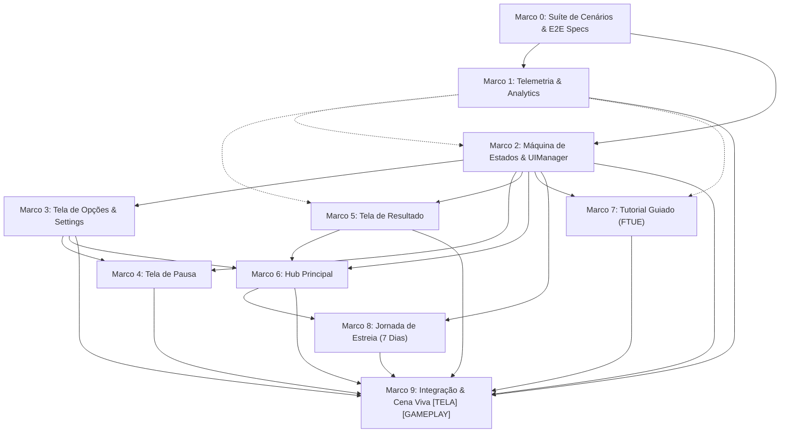

# Plano de Implementação: M19 · Fluxo de Telas e Estreia (Hub, Resultado, Opções, Tutorial)
> Data: 2026-10-22  
> Issue: NEX-654  
> Status: Pronto para Execução via /executar  

---

## 1. Contexto & Arquitetura

- **Resumo**: Implementar a suíte completa de fluxo de telas e retenção de estreia (M19) no Horde Runner: Hub com seleção de fases e navegação para Quartel/Loja/Passe, Tela de Resultado com multiplicação de moedas e hook de rewarded ad para dobrar a recompensa, Tela de Pausa com congelamento de simulação, Tela de Opções (volumes Master/SFX/BGM, toggle Auto/Manual do poder do General, seleção de idioma), Tutorial Guiado contextual nas 3 primeiras fases (FTUE: swipe, portão, jaula), Jornada de Estreia de 7 dias via `ProgressTrack`, e serviço de telemetria `IAnalyticsService`.
- **Stack**: Unity 6 (6000.6.3f1), C# (.NET Standard 2.1 / C# 9+), uGUI + TextMeshPro, VContainer, Harness CLI (`tools/unity`).
- **Verificação disponível**: Suíte automatizada confiável (compile com 0 erros, test-edit com 897+ testes EditMode, test-play em cena viva uGUI e validação visual de telas).

### 1.1 Dossiê de Investigação
- **Jornada Atual vs. Desejada**: Atualmente a cena entra diretamente na pista de corrida (`GameState.Run`) sem Hub intermediário, sem menu de pausa nem opções, sem tela de resultado pós-corrida e sem guia contextual nas primeiras fases. A nova jornada estabelece o fluxo canônico: `Boot -> Hub -> Run -> Result -> Hub`, com pausa interativa durante a corrida e jornada de estreia de 7 dias.
- **Fontes Inspecionadas**:
  - `Assets/_Game/Scripts/Core/State/GameStateMachine.cs:1-52` (máquina de estados central; necessita transições para `Hub`, `Paused`, `Result`).
  - `Assets/_Game/Scripts/Meta/Run/RewardCalculator.cs:1-60` (cálculo de moedas e parâmetro `doubleReward`).
  - `Assets/_Game/Scripts/Meta/Stages/StageMapService.cs:1-90` (gerenciamento de fases e estrelas).
  - `Assets/_Game/Scripts/Meta/Tracks/ProgressTrack.cs:1-96` (trilha pura com marcos e concessão idempotente).
  - `Assets/_Game/Scripts/Presentation/PlayerPrefsAbilitySettings.cs:1-43` (persistência do modo Auto/Manual).
  - `Assets/_Game/Scripts/Editor/SceneBuilder.cs:238-276` (geração de Canvas e uGUI).
  - `docs/planos/2026-09-29-horde-runner-gameplay-meta-liveops.md:238-335` (especificação de entrada/saída de fase, telemetria e live-ops).
  - `docs/agentes/rea-referencia.md` e referência TopKing `Framework/UI/*` (`UIManager`, `UIWindow`, `UILayer`).
- **Hipóteses e Decisões**:
  - Transições de `GameStateMachine` estendidas com validação estrita sem quebrar testes existentes.
  - Abstração `IAnalyticsService` em `Game.Core` com `MockAnalyticsService` para testes e rastreamento de `ftue_step`.
  - Arquitetura de apresentação uGUI com `UIManager` gerenciando janelas e camadas (`UILayer`), mantendo orçamento <= 300 linhas por PR.
- **Matriz Risco → Cenário → Verificação**:
  - *Risco*: `timeScale` permanecer 0 após desrespeitar ciclo de pausa. *Verificação*: `PauseView.OnDestroy()` e `QuitToHub()` garantem `timeScale = 1.0f`.
  - *Risco*: Concessão duplicada de moedas no resultado. *Verificação*: `grantId` idempotente via `RewardBundle.Grant(sink)` e trava de cliques no botão.
  - *Risco*: Tutorial FTUE reaparecer em repetição de fase. *Verificação*: Estado de conclusão persistido em `MetaState`.

---

## 2. Armadilhas do Repositório

| Armadilha | Onde morde (arquivo/passo) | Regra a respeitar |
|---|---|---|
| **Tempo Congelado após Pausa** | `PauseView.cs` — Passo 4 | Ao pausar o jogo (`Time.timeScale = 0`), qualquer saída que não seja o botão Resumir (ex.: Desistir para o Hub, troca de cena ou destruição do objeto) DEVE restaurar deterministicamente `Time.timeScale = 1.0f`. |
| **Pureza de Asmdefs (`Game.Core` e `Game.Meta`)** | `IAnalyticsService.cs`, `DebutJourneyDefinition.cs` — Passos 1 e 8 | Classes em `Game.Core` e `Game.Meta` NUNCA devem importar `UnityEngine` ou herdar de `MonoBehaviour`. Manter C# puro (`noEngineReferences: true`). |
| **Comunicação Direta Gameplay ↔ Meta Proibida** | `TutorialGuideController.cs`, `ResultView.cs` — Passos 5 e 7 | `Game.Gameplay` NUNCA referencia `Game.Meta`. Comunicação ocorre unicamente por `RunConfig` (entrada), sinais no `IEventBus` e `RunResult` (saída). |
| **Idempotência de Crédito de Moedas** | `ResultRewardPresenter.cs` — Passo 5 | O botão de continuar na tela de resultado deve gerar um `grantId` determinístico (`$"{runConfig.LevelId}_{runResult.SessionId}"`) e desabilitar o botão no primeiro clique, evitando duplicação de crédito na carteira em cliques múltiplos. |
| **Fiação uGUI pelo SceneBuilder** | `SceneBuilder.cs` — Passo 9 | O `SceneBuilder` vincula referências serializadas por `SerializedObject.FindProperty`. Nomes de campos de UI devem bater com exatidão com os declarados em MonoBehaviour, sob pena de ficarem nulos silenciosamente. |
| **Diffs Cirúrgicos (<= 300 linhas por PR)** | Todos os Marcos (0 a 9) | Cada Marco deve limitar suas modificações a até 300 linhas de diff de comportamento, isolando arquivos novos e modificações por responsabilidade única. |

---

## 3. Árvore de Arquivos

```
Assets/_Game/Scripts/
├── Core/
│   ├── Analytics/
│   │   ├── [NOVO] IAnalyticsService.cs
│   │   ├── [NOVO] MockAnalyticsService.cs
│   │   └── [NOVO] AnalyticsEvents.cs
│   └── State/
│       ├── [MODIFICADO] GameState.cs
│       └── [MODIFICADO] GameStateMachine.cs
├── Meta/
│   └── Debut/
│       ├── [NOVO] DebutJourneyDefinition.cs
│       └── [NOVO] DebutJourneyService.cs
├── Presentation/
│   ├── Settings/
│   │   ├── [NOVO] AudioSettings.cs
│   │   ├── [NOVO] IAudioSettings.cs
│   │   ├── [NOVO] LocalizationSettings.cs
│   │   └── [NOVO] ILocalizationSettings.cs
│   └── UI/
│       ├── [NOVO] UILayer.cs
│       ├── [NOVO] UIWindow.cs
│       ├── [NOVO] UIManager.cs
│       ├── [NOVO] OptionsView.cs
│       ├── [NOVO] PauseView.cs
│       ├── [NOVO] PauseController.cs
│       ├── [NOVO] ResultView.cs
│       ├── [NOVO] ResultRewardPresenter.cs
│       ├── [NOVO] HubView.cs
│       ├── [NOVO] StageSelectionWidget.cs
│       ├── [NOVO] TutorialGuideView.cs
│       └── [NOVO] DebutJourneyView.cs
├── Gameplay/
│   └── Tutorial/
│       ├── [NOVO] TutorialGuideController.cs
│       └── [NOVO] FtueStepProgress.cs
├── Composition/
│   ├── [MODIFICADO] GameLifetimeScope.cs
│   └── [MODIFICADO] GreyboxRunComposer.cs
├── Editor/
│   └── [MODIFICADO] SceneBuilder.cs
└── Tests/
    ├── EditMode/
    │   ├── Analytics/
    │   │   └── [NOVO] AnalyticsServiceTests.cs
    │   ├── UI/
    │   │   ├── [NOVO] UiNavigationCoreTests.cs
    │   │   ├── [NOVO] UIManagerTests.cs
    │   │   ├── [NOVO] OptionsViewTests.cs
    │   │   ├── [NOVO] PauseViewTests.cs
    │   │   ├── [NOVO] ResultViewTests.cs
    │   │   └── [NOVO] HubViewTests.cs
    │   ├── Tutorial/
    │   │   └── [NOVO] TutorialGuideControllerTests.cs
    │   └── Meta/
    │       └── [NOVO] DebutJourneyServiceTests.cs
    └── PlayMode/
        └── [NOVO] UiFlowPlayModeTests.cs
```

---

## 4. Contratos e Interfaces

```csharp
namespace Game.Core.Analytics
{
    public interface IAnalyticsService
    {
        void TrackEvent(string eventName, IReadOnlyDictionary<string, object> parameters = null);
        void TrackFtueStep(string stepName, int stageIndex, string status);
    }
}

namespace Game.Core
{
    public enum GameState
    {
        Boot,
        Hub,
        Run,
        Paused,
        Victory,
        Defeat,
        Result
    }
}

namespace Game.Presentation.Settings
{
    public interface IAudioSettings
    {
        float MasterVolume { get; set; }
        float SfxVolume { get; set; }
        float BgmVolume { get; set; }
        void Save();
    }

    public interface ILocalizationSettings
    {
        string CurrentLanguage { get; set; }
        IReadOnlyList<string> SupportedLanguages { get; }
        void Save();
    }
}

namespace Game.Presentation.UI
{
    public enum UILayerType
    {
        Hub,
        GameHud,
        Modal,
        TutorialOverlay
    }
}
```

---

## 4.5 Linear Overlay
- **História (issue-pai):** `NEX-654`
- **Sub-issues deste plano:** Marcos 0 a 9 listados no checklist abaixo.
- **PRs:** História aponta para `origin/main`. Tarefas ramificam da branch da História (`jamilzerati/nex-654-story-m19-fluxo-de-telas-e-estreia-hub-resultado-opcoes`) e abrem PRs para ela.

---

## 4.6 Grafo de Dependências

| De | Para | Tipo | Por quê |
|---|---|---|---|
| Marco 0 | Marco 1 | implementação | Marco 1 implementa o serviço de analytics coberto pelos contratos do Marco 0 |
| Marco 0 | Marco 2 | implementação | Marco 2 estende a máquina de estados e UI testadas nos contratos de navegação |
| Marco 1 | Marco 2 | interface | Marco 2 emite eventos de navegação para `IAnalyticsService` |
| Marco 2 | Marco 3 | implementação | Marco 3 registra a janela de opções (`OptionsView`) no `UIManager` |
| Marco 2 | Marco 4 | implementação | Marco 4 implementa a janela de pausa (`PauseView`) no `UIManager` |
| Marco 3 | Marco 4 | implementação | Marco 4 permite abrir a janela de opções a partir da pausa |
| Marco 1 | Marco 5 | interface | Marco 5 emite `ad_offer` e `run_end` para `IAnalyticsService` |
| Marco 2 | Marco 5 | implementação | Marco 5 registra a janela de resultado (`ResultView`) no `UIManager` |
| Marco 2 | Marco 6 | implementação | Marco 6 implementa a janela central (`HubView`) no `UIManager` |
| Marco 3 | Marco 6 | implementação | Marco 6 abre a tela de opções a partir do Hub |
| Marco 5 | Marco 6 | implementação | Marco 6 recebe o retorno da corrida e consome o saldo atualizado no resultado |
| Marco 1 | Marco 7 | interface | Marco 7 emite `ftue_step` via `IAnalyticsService` |
| Marco 2 | Marco 7 | implementação | Marco 7 renderiza a camada de tutorial sob a gestão de camadas do `UIManager` |
| Marco 2 | Marco 8 | implementação | Marco 8 abre a janela da jornada de estreia como modal no `UIManager` |
| Marco 6 | Marco 8 | implementação | Marco 6 hospeda o botão de acesso à Jornada de Estreia no Hub |
| Marco 1 | Marco 9 | implementação | Marco 9 injeta `IAnalyticsService` na cena montada pelo `SceneBuilder` |
| Marco 2 | Marco 9 | implementação | Marco 9 adiciona o `UIManager` e Canvas ao `SceneBuilder` e ao `GreyboxRunComposer` |
| Marco 3 | Marco 9 | implementação | Marco 9 instancia e conecta `OptionsView` na cena viva |
| Marco 4 | Marco 9 | implementação | Marco 9 instancia e conecta `PauseView` na cena viva |
| Marco 5 | Marco 9 | implementação | Marco 9 instancia e conecta `ResultView` na cena viva |
| Marco 6 | Marco 9 | implementação | Marco 9 instancia e conecta `HubView` e `StageSelectionWidget` na cena viva |
| Marco 7 | Marco 9 | implementação | Marco 7 conecta `TutorialGuideController` aos eventos da cena |
| Marco 8 | Marco 9 | implementação | Marco 8 instancia e conecta `DebutJourneyView` na cena viva |



---

## 5. Divisão de Execução por Passo

| Faixa | Passos | Por quê |
|---|---|---|
| **Risco de falha silenciosa** | Passo 1, Passo 2, Passo 3, Passo 5, Passo 8 | Mudanças em cálculos de moedas (`RewardCalculator`), persistência de preferências de áudio/idioma, estados de transição da máquina e cálculo de marcos da jornada de estreia podem falhar silenciosamente sem gerar exceções visíveis. |
| **Falha visível** | Passo 0, Passo 4, Passo 6, Passo 7, Passo 9 | Falhas de vinculação de UI uGUI, botões nulos, congelamento de tempo em pausa ou falta de componentes explodem erros imediatos ou impedem interação em tela. |

---

## 6. Checklist de Execução

- [x] **Passo 0 (Marco 0)**: `Suíte de Cenários & E2E Specs` [NEX-1128]
  - **Ação**: Criar cenários Red de testes EditMode para os Seams públicos de telemetria, máquina de estados, opções, pausa, resultado, hub, tutorial e estreia.
  - **Lógica de Negócios / Responsabilidade**: Definir contratos públicos e asserções adversárias, validando falha prévia (Red) antes da codificação dos módulos.
  - **Dependências / Pré-requisitos**: nenhuma (raiz).
  - **Seam Público**: `Game.Core.Analytics`, `Game.Core.State`, `Game.Presentation.Settings`, `Game.Presentation.UI`.
  - **AC**: AC-1, AC-2, AC-3, AC-4, AC-5, AC-6, AC-7 (CT-1 a CT-7).
  - **Marco de PR**: Marco 0
  - **Effort**: high

- [x] **Passo 1 (Marco 1)**: `Assets/_Game/Scripts/Core/Analytics/IAnalyticsService.cs` [NEX-1129]
  - **Ação**: Criar abstração `IAnalyticsService`, `MockAnalyticsService` e eventos de telemetria em `Game.Core`.
  - **Lógica de Negócios / Responsabilidade**: Suportar métodos de rastreamento `TrackEvent` e `TrackFtueStep`, permitindo captura em mock em testes EditMode e PlayMode.
  - **Dependências / Pré-requisitos**: `implementação`: Marco 0.
  - **Seam Público**: `IAnalyticsService.TrackFtueStep`, `IAnalyticsService.TrackEvent`.
  - **AC**: AC-7 (CT-7).
  - **Marco de PR**: Marco 1
  - **Effort**: medium

- [x] **Passo 2 (Marco 2)**: `Assets/_Game/Scripts/Presentation/UI/UIManager.cs` [NEX-1130]
  - **Ação**: Estender `GameState` com `Hub`, `Paused`, `Result` e implementar `GameStateMachine` com as novas transições. Criar `UIManager`, `UIWindow` e `UILayer`.
  - **Lógica de Negócios / Responsabilidade**: Gerenciar registro de telas uGUI, controle de visibilidade por camada (`UILayerType`: `Hub`, `GameHud`, `Modal`, `TutorialOverlay`), interceptação de input e transições integradas com o `IGameStateMachine`.
  - **Dependências / Pré-requisitos**: `implementação`: Marco 0. `interface`: Marco 1 (`IAnalyticsService`).
  - **Consome contrato:** `IAnalyticsService` (fake: `MockAnalyticsService`).
  - **Seam Público**: `IGameStateMachine.TryTransition`, `UIManager.OpenWindow`, `UIManager.CloseWindow`.
  - **AC**: AC-1, AC-3 (CT-1, CT-3).
  - **Marco de PR**: Marco 2
  - **Effort**: high

- [ ] **Passo 3 (Marco 3)**: `Assets/_Game/Scripts/Presentation/UI/OptionsView.cs` [NEX-1131]
  - **Ação**: Criar serviços `AudioSettings` e `LocalizationSettings` persistidos via `PlayerPrefs` e implementar `OptionsView` com sliders de volume, toggle de habilidade (Auto/Manual via `IAbilitySettings`) e dropdown de idioma.
  - **Lógica de Negócios / Responsabilidade**: Validação e restrição de volumes no intervalo [0, 1], reflexão imediata nas configurações e suporte à reabertura tanto no Hub quanto na Pausa.
  - **Dependências / Pré-requisitos**: `implementação`: Marco 0, Marco 2.
  - **Seam Público**: `IAudioSettings`, `ILocalizationSettings`, `OptionsView.ApplySettings`.
  - **AC**: AC-4 (CT-4).
  - **Marco de PR**: Marco 3
  - **Effort**: medium

- [ ] **Passo 4 (Marco 4)**: `Assets/_Game/Scripts/Presentation/UI/PauseView.cs` [NEX-1132]
  - **Ação**: Criar `PauseView` e `PauseController` para congelamento e desdobramento do tempo (`Time.timeScale = 0`).
  - **Lógica de Negócios / Responsabilidade**: Implementar botões Resumir (`timeScale = 1`), Reiniciar (recarrega a corrida), Opções (abre `OptionsView` na camada modal) e Desistir (retorna com segurança ao Hub restaurando `timeScale = 1.0f`).
  - **Dependências / Pré-requisitos**: `implementação`: Marco 0, Marco 2, Marco 3.
  - **Seam Público**: `PauseController.PauseGame`, `PauseController.ResumeGame`, `PauseController.QuitToHub`.
  - **AC**: AC-3 (CT-3).
  - **Marco de PR**: Marco 4
  - **Effort**: medium

- [x] **Passo 5 (Marco 5)**: `Assets/_Game/Scripts/Presentation/UI/ResultView.cs` [NEX-1133]
  - **Ação**: Criar `ResultView` e `ResultRewardPresenter` integrados ao `RewardCalculator` e `IWallet`.
  - **Lógica de Negócios / Responsabilidade**: Exibir título de Vitória/Derrota, moedas base e multiplicador da pista. Implementar botão de extensão de rewarded ad para dobrar as moedas (aplicando `doubleReward: true`), e botão Continuar com concessão idempotente via `RewardBundle.Grant(sink)` e retorno ao Hub.
  - **Dependências / Pré-requisitos**: `implementação`: Marco 0, Marco 2. `interface`: Marco 1 (`IAnalyticsService`).
  - **Consome contrato:** `IAnalyticsService` (fake: `MockAnalyticsService`).
  - **Seam Público**: `ResultRewardPresenter.PresentResult`, `ResultRewardPresenter.ClaimAndContinue`.
  - **AC**: AC-2 (CT-2).
  - **Marco de PR**: Marco 5
  - **Effort**: high

- [ ] **Passo 6 (Marco 6)**: `Assets/_Game/Scripts/Presentation/UI/HubView.cs` [NEX-1134]
  - **Ação**: Criar `HubView` e `StageSelectionWidget` integrados ao `StageMapService` e `IWallet`.
  - **Lógica de Negócios / Responsabilidade**: Exibir saldo de moedas, mapa com lista de fases (estrelas e desbloqueio), atalhos para Quartel, Loja e Passe com feedback de navegação, botão de opções, botão de jornada de estreia e botão Jogar (iniciando a corrida da fase selecionada via `GameState.Run`).
  - **Dependências / Pré-requisitos**: `implementação`: Marco 0, Marco 2, Marco 3, Marco 5.
  - **Seam Público**: `HubView.SelectStage`, `HubView.StartSelectedRun`.
  - **AC**: AC-1 (CT-1).
  - **Marco de PR**: Marco 6
  - **Effort**: high

- [ ] **Passo 7 (Marco 7)**: `Assets/_Game/Scripts/Gameplay/Tutorial/TutorialGuideController.cs` [NEX-1135]
  - **Ação**: Implementar `TutorialGuideController` e `TutorialGuideView` para condução contextual nas fases 1, 2 e 3.
  - **Lógica de Negócios / Responsabilidade**: Monitorar eventos de fase: Fase 1 (Swipe/movimento), Fase 2 (Portão de perk) e Fase 3 (Jaula de sobrevivente). Exibir banner de instrução na camada de tutorial, emitir eventos `ftue_step` via `IAnalyticsService` e salvar conclusão no `MetaState`.
  - **Dependências / Pré-requisitos**: `implementação`: Marco 0, Marco 2. `interface`: Marco 1 (`IAnalyticsService`).
  - **Consome contrato:** `IAnalyticsService` (fake: `MockAnalyticsService`).
  - **Seam Público**: `TutorialGuideController.CheckTutorialStep`, `TutorialGuideController.CompleteTutorialStep`.
  - **AC**: AC-5, AC-7 (CT-5, CT-7).
  - **Marco de PR**: Marco 7
  - **Effort**: high

- [ ] **Passo 8 (Marco 8)**: `Assets/_Game/Scripts/Presentation/UI/DebutJourneyView.cs` [NEX-1136]
  - **Ação**: Criar `DebutJourneyDefinition` (trilha de 7 marcos diários), `DebutJourneyService` e tela `DebutJourneyView`.
  - **Lógica de Negócios / Responsabilidade**: Exibir a progressão dos 7 dias, permitir resgate idempotente dos dias alcançados com crédito de moedas/medalhas na carteira via `IProgressTrack.ClaimMilestone`, e bloquear marcos futuros.
  - **Dependências / Pré-requisitos**: `implementação`: Marco 0, Marco 2, Marco 6.
  - **Seam Público**: `DebutJourneyService.GetDaysStatus`, `DebutJourneyService.ClaimDay`.
  - **AC**: AC-6 (CT-6).
  - **Marco de PR**: Marco 8
  - **Effort**: medium

- [ ] **Passo 9 (Marco 9)**: `Assets/_Game/Scripts/Editor/SceneBuilder.cs` `[TELA]` `[GAMEPLAY]` [NEX-1137]
  - **Ação**: Atualizar `SceneBuilder` para montar a hierarquia completa de UI uGUI (`UIManager`, `HubView`, `PauseView`, `ResultView`, `OptionsView`, `TutorialGuideView`, `DebutJourneyView`), registrar na injeção de dependência (`GameLifetimeScope` e `GreyboxRunComposer`), e criar teste PlayMode `UiFlowPlayModeTests` para validação em cena viva e captura de tela.
  - **Lógica de Negócios / Responsabilidade**: Ponto de montagem e integração final de todas as telas na cena, garantindo resolução de propriedades serializadas, funcionamento do loop em PlayMode e registro de evidência visual canônica.
  - **Dependências / Pré-requisitos**: `implementação`: Marco 0, Marco 1, Marco 2, Marco 3, Marco 4, Marco 5, Marco 6, Marco 7, Marco 8.
  - **Seam Público**: `SceneBuilder.BuildM1GreyboxScene`, `UiFlowPlayModeTests.RunFullUiFlow`.
  - **AC**: AC-1, AC-2, AC-3, AC-4, AC-5, AC-6, AC-7 (todos os CTs em PlayMode).
  - **Marco de PR**: Marco 9
  - **Effort**: high

---

## 7. Rascunho das Tarefas (Dossiês dos Marcos)

### Marco 0: Suíte de Cenários & E2E Specs
- **Objetivo**: Criar a suíte Red de testes EditMode para os Seams públicos de UI, telemetria, opções, pausa, resultado, hub, tutorial e estreia.
- **Fontes**: `GameStateMachineTests.cs`, `MetaGameplayIntegrationTests.cs`, `ProgressTrackTests.cs`.
- **Arquivos**: `Assets/_Game/Scripts/Tests/EditMode/UI/UiNavigationCoreTests.cs`, `Assets/_Game/Scripts/Tests/EditMode/UI/OptionsSettingsTests.cs`, `Assets/_Game/Scripts/Tests/EditMode/UI/FtueTutorialTests.cs`, `Assets/_Game/Scripts/Tests/EditMode/UI/DebutJourneyTests.cs`.
- **Seam Público**: Contratos de Seam público de todos os marcos subsequentes.
- **Riscos**: Testes com acoplamento prematuro à implementação visual uGUI. Mitigado testando o modelo e a lógica de apresentação através de interfaces e fakes.
- **Comandos & Oráculo**: `.\tools\unity.cmd test-edit` comprovando falha dos novos testes antes da implementação (Red).

### Marco 1: Telemetria & Analytics (`IAnalyticsService`, Mock e Eventos FTUE)
- **Objetivo**: Implementar abstração limpa de telemetria `IAnalyticsService` e `MockAnalyticsService` em `Game.Core`.
- **Fontes**: `docs/planos/2026-09-29-horde-runner-gameplay-meta-liveops.md:291-296`.
- **Arquivos**: `Assets/_Game/Scripts/Core/Analytics/IAnalyticsService.cs`, `MockAnalyticsService.cs`, `AnalyticsEvents.cs`, `AnalyticsServiceTests.cs`.
- **Seam Público**: `IAnalyticsService.TrackFtueStep(stepName, stageIndex, status)`.
- **Riscos**: Dependência de engine em `Game.Core`. Mitigado mantendo tipos C# puros (`string`, `IReadOnlyDictionary`).
- **Comandos & Oráculo**: `.\tools\unity.cmd test-edit` verde nos testes de `AnalyticsServiceTests`.

### Marco 2: Máquina de Estados e Controlador de Navegação de Telas (`UIManager`, `ScreenState`, `GameStateMachine`)
- **Objetivo**: Estender `GameState` com `Hub`, `Paused`, `Result` e implementar `UIManager`, `UIWindow` e `UILayer`.
- **Fontes**: `GameStateMachine.cs`, `docs/agentes/rea-referencia.md` (TopKing `Framework/UI/*`).
- **Arquivos**: `GameState.cs`, `GameStateMachine.cs`, `UIManager.cs`, `UIWindow.cs`, `UILayer.cs`, `UIManagerTests.cs`.
- **Seam Público**: `IGameStateMachine.TryTransition`, `UIManager.OpenWindow<T>()`.
- **Riscos**: Regressão nas transições legadas de `GameStateMachine`. Mitigado garantindo cobertura de regressão nos 897 testes existentes.
- **Comandos & Oráculo**: `.\tools\unity.cmd test-edit` verde com 100% de passagem.

### Marco 3: Tela de Opções (Áudio, Toggle Disparo Auto/Manual, Idioma) e Settings
- **Objetivo**: Implementar `AudioSettings`, `LocalizationSettings` e a tela uGUI `OptionsView`.
- **Fontes**: `IAbilitySettings.cs`, `PlayerPrefsAbilitySettings.cs`.
- **Arquivos**: `AudioSettings.cs`, `LocalizationSettings.cs`, `OptionsView.cs`, `OptionsViewTests.cs`.
- **Seam Público**: `IAudioSettings`, `ILocalizationSettings`, `OptionsView.ApplySettings`.
- **Riscos**: Valores de volume corrompidos ou fora de escala. Mitigado com clamping estrito `[0f, 1f]`.
- **Comandos & Oráculo**: `.\tools\unity.cmd test-edit` verde em `OptionsViewTests`.

### Marco 4: Tela de Pausa (`PauseView`, Resumir, Reiniciar, Opções, Desistir)
- **Objetivo**: Implementar `PauseView` com controle de simulação e opções de Resumir, Reiniciar, Configurações e Desistir.
- **Fontes**: `docs/agentes/unity-runtime.md`, `Time.timeScale`.
- **Arquivos**: `PauseView.cs`, `PauseController.cs`, `PauseViewTests.cs`.
- **Seam Público**: `PauseController.PauseGame`, `PauseController.ResumeGame`, `PauseController.QuitToHub`.
- **Riscos**: Vazamento de `timeScale = 0` para fora da partida. Mitigado com garantia incondicional de restauração de `timeScale = 1.0f` em `QuitToHub` e `OnDestroy`.
- **Comandos & Oráculo**: `.\tools\unity.cmd test-edit` verde em `PauseViewTests`.

### Marco 5: Tela de Resultado (`ResultView`, Moedas, Multiplicador, Dobrar Rewarded Hook)
- **Objetivo**: Implementar `ResultView` conectada ao `RewardCalculator` e à carteira `IWallet`.
- **Fontes**: `RewardCalculator.cs`, `MetaGameplayIntegrationTests.cs`.
- **Arquivos**: `ResultView.cs`, `ResultRewardPresenter.cs`, `ResultViewTests.cs`.
- **Seam Público**: `ResultRewardPresenter.PresentResult(RunResult, RunConfig)`, `ResultRewardPresenter.DoubleReward()`.
- **Riscos**: Duplicação de crédito de moedas por reentrada. Mitigado com concessão idempotente via `grantId` único em `RewardBundle.Grant(sink)`.
- **Comandos & Oráculo**: `.\tools\unity.cmd test-edit` verde em `ResultViewTests`.

### Marco 6: Hub Principal (`HubView`, Mapa de Fases, Navegação Quartel/Loja/Passe, Carteira)
- **Objetivo**: Implementar `HubView` com seleção de fases, saldo do jogador e atalhos de navegação.
- **Fontes**: `StageMapService.cs`, `Wallet.cs`.
- **Arquivos**: `HubView.cs`, `StageSelectionWidget.cs`, `HubViewTests.cs`.
- **Seam Público**: `HubView.SelectStage(stageId)`, `HubView.StartSelectedRun()`.
- **Riscos**: Tentativa de iniciar fase bloqueada. Mitigado com validação no `IStageMapService.IsStageUnlocked(stageId)`.
- **Comandos & Oráculo**: `.\tools\unity.cmd test-edit` verde em `HubViewTests`.

### Marco 7: Tutorial Guiado das 3 Primeiras Fases (`TutorialGuideController`, FTUE Steps)
- **Objetivo**: Implementar orientações contextuais de FTUE nas fases 1 (Swipe), 2 (Portão) e 3 (Jaula).
- **Fontes**: `SwipeDetector.cs`, `GateView.cs`, `CageView.cs`, `docs/planos/2026-09-29-horde-runner-gameplay-meta-liveops.md:291-296`.
- **Arquivos**: `TutorialGuideController.cs`, `TutorialGuideView.cs`, `FtueStepProgress.cs`, `TutorialGuideControllerTests.cs`.
- **Seam Público**: `TutorialGuideController.CheckTutorialStep`, `TutorialGuideController.CompleteTutorialStep`.
- **Riscos**: Tutorial ativo repetidamente para jogador veterano. Mitigado persistindo status de conclusão no save.
- **Comandos & Oráculo**: `.\tools\unity.cmd test-edit` verde em `TutorialGuideControllerTests`.

### Marco 8: Jornada de Estreia de 7 Dias (`DebutJourneyService`, `DebutJourneyView`, ProgressTrack)
- **Objetivo**: Implementar a trilha fixa de 7 dias com recompensas diárias para retenção de estreia.
- **Fontes**: `ProgressTrack.cs`, `MilestoneDefinition.cs`.
- **Arquivos**: `DebutJourneyDefinition.cs`, `DebutJourneyService.cs`, `DebutJourneyView.cs`, `DebutJourneyServiceTests.cs`.
- **Seam Público**: `DebutJourneyService.GetDaysStatus()`, `DebutJourneyService.ClaimDay(int dayIndex)`.
- **Riscos**: Resgate adiantado de dias não alcançados. Mitigado com verificação estrita de dias decorridos / desbloqueio diário.
- **Comandos & Oráculo**: `.\tools\unity.cmd test-edit` verde em `DebutJourneyServiceTests`.

### Marco 9: Integração de Cena e Validação em Cena Viva `[TELA]` `[GAMEPLAY]` (`SceneBuilder`, `Bootstrap`, PlayMode)
- **Objetivo**: Montar hierarquia completa de UI uGUI no `SceneBuilder`, integrar com `GameLifetimeScope` e `GreyboxRunComposer`, e executar testes PlayMode com validação visual.
- **Fontes**: `SceneBuilder.cs`, `GreyboxRunComposer.cs`, `GameLifetimeScope.cs`.
- **Arquivos**: `SceneBuilder.cs`, `GreyboxRunComposer.cs`, `GameLifetimeScope.cs`, `UiFlowPlayModeTests.cs`.
- **Seam Público**: `SceneBuilder.BuildM1GreyboxScene()`, `UiFlowPlayModeTests`.
- **Riscos**: Falha de serialização em propriedades uGUI ou descompasso de resolução. Mitigado com asserções em PlayMode e checagem de referências do `SerializedObject`.
- **Comandos & Oráculo**: `.\tools\unity.cmd compile`, `.\tools\unity.cmd test-edit`, `.\tools\unity.cmd test-play` e gravação de evidência visual.
