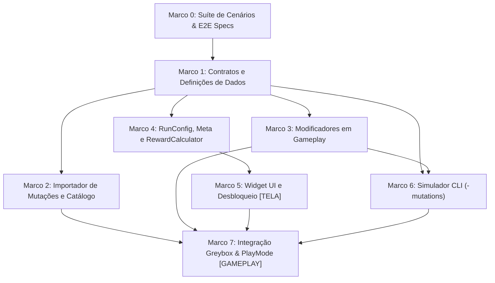

# Plano de Implementação: M20 · Mutações (Modificadores de Fase)
> Data: 2026-10-28  
> Issue: NEX-655  
> Status: Cenários validados — Suíte Red comprovada em 2026-10-29  

---

## 1. Contexto & Arquitetura

- **Resumo**: Implementar o sistema completo de Mutações (modificadores de fase) no Horde Runner (M20). O sistema oferece rejogabilidade e risco/recompensa deliberados para o jogador, permitindo selecionar até 3 mutações ativas antes de iniciar a corrida (desbloqueadas após derrotar o primeiro Boss, `level_05_boss`). A arquitetura baseia-se fortemente na engenharia reversa de referência do Top Lords / Last War v1.0.39, desacoplando o layout espacial de pistas e ondas (`LevelDefinition`) dos coeficientes de regras e dificuldade via modificadores polimórficos (`IStageModifier`) com origem rastreável (`Source = "mutacao:<id>"`). As recompensas extras acumulam no `RewardCalculator` e a mecânica suporta auditoria determinística headless via `tools/unity simulate -mutations <id1,id2>`.
- **Stack**: Unity 6 (6000.6.3f1), C# 9+ (.NET Standard 2.1), ScriptableObjects com `[SerializeReference]`, uGUI + TextMeshPro, VContainer, Harness CLI (`tools/unity`).
- **Verificação disponível**: Suíte automatizada confiável (compile com 0 erros, test-edit com 992+ testes EditMode passando, test-play em cena viva e simulação headless via CLI).

### 1.1 Dossiê de Investigação
- **Jornada Atual vs. Desejada**:
  - *Atual*: `RunConfig` aceita uma lista de strings `MutationIds`, e `RewardCalculator` possui suporte a um dicionário de `mutationBonuses`, porém não existem definições de dados de mutações, importador, modificadores de estágio correspondentes, lógica de desbloqueio após Boss, nem widget na interface do Hub ou suporte a flag `-mutations` no CLI.
  - *Desejada*:
    1. Catálogo de mutações carregado via ScriptableObjects gerados a partir de `Content/Source/Mutations/mutations.json`.
    2. Modificadores de combate aplicados limpos no `StageModifierController` com `SourceId = "mutacao:<id>"`.
    3. UI no Hub com bloqueio contextual até a derrota do Boss 1 (`level_05_boss`) e seleção limitada a 3 mutações.
    4. Portões aritméticos de multiplicação/divisão convertidos em adição/subtração na presença da mutação *Sem Multiplicação*.
    5. Inimigos spawnados com HP x1.5 em *Blindados*, velocidade x1.3 em *Frenesi*, alcance x0.6 em *Neblina*, e tropa inicial forçada a 1 em *Último Soldado*.
    6. Bônus de recompensa calculado e creditado na carteira.
    7. `SimulateCommand` auditando a taxa de vitória com `-mutations <id1,id2>`.
- **Fontes Inspecionadas**:
  - `Assets/_Game/Scripts/Core/State/RunConfig.cs:1-31`: Contrato de configuração de corrida contendo `MutationIds`.
  - `Assets/_Game/Scripts/Core/Gates/IStageModifier.cs:1-10`: Interface base de modificadores de estágio.
  - `Assets/_Game/Scripts/Core/Gates/StageModifierController.cs:1-102`: Gerenciador de modificadores e recálculo de multiplicadores.
  - `Assets/_Game/Scripts/Core/Perks/Effects/MultiplySoldiersEffect.cs:1-26` e `DivideSoldiersEffect.cs:1-31`: Efeitos aritméticos de portões.
  - `Assets/_Game/Scripts/Gameplay/GatePair.cs:100-155`: Disparo de portão e aplicação de efeitos na tropa.
  - `Assets/_Game/Scripts/Gameplay/Combat/CombatDirector.cs:85-117`: Multiplicador de alcance de tiro (`EffectiveSquadRangeMultiplier`).
  - `Assets/_Game/Scripts/Gameplay/Enemies/HordeSpawner.cs:120-152`: Spawning e parametrização de HP e velocidade dos zumbis.
  - `Assets/_Game/Scripts/Meta/Progression/ProgressionService.cs:85-90`: Validação de Boss derrotado (`IsBossDefeated`).
  - `Assets/_Game/Scripts/Meta/Run/RewardCalculator.cs:18-53`: Cálculo de moedas com soma de bônus de mutações.
  - `Assets/_Game/Scripts/Presentation/UI/HubView.cs:120-135`: Início de corrida e emissão de `RunStartedEvent`.
  - `Assets/_Game/Scripts/Editor/Tools/SimulateCommand.cs:976-1010`: Parsing de argumentos CLI do simulador headless.
  - `docs/planos/2026-09-29-horde-runner-gameplay-meta-liveops.md:153-160`: Especificação GDD da M20.
  - `table_3933.zip` / Top Lords v1.0.39: Referência REA de desacoplamento entre layout espacial e modificadores (`stage_numeric_template.lua`).
- **Hipóteses e Decisões**:
  - *Hipótese 1*: Modificadores de mutação devem durar a fase inteira sem expirar por distância. *Decisão*: Ativados com distância infinita (`float.MaxValue`) ou através de método persistente no `StageModifierController`, com tag `mutacao:<id>`.
  - *Hipótese 2*: Mutação *Último Soldado* deve sobrepor bônus de fase e upgrades do quartel. *Decisão*: Configura `RunConfig.InitialSquad = 1` no `RunConfigBuilder` e valida no `LevelDirector.Initialize` via `CurrentInitialSquadOverride = 1`.
  - *Hipótese 3*: Portões convertidos em *Sem Multiplicação* mantêm a magnitude do efeito original. *Decisão*: `x2` torna-se `+2`, `x3` torna-se `+3`, `÷2` torna-se `-2`.
  - *Hipótese 4*: O desbloqueio deve respeitar estritamente a derrota do primeiro Boss (`level_05_boss`). *Decisão*: `ProgressionService.IsBossDefeated("level_05_boss")` é consultado pelo widget de seleção.
- **Matriz Risco → Cenário → Verificação**:
  - *Risco 1*: Modificadores de mutação afetarem corridas subsequentes sem mutações. *Verificação*: `StageModifierController.Clear()` e novo `Initialize` garantem reset completo.
  - *Risco 2*: Portão `÷N` com *Sem Multiplicação* zerar a tropa. *Verificação*: `ApplySquadDelta` respeita a trava de piso de 1 soldado mínimo.
  - *Risco 3*: Mais de 3 mutações serem ativadas via script/UI. *Verificação*: `MutationSelectionWidget` e `RunConfigBuilder` travam em 3 o tamanho de `MutationIds`.

---

## 2. Armadilhas do Repositório

| Armadilha | Onde morde (arquivo/passo) | Regra a respeitar |
|---|---|---|
| **Pureza de Asmdefs (`Game.Core` e `Game.Meta`)** | `IStageModifier.cs`, `EnemyStatStageModifier.cs` — Passos 1 e 4 | Tipos em `Game.Core` NUNCA devem referenciar `UnityEngine` ou herdar de `MonoBehaviour`. Manter C# puro com `noEngineReferences: true`. |
| **Comunicação Gameplay ↔ Meta Proibida** | `LevelDirector.cs`, `HubView.cs` — Passos 3 e 5 | `Game.Gameplay` NUNCA referencia diretamente `Game.Meta`. Comunicação ocorre estritamente via `RunConfig` (entrada), `RunResult` (saída) e eventos no `IEventBus`. |
| **Identificadores de Origem em Modificadores** | `StageModifierController.cs` — Passo 3 | Todos os modificadores de mutação devem declarar `SourceId = $"mutacao:{id}"` para permitir remoção limpa e evitar conflito com clima (`clima:*`) ou portões amaldiçoados (`cursed:*`). |
| **Desserialização Polimórfica com `[SerializeReference]`** | `MutationDefinition.cs`, `MutationImporter.cs` — Passos 1 e 2 | Classes concretas de modificadores devem ser decoradas com `[Serializable]` público e possuir construtor padrão sem parâmetros para serialização pelo Unity. |
| **Fiação uGUI pelo SceneBuilder** | `SceneBuilder.cs` — Passo 7 | Campos serializados vinculados via `SerializedObject.FindProperty` devem ter nomes exatamente idênticos aos membros privados serializados no MonoBehaviour do widget. |
| **Diffs Cirúrgicos (<= 300 linhas por PR)** | Todos os Marcos (0 a 7) | Cada Marco deve limitar o diff de código a até 300 linhas de alteração de comportamento, isolando arquivos novos e modificações por responsabilidade coesa. |

---

## 3. Árvore de Arquivos

```
Assets/_Game/
├── Data/
│   └── Mutations/
│       ├── [NOVO] MutationCatalog.asset
│       ├── [NOVO] armored.asset
│       ├── [NOVO] frenzy.asset
│       ├── [NOVO] fog.asset
│       ├── [NOVO] last_soldier.asset
│       └── [NOVO] no_multiplication.asset
└── Scripts/
    ├── Core/
    │   ├── Gates/
    │   │   ├── [MODIFICADO] IStageModifier.cs
    │   │   ├── [MODIFICADO] StageModifierController.cs
    │   │   └── [MODIFICADO] StageModifierSpec.cs
    │   ├── Modifiers/
    │   │   ├── [NOVO] EnemyStatStageModifier.cs
    │   │   ├── [NOVO] SquadStatStageModifier.cs
    │   │   ├── [NOVO] InitialSquadOverrideStageModifier.cs
    │   │   └── [NOVO] GateOperationRemapStageModifier.cs
    │   └── Weather/
    │       └── [MODIFICADO] WeatherStageModifier.cs
    ├── Data/
    │   └── Mutations/
    │       ├── [NOVO] MutationDefinition.cs
    │       ├── [NOVO] MutationCatalog.cs
    │       └── [NOVO] IMutationCatalog.cs
    ├── Gameplay/
    │   ├── Combat/
    │   │   └── [MODIFICADO] CombatDirector.cs
    │   ├── Enemies/
    │   │   └── [MODIFICADO] HordeSpawner.cs
    │   ├── LevelDirector.cs [MODIFICADO]
    │   └── GatePair.cs [MODIFICADO]
    ├── Meta/
    │   ├── Progression/
    │   │   ├── [MODIFICADO] IProgressionService.cs
    │   │   └── [MODIFICADO] ProgressionService.cs
    │   └── Run/
    │       ├── [MODIFICADO] RunConfigBuilder.cs
    │       └── [MODIFICADO] RewardCalculator.cs
    ├── Presentation/
    │   └── UI/
    │       ├── [NOVO] MutationSelectionWidget.cs
    │       ├── [NOVO] MutationToggleItem.cs
    │       └── [MODIFICADO] HubView.cs
    ├── Composition/
    │   └── [MODIFICADO] GreyboxRunComposer.cs
    ├── Editor/
    │   ├── [NOVO] MutationImporter.cs
    │   ├── [MODIFICADO] Cli.cs
    │   ├── [MODIFICADO] SceneBuilder.cs
    │   └── Tools/
    │       └── [MODIFICADO] SimulateCommand.cs
    └── Tests/
        ├── EditMode/
        │   └── Mutations/
        │       ├── [NOVO] MutationCoreContractsTests.cs
        │       ├── [NOVO] MutationImporterTests.cs
        │       ├── [NOVO] MutationGameplayModifiersTests.cs
        │       ├── [NOVO] MutationMetaRewardTests.cs
        │       ├── [NOVO] MutationSelectionWidgetTests.cs
        │       ├── [NOVO] MutationSimulateCommandTests.cs
        │       └── [NOVO] MutationAdversarialScenariosTests.cs
        └── PlayMode/
            └── [NOVO] MutationFlowPlayModeTests.cs
Content/
└── Source/
    └── Mutations/
        └── [NOVO] mutations.json
```

---

## 4. Contratos e Interfaces C#

```csharp
// ==========================================
// 1. Core: Modificadores de Estágio (C# Puro)
// ==========================================
namespace Game.Core.Gates
{
    public interface IStageModifier
    {
        string SourceId { get; }
        float EnemySpeedMultiplier { get; }
        float EnemyContactDamageMultiplier { get; }
        float SquadRangeMultiplier { get; }
        float EnemyHealthMultiplier { get; }
        int? InitialSquadOverride { get; }
        bool RemapGateMultiplication { get; }
        bool RemapGateDivision { get; }
    }
}

namespace Game.Core.Modifiers
{
    public enum StatTarget
    {
        MaxHealth,
        MoveSpeed,
        Range,
        ContactDamage
    }

    [System.Serializable]
    public class EnemyStatStageModifier : IStageModifier
    {
        public string sourceId;
        public StatTarget statTarget;
        public float multiplier;

        public string SourceId => sourceId;
        public float EnemySpeedMultiplier => statTarget == StatTarget.MoveSpeed ? multiplier : 1f;
        public float EnemyContactDamageMultiplier => statTarget == StatTarget.ContactDamage ? multiplier : 1f;
        public float SquadRangeMultiplier => 1f;
        public float EnemyHealthMultiplier => statTarget == StatTarget.MaxHealth ? multiplier : 1f;
        public int? InitialSquadOverride => null;
        public bool RemapGateMultiplication => false;
        public bool RemapGateDivision => false;
    }

    [System.Serializable]
    public class SquadStatStageModifier : IStageModifier
    {
        public string sourceId;
        public StatTarget statTarget;
        public float multiplier;

        public string SourceId => sourceId;
        public float EnemySpeedMultiplier => 1f;
        public float EnemyContactDamageMultiplier => 1f;
        public float SquadRangeMultiplier => statTarget == StatTarget.Range ? multiplier : 1f;
        public float EnemyHealthMultiplier => 1f;
        public int? InitialSquadOverride => null;
        public bool RemapGateMultiplication => false;
        public bool RemapGateDivision => false;
    }

    [System.Serializable]
    public class InitialSquadOverrideStageModifier : IStageModifier
    {
        public string sourceId;
        public int squadCount;

        public string SourceId => sourceId;
        public float EnemySpeedMultiplier => 1f;
        public float EnemyContactDamageMultiplier => 1f;
        public float SquadRangeMultiplier => 1f;
        public float EnemyHealthMultiplier => 1f;
        public int? InitialSquadOverride => squadCount;
        public bool RemapGateMultiplication => false;
        public bool RemapGateDivision => false;
    }

    [System.Serializable]
    public class GateOperationRemapStageModifier : IStageModifier
    {
        public string sourceId;
        public bool remapMultiplyToAdd;
        public bool remapDivideToSubtract;

        public string SourceId => sourceId;
        public float EnemySpeedMultiplier => 1f;
        public float EnemyContactDamageMultiplier => 1f;
        public float SquadRangeMultiplier => 1f;
        public float EnemyHealthMultiplier => 1f;
        public int? InitialSquadOverride => null;
        public bool RemapGateMultiplication => remapMultiplyToAdd;
        public bool RemapGateDivision => remapDivideToSubtract;
    }
}

// ==========================================
// 2. Data: Definição de Mutações & Catálogo
// ==========================================
namespace Game.Data.Mutations
{
    public interface IMutationCatalog
    {
        IReadOnlyList<MutationDefinition> Entries { get; }
        bool TryGet(string id, out MutationDefinition definition);
        IReadOnlyDictionary<string, float> GetRewardBonuses();
    }
}

// ==========================================
// 3. Meta: Serviço de Progressão
// ==========================================
namespace Game.Meta.Progression
{
    public partial interface IProgressionService
    {
        bool AreMutationsUnlocked { get; }
    }
}
```

---

## 4.5 Linear Overlay

- **História (issue-pai)**: `NEX-655`
- **Sub-issues deste plano**:
  - `Marco 0`: Suíte de Cenários & E2E Specs (`NEX-1233`)
  - `Marco 1`: Contratos de Modificadores e Definições de Dados (`NEX-1234`)
  - `Marco 2`: Importador de Mutações e Asset Catalog (`NEX-1235`)
  - `Marco 3`: Implementação dos Modificadores em Gameplay (`NEX-1236`)
  - `Marco 4`: Integração com RunConfig, Meta e RewardCalculator (`NEX-1237`)
  - `Marco 5`: Widget de Seleção Pré-Fase e Desbloqueio na UI [TELA] (`NEX-1238`)
  - `Marco 6`: Extensão do Simulador CLI Headless (-mutations) (`NEX-1239`)
  - `Marco 7`: Integração Geral, Cena Greybox e Validação PlayMode [GAMEPLAY] (`NEX-1240`)
- **PRs (modelo C)**: História = `jamilzerati/nex-655-story-m20-mutacoes-modificadores-de-fase`; draft PR → `main`. Cada tarefa ramifica da branch da história e abre PR para ela.

---

## 4.6 Grafo de Dependências

| De | Para | Tipo | Por quê |
|---|---|---|---|
| Marco 0 | Marco 1 | implementação | Marco 0 estabelece os contratos Red e a suíte que Marco 1 irá satisfazer. |
| Marco 1 | Marco 2 | implementação | Marco 2 importa dados instanciando os tipos `MutationDefinition` e modificadores de Marco 1. |
| Marco 1 | Marco 3 | implementação | Marco 3 aplica os contratos de `IStageModifier` na lógica de combate e portões de Gameplay. |
| Marco 1 | Marco 4 | implementação | Marco 4 integra os IDs e bônus das mutações no `RunConfigBuilder` e `RewardCalculator`. |
| Marco 4 | Marco 5 | implementação | Marco 5 consome o catálogo, regras de desbloqueio do `ProgressionService` e builder de `RunConfig`. |
| Marco 1 | Marco 6 | implementação | Marco 6 consome os contratos e `StageModifierController` no `SimulateCommand`. |
| Marco 3 | Marco 6 | implementação | Marco 6 simula a conversão de portões e atributos de inimigos alterados por Marco 3. |
| Marco 2 | Marco 7 | implementação | Marco 7 necessita dos assets de dados importados em cena. |
| Marco 3 | Marco 7 | implementação | Marco 7 exercita os modificadores de gameplay na cena viva. |
| Marco 5 | Marco 7 | implementação | Marco 7 conecta a apresentação uGUI do widget de seleção no `SceneBuilder`. |
| Marco 6 | Marco 7 | implementação | Marco 7 executa o harness e PlayMode sobre toda a composição final. |



---

## 5. Divisão de Execução por Passo

| Faixa | Passos | Por quê |
|---|---|---|
| **Risco de falha silenciosa** | Marco 1, Marco 2, Marco 3, Marco 4, Marco 6 | Multiplicadores numéricos (1.5x, 1.3x, 0.6x), bônus de moedas somados (+0.5, +0.25, +1.0), conversão aritmética de portões (soma/subtração) e flags de simulação CLI não geram erros de compilação ou exceções visíveis se calculados com fórmula ou sinal invertido. |
| **Falha visível** | Marco 0, Marco 5, Marco 7 | Falha de compilação de testes, quebra de hierarquia uGUI no widget de seleção ou erro na fiação de GameObjects e referências no `SceneBuilder` acusam erro imediato no console. |

---

## 6. Checklist de Execução

- [x] **Passo 0 (Marco 0)**: `Suíte de Cenários & E2E Specs` [NEX-1233]
  - **Ação**: Criar a suíte Red de testes comportamentais e cenários adversários em `Assets/_Game/Scripts/Tests/EditMode/Mutations/`.
  - **Lógica de Negócios / Responsabilidade**: Definir os testes unitários cobrindo as 5 mutações canônicas, recálculo de multiplicadores, remap de portões, validação de trava de Boss, teto de 3 mutações e bônus no `RewardCalculator`.
  - **Dependências / Pré-requisitos**: nenhuma (raiz).
  - **Seam Público**: `Game.Core.Gates.IStageModifier`, `Game.Core.Gates.StageModifierController`, `Game.Meta.Run.RewardCalculator`.
  - **AC**: AC-1, AC-2, AC-3, AC-4, AC-5, AC-6 (CT-1 a CT-12)
  - **Marco de PR**: Marco 0
  - **Effort**: high

- [x] **Passo 1 (Marco 1)**: `Contratos de Modificadores e Definições de Dados` [NEX-1234]
  - **Ação**: Estender `IStageModifier` em `Game.Core.Gates` e criar modificadores polimórficos em `Game.Core.Modifiers`, além de `MutationDefinition` e `MutationCatalog` em `Game.Data.Mutations`.
  - **Lógica de Negócios / Responsabilidade**: Definir C# puro para `EnemyStatStageModifier`, `SquadStatStageModifier`, `InitialSquadOverrideStageModifier` e `GateOperationRemapStageModifier`, mantendo compatibilidade com `StageModifierSpec` e `WeatherStageModifier`.
  - **Dependências / Pré-requisitos**: `implementação`: Marco 0.
  - **Seam Público**: `IStageModifier`, `MutationDefinition`, `IMutationCatalog`.
  - **AC**: AC-1, AC-2 (CT-1, CT-2)
  - **Marco de PR**: Marco 1
  - **Effort**: medium

- [ ] **Passo 2 (Marco 2)**: `Importador de Mutações e Catálogo de Dados` [NEX-1235]
  - **Ação**: Criar `Content/Source/Mutations/mutations.json` com os 5 registros canônicos e implementar `MutationImporter.cs` no `Game.Editor`, conectando no `Cli.ImportContent()`.
  - **Lógica de Negócios / Responsabilidade**: Ler o JSON fonte, instanciar e serializar os assets ScriptableObject e gerar `MutationCatalog.asset` de forma determinística e idempotente.
  - **Dependências / Pré-requisitos**: `implementação`: Marco 1.
  - **Seam Público**: `Game.Editor.MutationImporter.ImportAll()`.
  - **AC**: AC-1 (CT-1)
  - **Marco de PR**: Marco 2
  - **Effort**: medium

- [ ] **Passo 3 (Marco 3)**: `Implementação dos Modificadores em Gameplay` [NEX-1236]
  - **Ação**: Integrar modificadores no `StageModifierController`, `HordeSpawner`, `LevelDirector` e `GatePair`.
  - **Lógica de Negócios / Responsabilidade**: Atualizar `StageModifierController` com `CurrentEnemyHealthMultiplier`, `CurrentInitialSquadOverride`, `RemapGateMultiplication` e `RemapGateDivision`. Aplicar scaling de HP em `HordeSpawner` e chefes, alcance em `CombatDirector`, tropa inicial em `LevelDirector` e conversão de portões em `GatePair`.
  - **Dependências / Pré-requisitos**: `implementação`: Marco 1.
  - **Seam Público**: `StageModifierController`, `GatePair.TryTrigger`, `LevelDirector.Initialize`.
  - **AC**: AC-2, AC-3 (CT-2, CT-3, CT-4, CT-5, CT-6, CT-7, CT-11)
  - **Marco de PR**: Marco 3
  - **Effort**: high

- [ ] **Passo 4 (Marco 4)**: `Integração com RunConfig, Meta e RewardCalculator` [NEX-1237]
  - **Ação**: Integrar mutações em `RunConfigBuilder`, estender `ProgressionService` e atualizar `RewardCalculator`.
  - **Lógica de Negócios / Responsabilidade**: Adicionar checagem de desbloqueio `AreMutationsUnlocked` via `IsBossDefeated("level_05_boss")`, aplicar override de `last_soldier` na geração de `RunConfig`, e validar cálculo acumulativo de moedas no `RewardCalculator`.
  - **Dependências / Pré-requisitos**: `implementação`: Marco 1.
  - **Seam Público**: `IRunConfigBuilder.Build`, `IProgressionService.AreMutationsUnlocked`, `IRewardCalculator.Calculate`.
  - **AC**: AC-4, AC-5 (CT-8, CT-10)
  - **Marco de PR**: Marco 4
  - **Effort**: medium

- [ ] **Passo 5 (Marco 5)**: `Widget de Seleção Pré-Fase e Desbloqueio na UI [TELA]` [NEX-1238]
  - **Ação**: Implementar `MutationSelectionWidget.cs` e `MutationToggleItem.cs`, integrando no `HubView`.
  - **Lógica de Negócios / Responsabilidade**: Exibir estado bloqueado se Boss 1 não foi derrotado; permitir seleção de 0 a 3 mutações ativas; exibir bônus total somado; e passar mutações selecionadas para `HubView.StartSelectedRun()`.
  - **Dependências / Pré-requisitos**: `implementação`: Marco 4.
  - **Seam Público**: `MutationSelectionWidget`, `HubView.SelectedMutations`.
  - **AC**: AC-4 (CT-8, CT-9)
  - **Marco de PR**: Marco 5
  - **Effort**: high

- [ ] **Passo 6 (Marco 6)**: `Extensão do Simulador CLI Headless (-mutations)` [NEX-1239]
  - **Ação**: Adicionar flag `-mutations <id1,id2>` no `SimulateCommand.cs`.
  - **Lógica de Negócios / Responsabilidade**: Interpretar as mutações passadas via CLI ou menu de contexto, injetar no `StageModifierController` do loop de simulação dos bots Guloso e Fujao, e registrar no relatório JSON.
  - **Dependências / Pré-requisitos**: `implementação`: Marco 1, Marco 3.
  - **Seam Público**: `Game.Editor.Tools.SimulateCommand.ExecuteFromCommandLine()`.
  - **AC**: AC-6 (CT-12)
  - **Marco de PR**: Marco 6
  - **Effort**: medium

- [ ] **Passo 7 (Marco 7)**: `Integração Geral, Cena Greybox e Validação PlayMode [GAMEPLAY]` [NEX-1240]
  - **Ação**: Atualizar `GreyboxRunComposer` e `SceneBuilder` para registrar `MutationCatalog` e fiação uGUI; executar validação em PlayMode com evidências visuais.
  - **Lógica de Negócios / Responsabilidade**: Conectar toda a esteira de Mutações de ponta a ponta na cena viva de teste, validar PlayMode, executar `tools/unity simulate -mutations armored,frenzy` e registrar capturas.
  - **Dependências / Pré-requisitos**: `implementação`: Marco 2, Marco 3, Marco 5, Marco 6.
  - **Seam Público**: `GreyboxRunComposer.Compose`, `SceneBuilder.BuildM6Scene`.
  - **AC**: AC-1 a AC-6 (CT-1 a CT-12)
  - **Marco de PR**: Marco 7
  - **Effort**: high

---

## 7. Rascunho das Tarefas

### Marco 0: Suíte de Cenários & E2E Specs (`NEX-1233`)
- **Dossiê**:
  - *Fontes*: `Assets/_Game/Scripts/Core/Gates/StageModifierController.cs`, `Assets/_Game/Scripts/Meta/Run/RewardCalculator.cs`.
  - *Arquivos*: `Assets/_Game/Scripts/Tests/EditMode/Mutations/MutationCoreContractsTests.cs`, `MutationGameplayModifiersTests.cs`, `MutationAdversarialScenariosTests.cs`.
  - *Seam*: Assinaturas de `IStageModifier`, `StageModifierController`, `RewardCalculator`.
  - *Riscos*: Testes acoplados a GameObjects Unity em vez de classes puras; fakes desatualizados.
  - *Comandos & Oráculos*: `.\tools\unity.ps1 test-edit` deve compilar e reportar falhas Red nos novos testes antes da implementação dos Marcos seguintes.
  - *Condição de Parada*: Suíte Red criada e versionada comprovando a ausência das mutações.

### Marco 1: Contratos de Modificadores e Definições de Dados (`NEX-1234`)
- **Dossiê**:
  - *Fontes*: `Assets/_Game/Scripts/Core/Gates/IStageModifier.cs`, `StageModifierSpec.cs`, `WeatherStageModifier.cs`.
  - *Arquivos*: `IStageModifier.cs`, `EnemyStatStageModifier.cs`, `SquadStatStageModifier.cs`, `InitialSquadOverrideStageModifier.cs`, `GateOperationRemapStageModifier.cs`, `MutationDefinition.cs`, `MutationCatalog.cs`.
  - *Seam*: `IStageModifier`, `MutationDefinition`.
  - *Riscos*: Importar `UnityEngine` em `Game.Core`; quebrar `StageModifierSpec`.
  - *Comandos & Oráculos*: `.\tools\unity.ps1 compile` exit 0; testes de contrato em `MutationCoreContractsTests.cs` passando Green.
  - *Condição de Parada*: Contratos puros e ScriptableObjects compilando perfeitamente.

### Marco 2: Importador de Mutações e Catálogo de Dados (`NEX-1235`)
- **Dossiê**:
  - *Fontes*: `Assets/_Game/Scripts/Editor/WeatherImporter.cs`, `EnemyImporter.cs`, `Cli.cs`.
  - *Arquivos*: `Content/Source/Mutations/mutations.json`, `Assets/_Game/Scripts/Editor/MutationImporter.cs`, `Assets/_Game/Scripts/Editor/Cli.cs`.
  - *Seam*: `MutationImporter.ImportAll()`.
  - *Riscos*: IDs duplicados; caminhos de assets inválidos; desserialização incorreta de `[SerializeReference]`.
  - *Comandos & Oráculos*: `.\tools\unity.ps1 import-content` gera 5 assets individuais e `MutationCatalog.asset` com exit code 0.
  - *Condição de Parada*: Catálogo e assets gerados e validados por `MutationImporterTests.cs`.

### Marco 3: Implementação dos Modificadores em Gameplay (`NEX-1236`)
- **Dossiê**:
  - *Fontes*: `Assets/_Game/Scripts/Core/Gates/StageModifierController.cs`, `Assets/_Game/Scripts/Gameplay/Enemies/HordeSpawner.cs`, `Assets/_Game/Scripts/Gameplay/LevelDirector.cs`, `Assets/_Game/Scripts/Gameplay/GatePair.cs`.
  - *Arquivos*: `StageModifierController.cs`, `HordeSpawner.cs`, `LevelDirector.cs`, `GatePair.cs`.
  - *Seam*: `StageModifierController.CurrentEnemyHealthMultiplier`, `GatePair.TryTrigger`.
  - *Riscos*: Portão `÷N` matar toda a tropa; modificadores de velocidade expirarem com a distância da pista.
  - *Comandos & Oráculos*: `.\tools\unity.ps1 test-edit` validando `MutationGameplayModifiersTests.cs` com 100% de sucesso.
  - *Condição de Parada*: Todas as 5 mutações alterando concretamente o comportamento dos sistemas em combate e portões.

### Marco 4: Integração com RunConfig, Meta e RewardCalculator (`NEX-1237`)
- **Dossiê**:
  - *Fontes*: `Assets/_Game/Scripts/Meta/Run/RunConfigBuilder.cs`, `ProgressionService.cs`, `RewardCalculator.cs`.
  - *Arquivos*: `RunConfigBuilder.cs`, `ProgressionService.cs`, `IProgressionService.cs`, `RewardCalculator.cs`.
  - *Seam*: `RunConfigBuilder.Build`, `IProgressionService.AreMutationsUnlocked`, `RewardCalculator.Calculate`.
  - *Riscos*: Mutação `last_soldier` ser sobrescrita por upgrades do Quartel; bônus de moedas não somar.
  - *Comandos & Oráculos*: `.\tools\unity.ps1 test-edit` executando `MutationMetaRewardTests.cs` verde.
  - *Condição de Parada*: Configuração e economia integradas e testadas.

### Marco 5: Widget de Seleção Pré-Fase e Desbloqueio na UI [TELA] (`NEX-1238`)
- **Dossiê**:
  - *Fontes*: `Assets/_Game/Scripts/Presentation/UI/HubView.cs`, `StageSelectionWidget.cs`.
  - *Arquivos*: `Assets/_Game/Scripts/Presentation/UI/MutationSelectionWidget.cs`, `MutationToggleItem.cs`, `HubView.cs`.
  - *Seam*: `MutationSelectionWidget.ToggleMutation`, `HubView.SelectedMutations`.
  - *Riscos*: Selecionar mais de 3 mutações; widget visível sem desbloqueio do Boss.
  - *Comandos & Oráculos*: `MutationSelectionWidgetTests.cs` passando com validação visual de estados ativo, inativo e bloqueado.
  - *Condição de Parada*: Widget funcional com teto de 3 escolhas e integração no fluxo do Hub.

### Marco 6: Extensão do Simulador CLI Headless (-mutations) (`NEX-1239`)
- **Dossiê**:
  - *Fontes*: `Assets/_Game/Scripts/Editor/Tools/SimulateCommand.cs`, `tools/unity.ps1`.
  - *Arquivos*: `Assets/_Game/Scripts/Editor/Tools/SimulateCommand.cs`.
  - *Seam*: `SimulateCommand.ExecuteFromCommandLine(args)`.
  - *Riscos*: Argumento com IDs inexistentes travar a simulação; divergência entre lógica do simulador e da runtime.
  - *Comandos & Oráculos*: `.\tools\unity.ps1 simulate -level level_01 -mutations armored,frenzy -runs 5` com exit code 0 e log reportando as mutações.
  - *Condição de Parada*: CLI reportando estatísticas de winrate com mutações combinadas.

### Marco 7: Integração Geral, Cena Greybox e Validação PlayMode [GAMEPLAY] (`NEX-1240`)
- **Dossiê**:
  - *Fontes*: `Assets/_Game/Scripts/Composition/GreyboxRunComposer.cs`, `Assets/_Game/Scripts/Editor/SceneBuilder.cs`.
  - *Arquivos*: `GreyboxRunComposer.cs`, `SceneBuilder.cs`, `MutationFlowPlayModeTests.cs`.
  - *Seam*: `GreyboxRunComposer.Compose`, `SceneBuilder.BuildM6Scene`.
  - *Riscos*: Referências nulas no uGUI do SceneBuilder; regressão de outros fluxos do Hub.
  - *Comandos & Oráculos*: `.\tools\unity.ps1 test-edit` verde (todos os testes), `.\tools\unity.ps1 test-play` com `MutationFlowPlayModeTests` passando e gravação de evidências visuais em `G:/Evidences/HordeRunner/NEX-655/`.
  - *Condição de Parada*: Sistema completo validado em cena viva de jogo e PlayMode.
