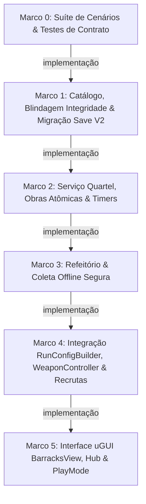

# Plano de Implementação: M21 · Quartel (Meta Idle)
> Data: 2026-11-01  
> Issue: NEX-656  
> Status: Cenários validados — Suíte Red comprovada em 2026-11-01  

---

## 1. Contexto & Arquitetura

- **Resumo**: Implementar a meta idle diegética do Quartel (M21), o único vetor de poder permanente do Horde Runner. O sistema introduz 5 construções (Recrutamento, Arsenal, Refeitório, Enfermaria, Oficina de munição) pagas com Moedas e Recrutas, gerenciamento de obras com tempo real sobre `ITimeProvider.UtcNow`, geração passiva offline com teto de 8 horas (com descarte de excedente pós-8h e preservação fracionária), hook de rewarded ad para dobrar a coleta, aceleração de obras (-30 min com cota diária de 3 usos) e pulo instantâneo com Medalhas, compilação de bônus em `RunConfig` e `WeaponController`, liquidação segura de sobreviventes em Recrutas no `RewardCalculator`, blindagem de integridade JSON no `SaveStore` para saves V1 existentes, com interface uGUI `BarracksView` no Hub e testes em cena viva.
- **Stack**: Unity 6 (6000.6.3f1), C# 9 / .NET Standard 2.1, uGUI + TextMeshPro, VContainer, System.Text.Json, Harness CLI (`tools/unity`).
- **Verificação disponível**: Suíte automatizada EditMode (992 testes passando com 0 erros), testes de domínio C# puro com `FakeTimeProvider`, testes uGUI EditMode e PlayMode em cena viva (`M6_Greybox.unity`) com evidências visuais capturadas.

### 1.1 Dossiê de Investigação
- **Jornada Entrada $\to$ Efeito**: O jogador obtém Moedas jogando e Recrutas resgatando jaulas (M18). No Hub, acessa o Quartel e investe esses recursos para evoluir construções. O `BarracksService` valida previamente os saldos e debita da `Wallet` atomicamente, agendando o timer de obra. O Refeitório acumula moedas offline continuamente até o teto de 8h (descartando surplus no momento da coleta). Ao iniciar uma fase, o `RunConfigBuilder` compila os níveis do Quartel em `InitialSquad` (+2/nível), `BaseDamageMultiplier` (+5%/nível), taxa de recuperação de baixas da Enfermaria e munições elementais desbloqueadas na Oficina de Munição. O `WeaponController` aplica o modificador de dano com `source: "BarracksArsenal"`. Ao encerrar a corrida, `RewardCalculator` gera `CurrencyReward(Recruits)` somente se `totalRecruits > 0`, prevenindo exceções de carteira.
- **Fontes Inspecionadas**:
  - `Assets/_Game/Scripts/Meta/Wallet/CurrencyKind.cs:1-10` (`Recruits` já definido).
  - `Assets/_Game/Scripts/Meta/Wallet/Wallet.cs:25-84` (`Add`/`TrySpend` com validação de `source` e exigência estrita de `amount > 0`).
  - `Assets/_Game/Scripts/Meta/Time/ITimeProvider.cs` e `MonotonicTimeProvider.cs` (`UtcNow`, `IsClockManipulated`).
  - `Assets/_Game/Scripts/Meta/Save/MetaState.cs` e `SaveStore.cs` (serialização JSON e migrações versionadas; necessidade de desacoplar `ValidateIntegrity` da classe C# tipada).
  - `Assets/_Game/Scripts/Meta/Run/RunConfigBuilder.cs:8-60` e `RewardCalculator.cs:18-54`.
  - `Assets/_Game/Scripts/Core/State/RunConfig.cs` e `RunResult.cs`.
  - `Assets/_Game/Scripts/Gameplay/LevelDirector.cs:120-165, 400-435` e `WeaponController.cs`.
  - `Assets/_Game/Scripts/Presentation/UI/HubView.cs:35, 162` (`_barracksButton` já emite atalho "Quartel").
  - `docs/planos/2026-09-29-horde-runner-gameplay-meta-liveops.md:161-176, 238-265`.
  - Referência REA TopKing (`LWScripts.data`: `DataCenter/LWBattle/Logic/LastStand/LastStandBuilding/*`).
- **Hipóteses e Decisões Fundamentadas**:
  - *Decisão 1:* Manter `BarracksBuildingDefinition`, `BarracksCatalog` e `BarracksService` estritamente dentro de `Game.Meta` com `noEngineReferences: true`, garantindo 100% de testabilidade em EditMode sem overhead de engine.
  - *Decisão 2 (Mitigação CRITICAL-01):* Refatorar `SaveStore.ValidateIntegrity` para manipular o JSON bruto em disco removendo a propriedade `"IntegrityHash"` via manipulação DOM (`JsonNode` / `JsonDocument`), sem desserializar em `MetaState` tipado. Isso garante que a adição de `BarracksState` no C# não quebre os hashes de arquivos V1 existentes em disco.
  - *Decisão 3 (Mitigação CRITICAL-02):* `RewardCalculator` só adiciona recompensa de `Recruits` se `Rescued + RecoveredSoldiers > 0`, respeitando a regra estrita de `Wallet.Add(amount > 0)`.
  - *Decisão 4 (Mitigação IMPORTANT-01):* Ao colher no Refeitório com tempo offline $\ge 8$ horas, o excedente é descartado e `LastCollectionUtcTicks` salta para `UtcNow`. Se moedas acumuladas $< 1$, a coleta não consome tempo residual e retorna `false`.
  - *Decisão 5 (Mitigação IMPORTANT-02):* `BarracksService.TryStartUpgrade` pré-valida atomicamente os saldos de moedas e recrutas antes de iniciar qualquer débito.
  - *Decisão 6 (Mitigação IMPORTANT-03):* Adicionar `GetInstantCompleteMedalCost(BarracksBuildingType)` em `IBarracksService` com a fórmula `Math.Max(5, (int)Math.Ceiling(remainingMinutes / 5.0))` exposta para a UI.
  - *Decisão 7 (Mitigação IMPORTANT-04):* `WeaponController` remove modificadores prévios da fonte `"BarracksArsenal"` antes de aplicar o novo bônus, prevenindo stacking entre corridas e preservando o bônus durante trocas de arma via `TryEquip`.
  - *Decisão 8 (Mitigação IMPORTANT-05):* Registrar `MonotonicTimeProvider` no `GameLifetimeScope` e invocar `RecordCurrentTime()` ao carregar e salvar o jogo.
- **Matriz Risco $\to$ Cenário $\to$ Resultado Esperado $\to$ Verificação**:
  - *Corrupção de save V1:* Save V1 legítimo em disco $\to$ `SaveStore.ValidateIntegrity` passa $\to$ teste `SaveStoreMigrationTests.ValidateIntegrity_V1SaveFileOnDisk_PassesWithoutCorruption`.
  - *Fechamento com 0 recrutas:* Fase sem jaulas ou baixas $\to$ `RewardCalculator` não adiciona item zero $\to$ teste `RewardCalculatorRecruitsTests.Calculate_WithZeroRescuedAndZeroRecovered_DoesNotThrow`.
  - *Exploit Canteen:* 24h offline $\to$ coleta limita a 8h e segunda coleta rende 0 $\to$ teste `BarracksCanteenTests.CollectOfflineCoins_WhenExceeding8Hours_CapsAt8Hours_AndSubsequentImmediateCollectionYieldsZero`.
  - *Débito parcial na carteira:* Saldo com moedas suficientes mas sem recrutas $\to$ rejeição atômica sem debitar moedas $\to$ teste `BarracksServiceTests.StartUpgrade_WhenCoinsSufficientButRecruitsInsufficient_DoesNotDebitCoins`.
  - *Stacking de dano:* Múltiplas corridas na mesma sessão $\to$ `WeaponController` mantém apenas 1 modificador de dano do Arsenal $\to$ teste `WeaponControllerBarracksTests.BaseDamageMultiplier_AppliedCorrectly_PreservedOnTryEquip_AndNotStackedOnMultipleRuns`.

---

## 2. Armadilhas do Repositório

| Armadilha | Onde morde (arquivo/passo) | Regra a respeitar |
|---|---|---|
| **Desserialização C# no `ValidateIntegrity`** | `SaveStore.cs` — Passo 1 | `ValidateIntegrity` NUNCA deve desserializar para a classe tipada `MetaState` antes de checar o hash, sob pena de quebrar o hash de saves V1 criados antes da inclusão de `BarracksState`. Remover `"IntegrityHash"` diretamente do JSON bruto. |
| **Crash em `Wallet.Add` com Valor Zero** | `RewardCalculator.cs` — Passo 4 | `Wallet.Add` lança `ArgumentOutOfRangeException` se `amount <= 0`. NUNCA adicionar `CurrencyReward` de recrutas com valor zero ao `RewardBundle`. |
| **Exploit de Coleta Infinita no Refeitório** | `BarracksService.cs` — Passo 3 | Ao colher após $\ge 8$ horas offline, descartar o excedente além de 8h e definir `LastCollectionUtcTicks = UtcNow`. Se o tempo decorrido não render ao menos 1 moeda, retornar `false` sem alterar timestamp. |
| **Débito Parcial sem Rollback** | `BarracksService.cs` — Passo 2 | Como `IWallet` não tem transação multi-moeda, SEMPRE pré-validar ambos os saldos (`Coins` e `Recruits`) antes de chamar `TrySpend`. |
| **Stacking Cumulativo de Dano na Arma** | `WeaponController.cs` — Passo 4 | Remover modificadores existentes com `source: "BarracksArsenal"` antes de adicionar o novo multiplicador da corrida. |
| **Pureza de Asmdefs (`Game.Meta`)** | `BarracksService.cs`, `BarracksBuildingDefinition.cs` — Passos 1 a 3 | `Game.Meta` possui `noEngineReferences: true`. PROIBIDO importar `UnityEngine`, usar `Mathf`, `Time.time` ou `ScriptableObject`. Toda matemática usa `System.Math` e tempo usa `ITimeProvider`. |
| **Comunicação Direta Gameplay $\leftrightarrow$ Meta Proibida** | `LevelDirector.cs`, `WeaponController.cs` — Passo 4 | `Game.Gameplay` NUNCA referencia `Game.Meta`. Comunicação ocorre exclusivamente por `RunConfig` (dados puros de entrada) e `RunResult` (saída). |
| **Invariante Modal no UIManager** | `BarracksView.cs` — Passo 5 | `BarracksView` deve declarar `LayerType => UILayerType.Modal`. Isso garante que o `UIManager` desative o raycast do Hub automaticamente enquanto a janela estiver aberta. |

---

## 3. Árvore de Arquivos

```
Assets/_Game/Scripts/
├── Core/
│   └── State/
│       ├── [MODIFICAÇÃO] RunConfig.cs
│       └── [MODIFICAÇÃO] RunResult.cs
├── Meta/
│   ├── Barracks/
│   │   ├── [NOVO] BarracksBuildingType.cs
│   │   ├── [NOVO] BarracksBuildingDefinition.cs
│   │   ├── [NOVO] BarracksCatalog.cs
│   │   ├── [NOVO] IBarracksCatalog.cs
│   │   ├── [NOVO] IBarracksService.cs
│   │   ├── [NOVO] BarracksService.cs
│   │   └── Events/
│   │       └── [NOVO] BuildingUpgradeCompletedEvent.cs
│   ├── Run/
│   │   ├── [MODIFICAÇÃO] RunConfigBuilder.cs
│   │   └── [MODIFICAÇÃO] RewardCalculator.cs
│   └── Save/
│       ├── [NOVO] BarracksState.cs
│       ├── [MODIFICAÇÃO] MetaState.cs
│       ├── [MODIFICAÇÃO] SaveStore.cs
│       └── Migrations/
│           └── [NOVO] SaveMigrationV1ToV2.cs
├── Gameplay/
│   ├── LevelDirector.cs [MODIFICAÇÃO]
│   └── Combat/
│       └── WeaponController.cs [MODIFICAÇÃO]
├── Presentation/
│   └── UI/
│       ├── [MODIFICAÇÃO] HubView.cs
│       └── Barracks/
│           ├── [NOVO] BarracksView.cs
│           ├── [NOVO] BarracksBuildingCardWidget.cs
│           └── [NOVO] CanteenWidget.cs
├── Composition/
│   ├── [MODIFICAÇÃO] GameLifetimeScope.cs
│   └── [MODIFICAÇÃO] GreyboxRunComposer.cs
└── Tests/
    ├── EditMode/
    │   ├── Meta/
    │   │   ├── [NOVO] Doubles/FakeTimeProvider.cs
    │   │   ├── [NOVO] BarracksContractTests.cs
    │   │   ├── [NOVO] BarracksBuildingDefinitionTests.cs
    │   │   ├── [NOVO] SaveStoreMigrationTests.cs
    │   │   ├── [NOVO] BarracksServiceTests.cs
    │   │   ├── [NOVO] BarracksCanteenTests.cs
    │   │   └── [NOVO] RewardCalculatorRecruitsTests.cs
    │   ├── Gameplay/
    │   │   └── [NOVO] WeaponControllerBarracksTests.cs
    │   └── UI/
    │       └── [NOVO] BarracksViewTests.cs
    └── PlayMode/
        └── [NOVO] BarracksPlayModeTests.cs
```

---

## 4. Contratos e Interfaces

```csharp
namespace Game.Core.State
{
    public class RunConfig
    {
        public string LevelId { get; set; }
        public int InitialSquad { get; set; }
        public string WeaponId { get; set; }
        public float RewardMultiplier { get; set; }
        public IReadOnlyList<string> MutationIds { get; set; }
        public int BonusAbilityCharges { get; set; }

        // Bônus do Quartel (M21):
        public float BaseDamageMultiplier { get; set; } = 1.0f; // Arsenal (+5%/nível)
        public int HospitalRecoveryCap { get; set; } = 0;         // Enfermaria (teto)
        public float HospitalRecoveryRatio { get; set; } = 0f;    // Enfermaria (0.1f = +1 a cada 10)
        public IReadOnlyList<string> UnlockedAmmoPerks { get; set; } // Oficina de munição
    }

    public class RunResult
    {
        public string LevelId { get; set; }
        public bool Victory { get; set; }
        public float Distance { get; set; }
        public int SquadAtEnd { get; set; }
        public int MultiplierReached { get; set; }
        public IReadOnlyDictionary<string, int> KillsByArchetype { get; set; }
        public int Rescued { get; set; }
        public int CoinsEarned { get; set; }
        public IReadOnlyList<string> MutationIds { get; set; }
        public float DurationSeconds { get; set; }
        public int Stars { get; set; }
        public int HoldoutsAttempted { get; set; }
        public int HoldoutsHeld { get; set; }

        // Baixas e Recuperações (M21):
        public int SoldiersLost { get; set; }
        public int RecoveredSoldiers { get; set; }
    }
}

namespace Game.Meta.Barracks
{
    public enum BarracksBuildingType
    {
        Recruitment = 0,
        Armory = 1,
        Canteen = 2,
        Infirmary = 3,
        Ammunition = 4
    }

    public class BarracksBuildingLevelDefinition
    {
        public int Level { get; set; }
        public int CoinCost { get; set; }
        public int RecruitCost { get; set; }
        public int DurationSeconds { get; set; }
        public float EffectValue { get; set; }
        public int CoinsPerHour { get; set; }
        public string UnlockedPerkId { get; set; }
    }

    public class BarracksBuildingDefinition
    {
        public BarracksBuildingType Type { get; set; }
        public string DisplayName { get; set; }
        public int MaxLevel { get; set; }
        public IReadOnlyList<BarracksBuildingLevelDefinition> Levels { get; set; }
    }

    public interface IBarracksService
    {
        bool IsClockManipulated { get; }
        int GetBuildingLevel(BarracksBuildingType type);
        bool IsUnderConstruction(BarracksBuildingType type);
        TimeSpan GetRemainingConstructionTime(BarracksBuildingType type);
        int GetInstantCompleteMedalCost(BarracksBuildingType type);

        int GetUpgradeCoinCost(BarracksBuildingType type);
        int GetUpgradeRecruitCost(BarracksBuildingType type);
        TimeSpan GetUpgradeDuration(BarracksBuildingType type);

        bool CanStartUpgrade(BarracksBuildingType type, out string failReason);
        bool TryStartUpgrade(BarracksBuildingType type);
        bool TrySpeedupWithAd(BarracksBuildingType type);
        bool TryInstantCompleteWithMedals(BarracksBuildingType type);
        bool TryCompleteUpgrade(BarracksBuildingType type);

        // Refeitório
        int GetPendingOfflineCoins();
        bool TryCollectOfflineCoins(bool doubleWithAd, out int collectedCoins);

        // Bônus para RunConfig
        int GetInitialSquadBonus();
        float GetBaseDamageMultiplier();
        int CalculateRecoveredSoldiers(int soldiersLost);
        IReadOnlyList<string> GetUnlockedAmmoPerks();
    }
}

namespace Game.Meta.Barracks.Events
{
    public readonly struct BuildingUpgradeCompletedEvent
    {
        public BarracksBuildingType BuildingType { get; }
        public int NewLevel { get; }
        public BuildingUpgradeCompletedEvent(BarracksBuildingType type, int newLevel) =>
            (BuildingType, NewLevel) = (type, newLevel);
    }
}
```

---

## 4.5 Linear Overlay

- **História (issue-pai):** `NEX-656` (`Story: M21 · Quartel (meta idle)`)
- **Sub-issues deste plano:**
  - Marco 0: `Suíte de Cenários & Testes de Contrato`
  - Marco 1: `Catálogo de Dados, Blindagem de Integridade e Migração de Save V2`
  - Marco 2: `Serviço do Quartel, Ciclo de Obras Atômico e Timers sobre ITimeProvider`
  - Marco 3: `Refeitório (Coleta Offline Segura, Teto de 8h e Dobra por Rewarded)`
  - Marco 4: `Integração no RunConfigBuilder, WeaponController e Carteira de Recrutas`
  - Marco 5: `Interface uGUI do Quartel (BarracksView), Fiação no Hub e Validação em PlayMode`
- **PRs (modelo C):**
  - Branch da História: `jamilzerati/nex-656-story-m21-quartel-meta-idle`
  - Tarefas ramificam da branch da História; PR de cada tarefa **aponta para a branch da História**.
  - Apenas a História abre PR para `main`.

---

## 4.6 Grafo de Dependências



| De | Para | Tipo | Por quê |
|---|---|---|---|
| Marco 0 | Marco 1 | implementação | Marco 1 materializa os tipos e migração cujos contratos foram estabelecidos no Marco 0. |
| Marco 1 | Marco 2 | implementação | Marco 2 consome os tipos de dados `BarracksBuildingDefinition`, `BarracksState` e o catálogo. |
| Marco 2 | Marco 3 | implementação | Marco 3 adiciona a lógica de acúmulo temporal seguro do Refeitório ao `BarracksService`. |
| Marco 3 | Marco 4 | implementação | Marco 4 consome a interface consolidada de `IBarracksService` no `RunConfigBuilder` e `WeaponController`. |
| Marco 4 | Marco 5 | implementação | Marco 5 conecta o serviço completo à interface visual `BarracksView` e ao Hub. |

---

## 5. Divisão de Execução por Passo (Modo de Falha)

| Faixa | Passos | Por quê |
|---|---|---|
| **Risco de falha silenciosa** | Marco 1, Marco 2, Marco 3, Marco 4 | Envolve cálculo de hash HMAC/SHA256 em disco, precedência de saldo multi-moeda, acúmulo temporal com descarte de surplus pós-8h, modificadores de dano e liquidação de recrutas. Erros corrompem a economia ou saves sem lançar exceção na hora. |
| **Falha visível** | Marco 0, Marco 5 | Marco 0 valida contratos e compilação; Marco 5 instancia janelas uGUI, botões e renderiza no Canvas. |

---

## 6. Checklist de Execução

- [x] **Passo 0 (Marco 0)**: `Suíte de Cenários & Testes de Contrato` [NEX-1258]
  - **Ação**: Criar contratos de Seams públicos, fakes (`FakeTimeProvider`) e suíte de cenários Red.
  - **Lógica de Negócios / Responsabilidade**: Definir `IBarracksService`, eventos e test doubles que garantem a testabilidade C# pura antes de qualquer implementação.
  - **Dependências**: nenhuma (raiz).
  - **Seam Público**: `Game.Meta.Barracks.IBarracksService` e `Game.Meta.Time.ITimeProvider`.
  - **AC**: AC-01..AC-08 (CT-01..CT-18)
  - **Marco de PR**: Marco 0
  - **Effort**: medium

- [x] **Passo 1 (Marco 1)**: `Catálogo de Dados, Blindagem de Integridade e Migração de Save V2` [NEX-1259]
  - **Ação**: Criar `BarracksBuildingDefinition`, `BarracksCatalog`, `BarracksState`, refatorar `SaveStore.ValidateIntegrity` para validação em JSON puro (DOM) sem desserialização tipada e registrar `SaveMigrationV1ToV2`.
  - **Lógica de Negócios / Responsabilidade**: Estruturar os dados das 5 construções com níveis 1 a 5 e seus custos. Blindar `SaveStore` para que saves V1 legítimos não quebrem integridade ao adicionar campos de V2, e migrar V1 $\to$ V2 com hash HMAC/SHA256 correto.
  - **Dependências**: `implementação`: Marco 0.
  - **Seam Público**: `BarracksCatalog.CreateDefault()` e `SaveStore.Load()`.
  - **AC**: AC-01, AC-07 (CT-01, CT-17)
  - **Marco de PR**: Marco 1
  - **Effort**: medium

- [x] **Passo 2 (Marco 2)**: `Serviço do Quartel, Ciclo de Obras Atômico e Timers sobre ITimeProvider` [NEX-1260]
  - **Ação**: Implementar `BarracksService` com início de obra com pré-validação atômica de saldos, timers, aceleração por ad (-30 min) e medalhas com custo proporcional.
  - **Lógica de Negócios / Responsabilidade**: Pré-validar moedas e recrutas antes de qualquer débito da `Wallet` para evitar perdas parciais; gerenciar timers contra `ITimeProvider.UtcNow`; respeitar limite diário de acelerações por anúncio; calcular custo de medalhas via `GetInstantCompleteMedalCost` e concluir instantaneamente; congelar timers sob `IsClockManipulated`.
  - **Dependências**: `implementação`: Marco 1.
  - **Seam Público**: `IBarracksService.TryStartUpgrade`, `TrySpeedupWithAd`, `TryInstantCompleteWithMedals`, `TryCompleteUpgrade`, `GetInstantCompleteMedalCost`.
  - **AC**: AC-02, AC-03 (CT-02..CT-08)
  - **Marco de PR**: Marco 2
  - **Effort**: medium

- [x] **Passo 3 (Marco 3)**: `Refeitório (Coleta Offline Segura, Teto de 8h e Dobra por Rewarded)` [NEX-1262]
  - **Ação**: Implementar acúmulo e coleta passiva de moedas offline no `BarracksService` com descarte de surplus pós-8h e preservação fracionária.
  - **Lógica de Negócios / Responsabilidade**: Calcular moedas pendentes proporcionalmente ao tempo decorrido até o teto estrito de 8 horas; ao coletar com $\ge 8$ horas offline, descartar o excedente além de 8h e atualizar `LastCollectionUtcTicks = UtcNow`; se o tempo acumulado render 0 moedas, retornar `false` sem alterar timestamp; permitir coleta dobrada via rewarded ad; congelar acúmulo sob `IsClockManipulated`.
  - **Dependências**: `implementação`: Marco 2.
  - **Seam Público**: `IBarracksService.GetPendingOfflineCoins`, `IBarracksService.TryCollectOfflineCoins`.
  - **AC**: AC-04 (CT-09..CT-12)
  - **Marco de PR**: Marco 3
  - **Effort**: medium

- [x] **Passo 4 (Marco 4)**: `Integração no RunConfigBuilder, WeaponController e Carteira de Recrutas` [NEX-1264]
  - **Ação**: Conectar o Quartel ao `RunConfigBuilder`, estender `RunConfig` e `RunResult`, aplicar multiplicador de dano em `WeaponController` com limpeza de fonte prévia, registrar baixas na Enfermaria e creditar Recrutas no `RewardCalculator` apenas quando $> 0$.
  - **Lógica de Negócios / Responsabilidade**: Compilar bônus de tropa inicial (+2/lv) e dano (+5%/lv) em `RunConfig`; `WeaponController` aplica `StatModifier` com `source: "BarracksArsenal"` após limpar modificadores anteriores da mesma fonte, preservando o bônus em `TryEquip`; `LevelDirector` rastreia baixas e calcula soldados recuperados pela Enfermaria; `RewardCalculator` gera recompensa em `Recruits` apenas se `totalRecruits > 0`, prevenindo exceção de carteira.
  - **Dependências**: `implementação`: Marco 3.
  - **Seam Público**: `IRunConfigBuilder.Build`, `IRewardCalculator.Calculate`, `WeaponController.Initialize`, `LevelDirector.EndRun`.
  - **AC**: AC-05, AC-06 (CT-13..CT-16)
  - **Marco de PR**: Marco 4
  - **Effort**: medium

- [x] **Passo 5 (Marco 5)**: `Interface uGUI do Quartel (BarracksView), Fiação no Hub e Validação em PlayMode` [NEX-1265]
  - **Ação**: Criar janela modal `BarracksView`, widgets das construções (`BarracksBuildingCardWidget`, `CanteenWidget`), registrar serviços no `GameLifetimeScope`, amarrar ao `HubView` e validar em PlayMode com evidências visuais.
  - **Lógica de Negócios / Responsabilidade**: Exibir cards das 5 construções com nível, custos, timers de obra, botão de pular com custo de medalhas, botões de upgrade/acelerar e coleta do Refeitório com aviso se relógio manipulado; amarrar ao `HubView._barracksButton`; validar fluxo completo em cena viva (`M6_Greybox.unity`).
  - **Dependências**: `implementação`: Marco 4.
  - **Seam Público**: `BarracksView.OpenWindow`, `HubView._barracksButton.onClick`.
  - **AC**: AC-08, AC-09 (CT-18, CT-19)
  - **Marco de PR**: Marco 5
  - **Effort**: high

---

## 7. Rascunho das Tarefas

### Marco 0: Suíte de Cenários & Testes de Contrato
- **Objetivo**: Estabelecer contratos, test doubles (`FakeTimeProvider`) e cenários automatizados Red para o Quartel.
- **Fontes Investigadas**: `ITimeProvider.cs`, `Wallet.cs`, `docs/planos/2026-09-29-horde-runner-gameplay-meta-liveops.md:161-176`.
- **Arquivos & Símbolos**: `IBarracksService.cs`, `FakeTimeProvider.cs`, `BarracksContractTests.cs`.
- **Seam Público**: `Game.Meta.Barracks.IBarracksService`.
- **Riscos**: Acoplamento acidental a `UnityEngine.Time` ou dependência de filesystem nos testes de contrato.
- **Aceite (Pronto quando)**: Fakes compilam com 0 referências a `UnityEngine`, interfaces expõem assinaturas necessárias e testes de contrato comprovam Red. (AC-01..AC-08, CT-01..CT-18).
- **Comandos & Verificação**: `tools/unity compile` com 0 erros.

### Marco 1: Catálogo de Dados, Blindagem de Integridade e Migração de Save V2
- **Objetivo**: Criar catálogo de construções, refatorar `SaveStore.ValidateIntegrity` para validação em JSON puro (DOM) e suportar migração de save V1 para V2 com recálculo de integridade HMAC/SHA256.
- **Fontes Investigadas**: `MetaState.cs`, `SaveStore.cs`, `ISaveMigration.cs`.
- **Arquivos & Símbolos**: `BarracksBuildingDefinition.cs`, `BarracksCatalog.cs`, `BarracksState.cs`, `SaveMigrationV1ToV2.cs`, `SaveStore.cs`, `SaveStoreMigrationTests.cs`, `BarracksBuildingDefinitionTests.cs`.
- **Seam Público**: `BarracksCatalog.CreateDefault()` e `SaveStore.Load()`.
- **Riscos**: Saves V1 falharem na verificação de hash SHA-256 se o `ValidateIntegrity` resserializar classes C# que ganharam novas propriedades.
- **Aceite (Pronto quando)**: Definições cobrem as 5 construções com níveis 1 a 5; saves V1 em disco passam no `ValidateIntegrity` sem corrupção e migram deterministicamente para V2 com novo hash. (AC-01, AC-07, CT-01, CT-17).
- **Comandos & Verificação**: `tools/unity test-edit` verde em `BarracksBuildingDefinitionTests` e `SaveStoreMigrationTests`.

### Marco 2: Serviço do Quartel, Ciclo de Obras Atômico e Timers sobre ITimeProvider
- **Objetivo**: Implementar o `BarracksService` com máquina de estados de obras, pré-validação atômica de saldos, timers, aceleração por ad e medalhas.
- **Fontes Investigadas**: `Wallet.cs`, `ITimeProvider.cs`, `MonotonicTimeProvider.cs`.
- **Arquivos & Símbolos**: `BarracksService.cs`, `BuildingUpgradeCompletedEvent.cs`, `BarracksServiceTests.cs`.
- **Seam Público**: `IBarracksService.TryStartUpgrade`, `TrySpeedupWithAd`, `TryInstantCompleteWithMedals`, `TryCompleteUpgrade`, `GetInstantCompleteMedalCost`.
- **Riscos**: Débito parcial de moedas caso recrutas sejam insuficientes; timers avançando com relógio manipulado.
- **Aceite (Pronto quando)**: Início pré-valida atomicamente moedas e recrutas; obra conclui quando `UtcNow >= End`; ad reduz 30 min (teto de 3/dia UTC); medalhas concluem instantaneamente pelo custo proporcional; `IsClockManipulated` congela timers e expõe flag. (AC-02, AC-03, CT-02..CT-08).
- **Comandos & Verificação**: `tools/unity test-edit` verde em `BarracksServiceTests`.

### Marco 3: Refeitório (Coleta Offline Segura, Teto de 8h e Dobra por Rewarded)
- **Objetivo**: Implementar a lógica de geração passiva offline e coleta de moedas do Refeitório com descarte de surplus pós-8h e preservação fracionária.
- **Fontes Investigadas**: `docs/planos/2026-09-29-horde-runner-gameplay-meta-liveops.md:161-176`, `Wallet.cs`.
- **Arquivos & Símbolos**: `BarracksService.cs` (métodos de Canteen), `BarracksCanteenTests.cs`.
- **Seam Público**: `IBarracksService.GetPendingOfflineCoins`, `IBarracksService.TryCollectOfflineCoins`.
- **Riscos**: Exploit de coleta infinita se o tempo excedente além de 8h não for descartado; perda de tempo residual em coletas frequentes sem moedas inteiras.
- **Aceite (Pronto quando)**: Gera moedas por tempo decorrido até o teto estrito de 8h; coleta após $\ge 8$ horas descarta o excedente e subsequente imediata gera 0; coletas sem moedas inteiras preservam tempo; opção `doubleWithAd` dobra as moedas creditadas; relógio manipulado congela geração. (AC-04, CT-09..CT-12).
- **Comandos & Verificação**: `tools/unity test-edit` verde em `BarracksCanteenTests`.

### Marco 4: Integração no RunConfigBuilder, WeaponController e Carteira de Recrutas
- **Objetivo**: Conectar os bônus do Quartel ao `RunConfig`, aplicar modificador de dano em `WeaponController` imune a troca de arma e stacking, rastrear baixas na Enfermaria e creditar Recrutas no `RewardCalculator` apenas se $> 0$.
- **Fontes Investigadas**: `RunConfigBuilder.cs`, `RewardCalculator.cs`, `LevelDirector.cs`, `WeaponController.cs`, `StatCollection.cs`.
- **Arquivos & Símbolos**: `RunConfig.cs`, `RunResult.cs`, `RunConfigBuilder.cs`, `RewardCalculator.cs`, `LevelDirector.cs`, `WeaponController.cs`, `BarracksContractTests.cs`, `RewardCalculatorRecruitsTests.cs`, `WeaponControllerBarracksTests.cs`.
- **Seam Público**: `RunConfigBuilder.Build`, `RewardCalculator.Calculate`, `WeaponController.Initialize`, `LevelDirector.EndRun`.
- **Riscos**: Stacking de dano a cada corrida na mesma sessão; crash em `Wallet.Add` se total de recrutas for 0.
- **Aceite (Pronto quando)**: `RunConfig` recebe +2 soldados por nível de Recrutamento e +5% dano por nível de Arsenal; `WeaponController` aplica modificador com `source: "BarracksArsenal"` após limpar prévios, resistindo a `TryEquip`; Enfermaria recupera soldados no fim da fase; `RewardCalculator` credita recrutas na `Wallet` apenas quando $> 0$, sem exceções quando 0. (AC-05, AC-06, CT-13..CT-16).
- **Comandos & Verificação**: `tools/unity test-edit` verde em `BarracksContractTests`, `RewardCalculatorRecruitsTests` e `WeaponControllerBarracksTests`.

### Marco 5: Interface uGUI do Quartel (BarracksView), Fiação no Hub e Validação em PlayMode
- **Objetivo**: Criar a janela uGUI modal do Quartel, widgets das construções (`BarracksBuildingCardWidget`, `CanteenWidget`), registrar serviços no `GameLifetimeScope`, amarrar ao `HubView` e validar em cena viva.
- **Fontes Investigadas**: `HubView.cs`, `UIManager.cs`, `UIWindow.cs`, `GameLifetimeScope.cs`, `SceneBuilder.cs`.
- **Arquivos & Símbolos**: `BarracksView.cs`, `BarracksBuildingCardWidget.cs`, `CanteenWidget.cs`, `HubView.cs`, `GameLifetimeScope.cs`, `GreyboxRunComposer.cs`, `BarracksViewTests.cs`, `BarracksPlayModeTests.cs`.
- **Seam Público**: `BarracksView.OpenWindow`, `HubView._barracksButton`.
- **Riscos**: Falta de injeção de dependência no `GameLifetimeScope` causando `NullReferenceException` ao abrir janela; inoperância de anti-cheat por falta de inicialização de ticks.
- **Aceite (Pronto quando)**: Botão "Quartel" no Hub abre `BarracksView` como modal; cards exibem dados, custos de moedas/recrutas/medalhas e reagem a `WalletChangedEvent`; aviso visual exibido se relógio manipulado; coleta e upgrades funcionam na UI; PlayMode executa em cena viva (`M6_Greybox.unity`) gravando screenshot em `docs/evidencias/NEX-656-01-barracks-hub-open.png`. (AC-08, AC-09, CT-18, CT-19).
- **Comandos & Verificação**: `tools/unity test-edit` verde em `BarracksViewTests` e `tools/unity test-play` verde em `BarracksPlayModeTests`.
