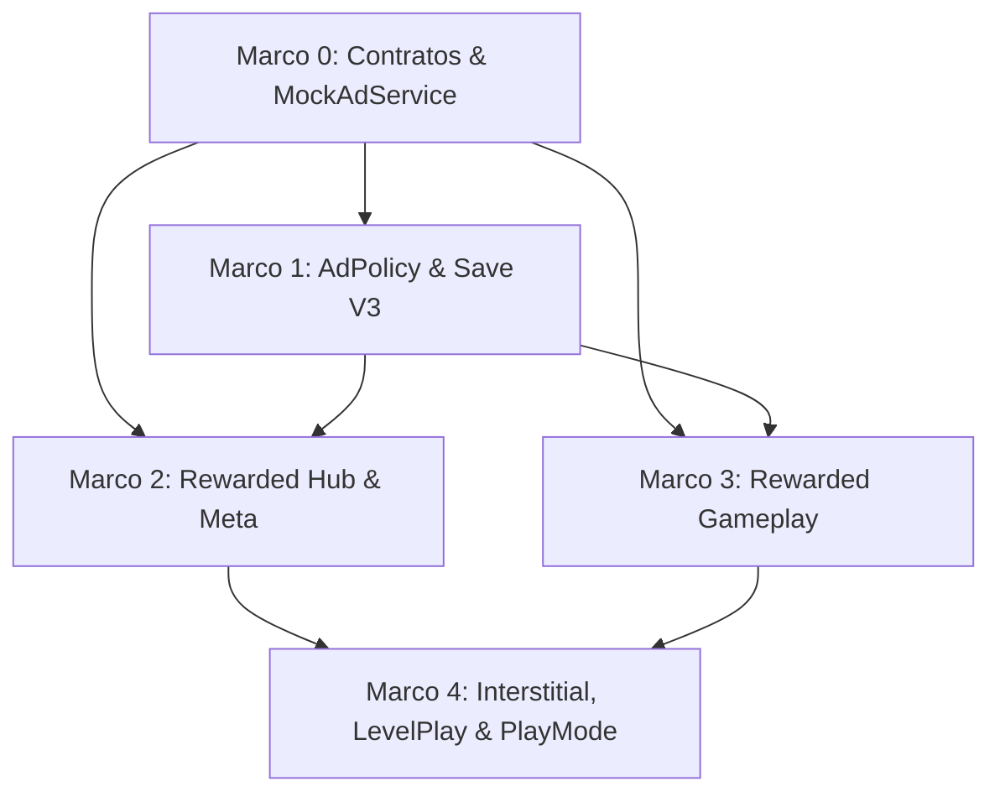

# Plano de Implementação: M13 · Anúncios: Rewarded e Interstitial com Política
> Data: 2026-11-10  
> Issue: NEX-518  
> Status: Cenários validados — Suíte Red comprovada em 2026-11-10  

---

## 1. Contexto & Arquitetura

- **Resumo**: Implementar o sistema de monetização por anúncios do Horde Runner (M13). O sistema combina anúncios premiados (**Rewarded Ads**) como o principal motor de engajamento e receita do loop hybrid-casual e anúncios de transição (**Interstitials**) regulados por uma política estrita (`AdPolicy`) para manter alta a retenção de longo prazo. A arquitetura segue a separação estrita de asmdefs: contratos agnósticos em `Game.Core.Ads` (`IAdService`, `AdPlacement`, `AdShowResult`), motor de regras puro em `Game.Meta.Ads` (`AdPolicy`, `AdPolicyDefinition`, `AdPolicyState` testável com `FakeTimeProvider` e `IEntitlements`), infraestrutura com `MockAdService` e `LevelPlayAdService` em `Game.Infrastructure.Ads`, persistência versionada V3 com migração segura no `SaveStore`, integração dos 6 placements premiados (dobrar recompensa em `ResultView`, revive de 10 soldados no `LevelDirector`, boost pré-fase de +10 tropa no `HubView`, carga extra de poder no `GeneralAbilityController`, e dobra de coleta offline e aceleração de obras no Quartel), interstitial entre fases no `GreyboxRunComposer` e validação com suíte EditMode/PlayMode em cena viva.
- **Stack**: Unity 6 (6000.6.3f1), C# 9 / .NET Standard 2.1, uGUI + TextMeshPro, VContainer, System.Text.Json, Harness CLI (`tools/unity`).
- **Verificação disponível**: Suíte automatizada EditMode (1167 testes passando com 0 erros), testes de regras puras com `FakeTimeProvider`, testes de integração uGUI e PlayMode em cena viva (`M6_Greybox.unity`) com evidências visuais capturadas em `G:/Evidences/HordeRunner/NEX-518/`.

### 1.1 Dossiê de Investigação
- **Jornada Entrada $\to$ Efeito**:
  1. *Rewarded (ResultView)*: Ao concluir ou falhar uma fase, o jogador visualiza a tela de resultados. Ao clicar em "Dobrar Recompensa", o `ResultRewardPresenter` valida `AdPolicy.CanShowRewarded(AdPlacement.DoubleReward)`. Se permitido, invoca `IAdService.ShowAd(AdPlacement.DoubleReward, ...)`. Se o callback for `AdShowResult.Completed`, as moedas são dobradas e o evento `ad_reward` é emitido. Se o anúncio for cancelado ou falhar, a recompensa base permanece 100% segura e resgatável.
  2. *Rewarded (Revive no LevelDirector)*: Durante o combate, quando a contagem de soldados zera (`_currentSquad <= 0`), se o revive não tiver sido utilizado na corrida ativa e `AdPolicy.CanShowRewarded(AdPlacement.Revive)` permitir, o jogo pausa e exibe o `RevivePromptWidget`. Ao assistir o anúncio com sucesso, `LevelDirector.ReviveSquad(10)` restaura 10 soldados, concede 1.5s de invulnerabilidade com dispersão imediata de zumbis em 5m, e a corrida retoma normalmente. Caso recuse ou falhe, `EndRun(victory: false)` é disparado.
  3. *Rewarded (Boost Pré-fase no HubView)*: Na seleção de fases, o jogador pode ativar o boost de tropa. Ao assistir ao anúncio com sucesso, a flag `squad_plus_10` é injetada no `RunConfig` da próxima corrida.
  4. *Rewarded (Carga do General)*: No HUD de habilidade do General, o jogador pode solicitar uma recarga extra (1x/fase). Ao completar o anúncio, `GeneralAbilityController.GrantBonusCharge()` adiciona 1 carga imediata.
  5. *Rewarded (Quartel)*: No `CanteenWidget`, o botão de coleta com anúncio invoca `ShowAd(AdPlacement.CanteenDouble)` e só dobra o ganho offline após `Completed`. No `BarracksBuildingCardWidget`, a aceleração de 30 min invoca `ShowAd(AdPlacement.BarracksSpeedup)` respeitando a cota diária de 3 usos.
  6. *Interstitial (Entre Fases)*: Ao sair do resultado para o Hub (ou avançar de fase), o `GreyboxRunComposer` consulta `AdPolicy.CanShowInterstitial()`. Se o jogador estiver na fase $\ge 5$, tiver completado $\ge 3$ fases desde o último anúncio, decorridos $\ge 90$s do último anúncio e $\ge 120$s de compras/rewarded, e não possuir o entitlement `"no_ads"`, o interstitial é exibido antes de retornar ao Hub.
- **Fontes Inspecionadas**:
  - `Assets/_Game/Scripts/Presentation/UI/ResultRewardPresenter.cs:70-130`: `DoubleReward()` e eventos analíticos pré-existentes.
  - `Assets/_Game/Scripts/Presentation/UI/ResultView.cs:13, 61, 92-105`: Botão `_doubleRewardButton` já ligado no uGUI e no `SceneBuilder.cs:1565`.
  - `Assets/_Game/Scripts/Gameplay/LevelDirector.cs:410-502`: `OnSquadSizeChanged` chamando `EndRun(victory: false)` quando `_currentSquad <= 0`.
  - `Assets/_Game/Scripts/Gameplay/Abilities/GeneralAbilityController.cs:48-99` e `AbilityChargeTracker.cs:1-50`: Rastreamento e consumo de cargas de habilidade.
  - `Assets/_Game/Scripts/Meta/Run/RunConfigBuilder.cs:66-87`: Suporte pré-existente a `squad_plus_10` e `bonus_charge` em `activeBoosts`.
  - `Assets/_Game/Scripts/Meta/Barracks/BarracksService.cs:80-140`: `TrySpeedupWithAd` e `TryCollectOfflineCoins(bool doubleWithAd)`.
  - `Assets/_Game/Scripts/Presentation/UI/Barracks/CanteenWidget.cs:125-133` e `BarracksBuildingCardWidget.cs:175-185`: Hooks de UI de rewarded do Quartel.
  - `Assets/_Game/Scripts/Meta/Save/MetaState.cs:1-20` e `SaveStore.cs:88-140`: Serialização e validação de integridade JSON.
  - `Assets/_Game/Scripts/Meta/Tracks/IEntitlements.cs:1-12`: Consulta de entitlements como `"no_ads"`.
  - `Assets/_Game/Scripts/Core/Analytics/AnalyticsEvents.cs` e `IAnalyticsService.cs`.
  - `docs/planos/2026-09-29-horde-runner-gameplay-meta-liveops.md:251-265` (seção 5.1).
- **Hipóteses e Decisões Fundamentadas**:
  - *Decisão 1 (Desacoplamento de Asmdef)*: Criar `IAdService`, `AdPlacement`, `AdType` e `AdShowResult` em `Game.Core.Ads` sem dependência de Unity, permitindo que tanto `Game.Meta` quanto `Game.Gameplay` e `Game.Presentation` utilizem o contrato sem dependências cruzadas.
  - *Decisão 2 (Determinismo e Testabilidade do AdPolicy)*: Implementar `AdPolicy` em `Game.Meta.Ads` com `noEngineReferences: true`, recebendo `ITimeProvider` e `IEntitlements`, garantindo que todas as regras de cooldown (90s / 120s), intervalos de fase e restrição de novatos sejam 100% testadas em EditMode com `FakeTimeProvider`.
  - *Decisão 3 (Inviolabilidade da Recompensa Base)*: O `ResultRewardPresenter` mantém as moedas base calculadas intocadas. Se o anúncio premiado falhar, for fechado ou o jogador cancelar, apenas a multiplicação é desabilitada; o botão de continuar permanece habilitado para resgatar a recompensa base.
  - *Decisão 4 (Segurança do Revive no Gameplay)*: Para evitar morte instantânea em loop (hitkill imediato no frame seguinte ao reviver se zumbis estiverem sobrepostos), `LevelDirector.ReviveSquad(10)` restaura 10 soldados, concede 1.5s de invulnerabilidade e repele/elimina zumbis em um raio de 5 metros ao redor do General.
  - *Decisão 5 (Isolamento do SDK de Terceiros)*: O adaptador `LevelPlayAdService` mora em `Game.Infrastructure.Ads`. Se o pacote LevelPlay não estiver presente no projeto ou sem credenciais de produção, o sistema opera de forma resiliente com fallback transparente para `MockAdService`, assegurando que o harness CLI (`tools/unity`) compile e teste com 0 erros.
  - *Decisão 6 (Migração de Save V3)*: `AdPolicyState` é persistido dentro de `MetaState` sob versão 3, com `SaveMigrationV2ToV3` inicializando os campos sem quebrar o cálculo de integridade SHA256 do `SaveStore`.
- **Matriz Risco $\to$ Cenário $\to$ Resultado Esperado $\to$ Verificação**:
  - *Recompensa concedida em anúncio cancelado:* Jogador fecha rewarded ad no meio $\to$ `AdShowResult.Skipped` $\to$ nenhuma recompensa adicional concedida $\to$ teste `ResultRewardAdTests.DoubleReward_WhenAdSkipped_DoesNotDoubleCoins_AndPreservesBaseCoins`.
  - *Perda de moedas base por falha de anúncio:* Erro de rede no rewarded $\to$ `AdShowResult.Failed` $\to$ moedas base permanecem resgatáveis no `ClaimAndContinue` $\to$ teste `ResultRewardAdTests.DoubleReward_WhenAdFails_AllowsClaimingBaseReward`.
  - *Spam de interstitial em jogador novato:* Jogador na fase 3 completa 3 fases $\to$ `AdPolicy.CanShowInterstitial()` retorna `false` $\to$ teste `AdPolicyTests.CanShowInterstitial_WhenPlayerOnStageBelow5_ReturnsFalse`.
  - *Interstitial após anúncio rewarded recente:* 60s após assistir a um rewarded $\to$ `AdPolicy.CanShowInterstitial()` retorna `false` (requer 120s) $\to$ teste `AdPolicyTests.CanShowInterstitial_WhenRewardedAdShown60SecondsAgo_ReturnsFalse`.
  - *Jogador comprou "Remover Anúncios":* Entitlement `"no_ads"` presente $\to$ `CanShowInterstitial()` retorna `false`, mas `CanShowRewarded()` retorna `true` $\to$ teste `AdPolicyTests.EntitlementNoAds_BlocksInterstitial_PreservesRewarded`.
  - *Loop infinito de Revive:* Tropa morre após já ter revivido uma vez $\to$ Revive rejeitado e derrota confirmada $\to$ teste `GameplayReviveAdTests.Revive_CanOnlyBeUsedOncePerRun`.

---

## 2. Armadilhas do Repositório

| Armadilha | Onde morde (arquivo/passo) | Regra a respeitar |
|---|---|---|
| **Concessão de Recompensa Prematura** | `ResultRewardPresenter.cs`, `CanteenWidget.cs`, `BarracksBuildingCardWidget.cs` — Passo 2 | PROIBIDO conceder bônus antes da conclusão do anúncio. Recompensas rewarded devem ser concedidas EXCLUSIVAMENTE dentro do callback quando `result == AdShowResult.Completed`. |
| **Perda da Recompensa Base no ResultView** | `ResultRewardPresenter.cs` — Passo 2 | Se o anúncio premiado de dobra de moedas falhar ou for cancelado, as moedas base calculadas na fase NUNCA devem ser zeradas ou perdidas; o botão de continuar deve permanecer funcional. |
| **Hitkill Imediato após Revive** | `LevelDirector.cs` — Passo 3 | Ao reviver a tropa com 10 soldados, aplicar 1.5s de invulnerabilidade e repelir inimigos no raio de 5 metros ao redor da tropa para impedir morte instantânea no mesmo frame. |
| **Bypass do Limite de 1 Revive por Fase** | `LevelDirector.cs` — Passo 3 | `ReviveUsedInCurrentRun` deve ser marcado como `true` no momento da confirmação do revive, impedindo revives consecutivos na mesma corrida. |
| **Quebra de Compilação sem SDK LevelPlay** | `LevelPlayAdService.cs` — Passo 4 | `LevelPlayAdService` deve operar com fallback automático para `MockAdService` quando o pacote LevelPlay não estiver resolvido ou inicializado, garantindo 0 erros de compilação no harness CLI. |
| **Pureza de Asmdef em Game.Meta** | `AdPolicy.cs`, `AdPolicyDefinition.cs` — Passo 1 | `Game.Meta` possui `noEngineReferences: true`. Proibido importar `UnityEngine` ou tipos de SDK. Toda matemática e tempo usam `System.Math` e `ITimeProvider`. |
| **Corrupção de Save V1/V2 no SaveStore** | `SaveStore.cs`, `MetaState.cs` — Passo 1 | Adicionar `SaveMigrationV2ToV3` para migrar saves antigos e garantir que `SaveStore.ValidateIntegrity` continue validando o JSON bruto sem interferência das novas propriedades. |

---

## 3. Árvore de Arquivos

```
Assets/_Game/Scripts/
├── Core/
│   ├── Ads/
│   │   ├── [NOVO] AdPlacement.cs
│   │   ├── [NOVO] AdType.cs
│   │   ├── [NOVO] AdShowResult.cs
│   │   ├── [NOVO] IAdService.cs
│   │   └── [NOVO] MockAdService.cs
│   ├── Abilities/
│   │   └── [MODIFICAÇÃO] AbilityChargeTracker.cs
│   └── Analytics/
│       └── [MODIFICAÇÃO] AnalyticsEvents.cs
├── Meta/
│   ├── Ads/
│   │   ├── [NOVO] AdPolicyDefinition.cs
│   │   ├── [NOVO] AdPolicyState.cs
│   │   ├── [NOVO] IAdPolicy.cs
│   │   └── [NOVO] AdPolicy.cs
│   ├── Run/
│   │   └── [MODIFICAÇÃO] RunConfigBuilder.cs
│   └── Save/
│       ├── [MODIFICAÇÃO] MetaState.cs
│       ├── [MODIFICAÇÃO] SaveStore.cs
│       └── Migrations/
│           └── [NOVO] SaveMigrationV2ToV3.cs
├── Gameplay/
│   ├── LevelDirector.cs [MODIFICAÇÃO]
│   └── Abilities/
│       └── GeneralAbilityController.cs [MODIFICAÇÃO]
├── Presentation/
│   └── UI/
│       ├── [MODIFICAÇÃO] ResultRewardPresenter.cs
│       ├── [MODIFICAÇÃO] ResultView.cs
│       ├── [MODIFICAÇÃO] HubView.cs
│       ├── [MODIFICAÇÃO] StageSelectionWidget.cs
│       ├── [NOVO] RevivePromptWidget.cs
│       └── Barracks/
│           ├── [MODIFICAÇÃO] CanteenWidget.cs
│           └── [MODIFICAÇÃO] BarracksBuildingCardWidget.cs
├── Infrastructure/
│   └── Ads/
│       └── [NOVO] LevelPlayAdService.cs
├── Composition/
│   ├── [MODIFICAÇÃO] GameLifetimeScope.cs
│   └── [MODIFICAÇÃO] GreyboxRunComposer.cs
└── Tests/
    ├── EditMode/
    │   ├── Ads/
    │   │   ├── [NOVO] AdContractTests.cs
    │   │   ├── [NOVO] MockAdServiceTests.cs
    │   │   ├── [NOVO] AdPolicyTests.cs
    │   │   └── [NOVO] SaveStoreV3MigrationTests.cs
    │   ├── UI/
    │   │   ├── [NOVO] ResultRewardAdTests.cs
    │   │   └── [NOVO] BarracksAdFlowTests.cs
    │   └── Gameplay/
    │       ├── [NOVO] GameplayReviveAdTests.cs
    │       └── [NOVO] PreRunBoostAdTests.cs
    └── PlayMode/
        └── [NOVO] AdsPlayModeFlowTests.cs

Content/Source/
└── [NOVO] ad_policy.json
```

---

## 4. Contratos e Interfaces

```csharp
namespace Game.Core.Ads
{
    public enum AdPlacement
    {
        DoubleReward = 0,
        Revive = 1,
        PreRunBoost = 2,
        GeneralPowerCharge = 3,
        CanteenDouble = 4,
        BarracksSpeedup = 5,
        InterLevel = 6
    }

    public enum AdType
    {
        Rewarded = 0,
        Interstitial = 1
    }

    public enum AdShowResult
    {
        Completed = 0,
        Skipped = 1,
        Failed = 2,
        NotAvailable = 3
    }

    public interface IAdService
    {
        bool IsAdAvailable(AdPlacement placement);
        void ShowAd(AdPlacement placement, Action<AdShowResult> onComplete);
    }
}

namespace Game.Meta.Ads
{
    public class AdPolicyDefinition
    {
        public int InterstitialMinStage { get; set; } = 5;
        public int InterstitialStageInterval { get; set; } = 3;
        public int InterstitialMinTimeBetweenAdsSeconds { get; set; } = 90;
        public int InterstitialCooldownAfterRewardedOrPurchaseSeconds { get; set; } = 120;
        public int InterstitialMinStageFirstSessionOfDay { get; set; } = 2;
        public int DailyRewardedLimit { get; set; } = 20;
        public int DailyBarracksSpeedupLimit { get; set; } = 3;
    }

    public class AdPolicyState
    {
        public long LastAdShownUtcTicks { get; set; }
        public long LastRewardedOrPurchaseUtcTicks { get; set; }
        public long LastInterstitialUtcTicks { get; set; }
        public int StagesCompletedSinceLastInterstitial { get; set; }
        public int StagesCompletedInCurrentSession { get; set; }
        public long CurrentSessionDateUtcTicks { get; set; }
        public int DailyRewardedCount { get; set; }
        public long DailyRewardedDateUtcTicks { get; set; }
        public Dictionary<string, int> PlacementDailyCounts { get; set; } = new();
    }

    public interface IAdPolicy
    {
        AdPolicyDefinition Definition { get; }
        AdPolicyState State { get; }
        bool CanShowInterstitial(int playerHighestStage);
        bool CanShowRewarded(AdPlacement placement);
        void RecordAdShown(AdPlacement placement, AdType adType);
        void RecordPurchase();
        void RecordSessionStart();
        void RecordStageCompleted();
    }
}
```

---

## 4.5 Linear overlay

- **História (issue-pai):** `NEX-518` (Story: M13 · Anúncios: rewarded e interstitial com política)
- **Sub-issues deste plano:**
  - `Marco 0`: Suíte de Cenários & Contratos de Anúncios (`IAdService`, `MockAdService`)
  - `Marco 1`: Motor AdPolicy Puro, AdPolicyDefinition e Migração Save V3
  - `Marco 2`: Placements Rewarded de Hub & Meta (ResultView e Quartel)
  - `Marco 3`: Placements Rewarded de Gameplay (Revive, Boost Pré-fase, Carga General)
  - `Marco 4`: Pacing Interstitial Entre Fases, Adapter LevelPlay, DI e Validação PlayMode
- **PRs (modelo C):**
  - História: branch `jamilzerati/nex-518-story-m13-anuncios-rewarded-e-interstitial` $\to$ Draft PR para `main`.
  - Sub-issues: cada tarefa ramifica da branch da história e abre PR para a branch da história.

---

## 4.6 Grafo de Dependências

| De | Para | Tipo | Por quê |
|---|---|---|---|
| Marco 0 | Marco 1 | implementação | Marco 1 consome enums e contratos definidos no Marco 0 |
| Marco 0 | Marco 2 | implementação | Marco 2 consome `IAdService` e `MockAdService` criados no Marco 0 |
| Marco 1 | Marco 2 | implementação | Marco 2 consulta `IAdPolicy` para validar permissão de exibição |
| Marco 0 | Marco 3 | implementação | Marco 3 consome `IAdService` para revive e boosts |
| Marco 1 | Marco 3 | implementação | Marco 3 consulta `IAdPolicy` para placements de gameplay |
| Marco 2 | Marco 4 | implementação | Marco 4 monta a composição de UI e Hub integrados |
| Marco 3 | Marco 4 | implementação | Marco 4 integra o ciclo de corrida com revive e interstitials |



---

## 5. Divisão de Execução por Passo

| Faixa | Passos | Por quê |
|---|---|---|
| **Risco de falha silenciosa** | Passo 1 (AdPolicy & Migração Save V3) | Cálculos de timestamp UtcTicks, cooldowns numéricos (90s, 120s), intervalos de fase, guarda monotônica e serialização JSON de save V3 onde erros não lançam exceção imediata mas corrompem regras de negócio. |
| **Risco de falha silenciosa** | Passo 2 (ResultRewardPresenter & Quartel) | Manipulação de saldos da carteira, duplicação condicional de moedas e consumo de cotas diárias onde race conditions ou callbacks errados podem duplicar moedas indevidamente. |
| **Risco de falha silenciosa** | Passo 3 (Revive & Boosts de Gameplay) | Restauração de estado de corrida, cálculo de soldados perdidos e aplicação de invulnerabilidade onde erros podem causar loops de revive ou hitkills silenciosos. |
| **Falha visível** | Passo 0 (Contratos e Mock) | Interfaces e assinaturas de tipos: erros acusam em tempo de compilação. |
| **Falha visível** | Passo 4 (Adapter LevelPlay, DI e PlayMode) | Resolução de container VContainer e inicialização de cena viva: falhas quebram no boot ou no runner de testes. |

---

## 6. Checklist de Execução

- [ ] **Passo 0 (Marco 0)**: `Suíte de Cenários & Contratos de Anúncios` [NEX-1496]
  - **Ação**: Criar contratos `IAdService`, `AdPlacement`, `AdType`, `AdShowResult` e implementação `MockAdService` em `Game.Core.Ads`, com testes Red de contrato.
  - **Lógica de Negócios / Responsabilidade**: Definir a abstração agnóstica de anúncios para todo o projeto, fornecer driver de testes determinístico com histórico de chamadas e integração analítica.
  - **Dependências / Pré-requisitos**: nenhuma (raiz).
  - **Seam Público**: `Game.Core.Ads.IAdService` e `Game.Core.Ads.MockAdService`.
  - **AC**: AC-01, AC-02 (CT-01, CT-02)
  - **Marco de PR**: Marco 0
  - **Effort**: medium

- [ ] **Passo 1 (Marco 1)**: `AdPolicy Puro, AdPolicyDefinition e Migração Save V3` [NEX-1497]
  - **Ação**: Criar `AdPolicyDefinition`, `AdPolicyState`, `IAdPolicy`, `AdPolicy` em `Game.Meta.Ads`, migração `SaveMigrationV2ToV3` e atualizar `MetaState` e `SaveStore`.
  - **Lógica de Negócios / Responsabilidade**: Implementar todas as regras de negócio de interstitial (fase $\ge 5$, 3 fases de intervalo, 90s entre anúncios, 120s cooldown pós-rewarded/compra, 1ª sessão do dia $\ge 2$ fases, desativação por `"no_ads"`), tetos diários de rewarded e persistência criptográfica segura.
  - **Dependências / Pré-requisitos**: `implementação`: Marco 0.
  - **Seam Público**: `Game.Meta.Ads.IAdPolicy` e `Game.Meta.Save.SaveStore`.
  - **AC**: AC-03, AC-04 (CT-03..CT-10)
  - **Marco de PR**: Marco 1
  - **Effort**: medium

- [x] **Passo 2 (Marco 2)**: `Placements Rewarded de Hub & Meta (ResultView e Quartel)` [NEX-1498]
  - **Ação**: Modificar [TELA] `ResultRewardPresenter.cs`, `ResultView.cs`, `CanteenWidget.cs` e `BarracksBuildingCardWidget.cs` para integrar `IAdService` e `IAdPolicy`.
  - **Lógica de Negócios / Responsabilidade**: Garantir concessão estrita de dobro de recompensa e aceleração/coleta do Quartel somente no callback `Completed`. Proteger integralmente a recompensa base caso o anúncio falhe ou seja cancelado.
  - **Dependências / Pré-requisitos**: `implementação`: Marco 0, Marco 1.
  - **Seam Público**: `ResultRewardPresenter.DoubleReward()` e widgets do Quartel.
  - **AC**: AC-05 (CT-11..CT-14)
  - **Marco de PR**: Marco 2
  - **Effort**: medium

- [ ] **Passo 3 (Marco 3)**: `Placements Rewarded de Gameplay (Revive, Boost Pré-fase e Carga General)` [NEX-1499]
  - **Ação**: Criar/Modificar [GAMEPLAY] `RevivePromptWidget.cs`, `LevelDirector.cs`, `GeneralAbilityController.cs`, `HubView.cs` e `StageSelectionWidget.cs`.
  - **Lógica de Negócios / Responsabilidade**: Implementar fluxo de Revive (1x por fase, restaura 10 soldados, 1.5s invulnerabilidade com dispersão de zumbis em 5m), Boost Pré-fase (+10 tropa no `RunConfig`) e Carga Extra do Poder do General (+1 carga).
  - **Dependências / Pré-requisitos**: `implementação`: Marco 0, Marco 1.
  - **Seam Público**: `LevelDirector.ReviveSquad(int count)`, `GeneralAbilityController.GrantBonusCharge()` e `HubView`.
  - **AC**: AC-06 (CT-15..CT-17)
  - **Marco de PR**: Marco 3
  - **Effort**: medium

- [ ] **Passo 4 (Marco 4)**: `Pacing Interstitial, Adapter LevelPlay, DI e Validação PlayMode` [NEX-1500]
  - **Ação**: Criar/Modificar [TELA] [GAMEPLAY] `LevelPlayAdService.cs`, `GameLifetimeScope.cs`, `GreyboxRunComposer.cs` e suíte PlayMode em cena viva (`M6_Greybox.unity`).
  - **Lógica de Negócios / Responsabilidade**: Conectar o gatilho de interstitial entre fases conforme `AdPolicy.CanShowInterstitial()`, registrar serviços no VContainer, encapsular o adapter LevelPlay com fallback seguro, exercitar a cena viva completa e capturar evidências visuais em `G:/Evidences/HordeRunner/NEX-518/`.
  - **Dependências / Pré-requisitos**: `implementação`: Marco 2, Marco 3.
  - **Seam Público**: `GreyboxRunComposer` e `LevelPlayAdService`.
  - **AC**: AC-07, AC-08, AC-09 (CT-08, CT-18)
  - **Marco de PR**: Marco 4
  - **Effort**: high

---

## 7. Rascunho das Tarefas

### Marco 0: Suíte de Cenários & Contratos de Anúncios
- **Objetivo**: Estabelecer os contratos fundamentais de anúncios em `Game.Core.Ads` e o driver de simulação `MockAdService`.
- **Fontes Inspecionadas**: `Assets/_Game/Scripts/Core/Analytics/AnalyticsEvents.cs`, `IAnalyticsService.cs`.
- **Arquivos & Símbolos**:
  - `Assets/_Game/Scripts/Core/Ads/AdPlacement.cs`: enum com os 7 placements.
  - `Assets/_Game/Scripts/Core/Ads/AdType.cs`: enum `Rewarded`, `Interstitial`.
  - `Assets/_Game/Scripts/Core/Ads/AdShowResult.cs`: enum `Completed`, `Skipped`, `Failed`, `NotAvailable`.
  - `Assets/_Game/Scripts/Core/Ads/IAdService.cs`: interface com `IsAdAvailable` e `ShowAd`.
  - `Assets/_Game/Scripts/Core/Ads/MockAdService.cs`: simulação com `AlwaysSucceed`, histórico e eventos de telemetria.
  - `Assets/_Game/Scripts/Tests/EditMode/Ads/AdContractTests.cs` e `MockAdServiceTests.cs`.
- **Seam Público**: `IAdService.ShowAd(AdPlacement, Action<AdShowResult>)`.
- **Riscos**: Acoplamento acidental com `UnityEngine` em `Game.Core`.
- **Comandos & Oráculos**: `powershell -File tools/unity.ps1 test-edit` passando 100% com novos testes de contrato verdes.
- **Condição de Parada**: Contratos compilando e testes de contrato e mock aprovados.

### Marco 1: Motor AdPolicy Puro, AdPolicyDefinition e Migração Save V3
- **Objetivo**: Implementar o motor de regras da política de anúncios em `Game.Meta.Ads` com persistência segura V3.
- **Fontes Inspecionadas**: `SaveStore.cs`, `SaveMigrationV1ToV2.cs`, `MetaState.cs`, `IEntitlements.cs`.
- **Arquivos & Símbolos**:
  - `Assets/_Game/Scripts/Meta/Ads/AdPolicyDefinition.cs`: parâmetros configuráveis de política.
  - `Assets/_Game/Scripts/Meta/Ads/AdPolicyState.cs`: estado persistido com timestamps e contadores.
  - `Assets/_Game/Scripts/Meta/Ads/IAdPolicy.cs` e `AdPolicy.cs`: motor de decisão puro.
  - `Assets/_Game/Scripts/Meta/Save/MetaState.cs`: campo `AdPolicyState AdPolicy`.
  - `Assets/_Game/Scripts/Meta/Save/SaveStore.cs`: versão V3.
  - `Assets/_Game/Scripts/Meta/Save/Migrations/SaveMigrationV2ToV3.cs`: migração JSON limpa.
  - `Content/Source/ad_policy.json`: arquivo de dados padrão.
  - `Assets/_Game/Scripts/Tests/EditMode/Ads/AdPolicyTests.cs` e `SaveStoreV3MigrationTests.cs`.
- **Seam Público**: `IAdPolicy.CanShowInterstitial(int)` e `IAdPolicy.CanShowRewarded(AdPlacement)`.
- **Riscos**: Quebra do cálculo de hash HMAC de saves antigos.
- **Comandos & Oráculos**: `powershell -File tools/unity.ps1 test-edit` validando todas as regras com `FakeTimeProvider` e migração de saves.
- **Condição de Parada**: Todas as regras de interstitial e rewarded comprovadas em testes unitários.

### Marco 2: Placements Rewarded de Hub & Meta (ResultView e Quartel)
- **Objetivo**: Integrar os anúncios premiados na tela de resultados e nas construções do Quartel.
- **Fontes Inspecionadas**: `ResultRewardPresenter.cs`, `ResultView.cs`, `CanteenWidget.cs`, `BarracksBuildingCardWidget.cs`.
- **Arquivos & Símbolos**:
  - `Assets/_Game/Scripts/Presentation/UI/ResultRewardPresenter.cs`: proteção da recompensa base e chamada de anúncio para dobro.
  - `Assets/_Game/Scripts/Presentation/UI/ResultView.cs`: amarração reativa dos botões.
  - `Assets/_Game/Scripts/Presentation/UI/Barracks/CanteenWidget.cs`: dobra de coleta somente pós-anúncio.
  - `Assets/_Game/Scripts/Presentation/UI/Barracks/BarracksBuildingCardWidget.cs`: aceleração 30m somente pós-anúncio.
  - `Assets/_Game/Scripts/Tests/EditMode/UI/ResultRewardAdTests.cs` e `BarracksAdFlowTests.cs`.
- **Seam Público**: `ResultRewardPresenter.DoubleReward()` e eventos de coleta/aceleração.
- **Riscos**: Perda de moedas base caso o anúncio falhe ou seja cancelado.
- **Comandos & Oráculos**: Testes EditMode provando integridade da recompensa base e concessão estrita em sucesso.
- **Condição de Parada**: Fluxos de rewarded de Hub e Meta funcionais e testados.

### Marco 3: Placements Rewarded de Gameplay (Revive, Boost Pré-fase, Carga General)
- **Objetivo**: Implementar os anúncios premiados de jogabilidade: Revive emergencial, Boost inicial e Carga de poder.
- **Fontes Inspecionadas**: `LevelDirector.cs`, `GeneralAbilityController.cs`, `HubView.cs`, `StageSelectionWidget.cs`.
- **Arquivos & Símbolos**:
  - `Assets/_Game/Scripts/Presentation/UI/RevivePromptWidget.cs`: modal de oferta de revive com timeout e botões.
  - `Assets/_Game/Scripts/Gameplay/LevelDirector.cs`: interceptação de derrota, `ReviveSquad(10)`, invulnerabilidade e dispersão de horda.
  - `Assets/_Game/Scripts/Gameplay/Abilities/GeneralAbilityController.cs`: método `GrantBonusCharge()`.
  - `Assets/_Game/Scripts/Presentation/UI/HubView.cs` e `StageSelectionWidget.cs`: gatilho de boost pré-fase (+10 tropa).
  - `Assets/_Game/Scripts/Tests/EditMode/Gameplay/GameplayReviveAdTests.cs` e `PreRunBoostAdTests.cs`.
- **Seam Público**: `LevelDirector.ReviveSquad` e `GeneralAbilityController.GrantBonusCharge`.
- **Riscos**: Hitkill imediato após revive ou loop infinito de revive.
- **Comandos & Oráculos**: Testes EditMode comprovando limite de 1x/fase, reposição de 10 soldados e proteção pós-revive.
- **Condição de Parada**: Revive e boosts de gameplay operando de forma resiliente.

### Marco 4: Pacing Interstitial Entre Fases, Adapter LevelPlay, DI e Validação PlayMode
- **Objetivo**: Integrar a exibição de interstitials na transição de fases, o adapter real LevelPlay com fallback seguro, registro no VContainer e validação completa em cena viva.
- **Fontes Inspecionadas**: `GameLifetimeScope.cs`, `GreyboxRunComposer.cs`, `SceneBuilder.cs`.
- **Arquivos & Símbolos**:
  - `Assets/_Game/Scripts/Infrastructure/Ads/LevelPlayAdService.cs`: adapter para SDK real com fallback para mock.
  - `Assets/_Game/Scripts/Composition/GameLifetimeScope.cs`: registro de `IAdPolicy` e `IAdService`.
  - `Assets/_Game/Scripts/Composition/GreyboxRunComposer.cs`: orquestração do interstitial entre corridas.
  - `Assets/_Game/Scripts/Tests/PlayMode/AdsPlayModeFlowTests.cs`: teste end-to-end em cena viva (`M6_Greybox.unity`).
- **Seam Público**: Container de DI e fluxo de cena do jogo.
- **Riscos**: Exceções de inicialização de SDK ou bloqueio de cena em ambiente headless.
- **Comandos & Oráculos**: `powershell -File tools/unity.ps1 test-play` passando 100% e gravação de evidências em `G:/Evidences/HordeRunner/NEX-518/tasks/`.
- **Condição de Parada**: Pirâmide completa de testes verde e evidências capturadas.
