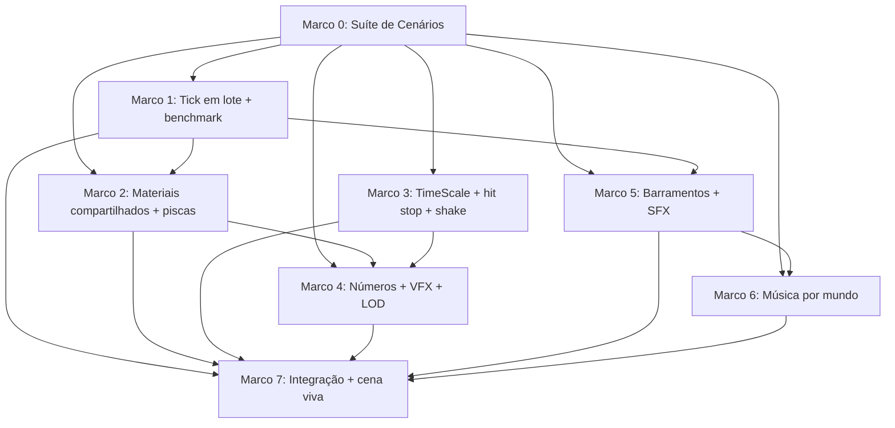

# Plano de Implementação: M14 · Performance mobile, game feel e áudio
> Data: 2026-11-12
> Issue: NEX-519
> Status: Pronto para Execução via /executar

## 1. Contexto & Arquitetura
- **Resumo**: sustentar 60 fps com 300 unidades (200 zumbis + 100 soldados) no Play Mode do Editor GUI. Para isso, os zumbis e projéteis passam a avançar em lote, os materiais passam a ser compartilhados (SRP Batcher preservado) e o feedback ganha LOD. A fatia também acrescenta game feel (pisca de soldado perdido e de acerto, hit stop arbitrado com pausa e câmera lenta, screen shake, números de dano, VFX por `StatusKind`) e áudio (barramentos com volumes das opções, SFX por evento com limite de vozes e atenuação por densidade, música por mundo e assets autorais). A spec de produto vive na História NEX-519 (rascunho em `.scratch/spec-NEX-519.md`).
- **Stack**: Unity 6000.6.3f1, URP 17.6 (SRP Batcher ligado em `Assets/Settings/Mobile_RPAsset.asset:72`), C# com asmdefs `Game.Core` ← `Game.Data` ← `Game.Gameplay` ← `Game.Presentation`, mais `Game.Composition` (VContainer 1.19), `Game.Editor` e os testes. Há TextMeshPro (uGUI 2.6). Não há Burst/Collections no manifest.
- **Verificação disponível**: suíte confiável, com `tools/unity compile` (0 erros), `test-edit` (baseline 1232/1232 em `5de29b6`) e `test-play`. Para render e frame time, o Editor vivo (`unity`, pacote `com.unity.pipeline` 0.8.0-exp.1) roda no Editor GUI (`docs/agentes/editor-vivo.md:43`: headless não desenha). `validate`/`simulate` são stubs sem valor de evidência.

### 1.1 Dossiê de Investigação

**HEAD e baseline.** HEAD `5de29b6e02ba27cfcab1caf267356772cdbee31e`, na branch `jamilzerati/nex-519-story-m14-performance-mobile-game-feel-e`. Em 2026-11-12, `tools/unity compile` saiu com `SUCCESS: 0 errors` e `tools/unity test-edit` com `SUCCESS: 1232/1232 passed` (`.artifacts/test-edit.log`). A execução reescreveu os assets de `Assets/_Game/Data/`, `Packages/`, `ProjectSettings/` e as cenas, sem mudança real, e tudo foi restaurado com `git checkout --` (ruído descrito no guardrail). O benchmark de frame time ainda não tem baseline numérica, porque o comando não existe. O Passo 1 mede a baseline **antes** de alterar o gameplay (é a condição do Passo 1, ver §6).

**Jornada atual (entrada → efeito):**
1. Spawn: `HordeSpawner` (`Gameplay/Enemies/HordeSpawner.cs:98`) cria `ObjectPool<EnemyController>` com capacidade inicial 15 (`SceneBuilder.cs:760-764`). Cada zumbi tem `Update` próprio (`EnemyController.cs:222`), que lê `IGameTimeService.GetDeltaTime(TimeTarget.Enemy)` e anda por `transform.position` (`:271`). O zumbi pode morrer e se reciclar dentro do próprio `Tick` (`:257-260`, `Die()`→`Recycle()`).
2. Tiro: `WeaponController.FireVolley` (`Gameplay/Combat/WeaponController.cs:185-205`) aluga `emissores × ProjectileCount` projéteis por volley, com `PlatoonSolver.MaxEmitters = 40` e 5 soldados por emissor (`Core/Combat/PlatoonSolver.cs:7`). O pool inicial tem 10 (`SceneBuilder.cs:692-696`). Cada `Projectile` tem `Update` (`Projectile.cs:80`) e acerta por `OnTriggerEnter` (`:114`) via `IStatusReceiver`/`IDamageable` (zumbis, jaulas e portões vivos).
3. Render: `EnemyView.cs:47-55` e `ProjectileView.cs:47-55` fazem `new Material` por instância (`meshRenderer.material = mat` em Play). `SquadVisualController.cs:105-130` clona materiais do General e do soldado. `EnemyStatusTint.cs:96-111` grava um `MaterialPropertyBlock` em **todo** `LateUpdate` de cada zumbi. Com o SRP Batcher ligado, o MPB tira o renderer do lote SRP. A tropa já se move num laço central (`SquadVisualController.UpdatePositions`, `:222`).
4. Contato: `MeleeEngagementManager.cs:188-196` calcula `soldiersLost = HealthBuffer.ApplyDamage(...)` e chama `Squad.Remove(soldiersLost)`. Publica só `SoldierDamagedEvent(current, max)`, sem a contagem de soldados perdidos.
5. Tempo: `Time.timeScale` tem três donos. `PauseController.cs` grava 0/1 em `PauseGame`/`ResumeGame` (`:97`, `:119`, `:126`), no `OnDestroy` (`:49-51`) e no `finally` de `QuitToHub` (`:165`). `PauseView.OnDestroy` (`:38-40`) grava 1 se estiver 0. `GeneralAbilityHud.cs` grava 0,3 ao mirar (`:312`), 1 ao soltar (`:335`) e 1 no timeout de mira de 3 s, dentro do `Update` (`:361-368`). Oito suítes afirmam o valor cru de `Time.timeScale` logo após a ação, sem cena: `Tests/EditMode/UI/PauseViewTests.cs`, `Tests/EditMode/GeneralAbilityHudTests.cs:282` e as PlayMode `GeneralAbilityAimPlayModeTests`, `GeneralAbilityRuntimePlayModeTests`, `UiFlowPlayModeTests`, `AdsPlayModeFlowTests`, `BarracksPlayModeTests`, `MutationFlowPlayModeTests`. `GameTimeService` só escala `TimeTarget.Enemy`/`Ally` para quem o consulta.
6. Câmera: `FollowCamera.LateUpdate` (`Presentation/FollowCamera.cs:29-58`) grava `transform.position` direto, então não existe ponto para somar um shake.
7. Áudio: `GeneralAbilityAudio.cs:10` é um único `AudioSource` + `PlayOneShot` de `Assets/_Game/Audio/SFX/grenade_explosion.ogg`. `AudioSettings.cs` persiste master/sfx/bgm em `PlayerPrefs`, e `OptionsView.cs:112-140` lê e grava esses valores, mas nada aplica o volume a um som (não há `AudioMixer` no projeto).
8. Dados de fase: `Data/LevelDefinition.cs:9-17` (`LevelId`, `BossId`, …) não tem mundo. Os importadores são registrados um a um em `Editor/Cli.cs:27-39`.
9. Barramento: `Core/Events/EventBus.cs:18` faz `delegates.ToArray()` a cada `Publish`. Com `EnemyHitEvent` por acerto (dezenas por frame com 20 emissores), isso sozinho ameaça o orçamento de GC de 1 KB/frame. `WeaponController.FireVolley` (`:177-180`) aloca uma `List<Projectile>` e o array de pelotões por volley (2–6 por segundo, custo amortizado).
10. Eventos disponíveis: `EnemyKilledEvent(archetypeId, lane, statusesAtDeath, byAbility)`, `GatePassedEvent`, `SurvivorsRescuedEvent` (`Gameplay/Rescue/Cage.cs:185`), `BossDefeatedEvent`, `AbilityUsedEvent(… OriginPosition, TargetPosition, HasSpatialTarget)` e `DamageTakenEvent` (só de `HealthComponent.cs:71`). Não existe evento de acerto em zumbi com posição nem de volley.

**Jornada desejada:** um único `CombatTickDriver` avança zumbis e projéteis. Os renderers trocam entre materiais compartilhados. `EnemyController.ReceiveHit` publica `EnemyHitEvent` (dano, posição, status aplicados), `MeleeEngagementManager` publica `SoldiersLostEvent` e `WeaponController` publica `VolleyFiredEvent`. Ouvintes de apresentação produzem pisca, números, VFX, shake, hit stop (via `TimeScaleArbiter`) e SFX. O `MusicPlayer` toca a trilha do `worldId` da fase, e os volumes das opções passam pelo `AudioBusMixer`.

**Exemplo verificável (atual × desejado):** uma tropa de 20 sofre contato e perde 3 soldados. Hoje a contagem cai para 17, sem feedback visual nem sonoro. Depois, tropa e General piscam em vermelho por 0,15 s, a câmera treme 0,1 s com |offset| em [0,08; 0,15] e o `SoldiersLostEvent(3, 17)` fica observável no bus (CT-9, CT-19).

**Referência REA (decompilada nesta sessão).** Origem: `C:/Users/jamilzerati/Downloads/Top+Lords_1.0.39_APKPure.xapk` → `install_time_pack.apk` → `assets/Assemblies/Assembly-CSharp.mdl` (PE com os 19 primeiros bytes em XOR 0x13; restaurado numa cópia temporária e decompilado com `ilspycmd`). Os IDs de evidência citados no card (`ev_4847…`, `ev_7300…`, `ev_c6b9…`) não estão retidos no servidor REA atual (`get_evidence_bundle` devolveu 0 registros). Por isso, a decompilação foi refeita, e a extração fica registrada aqui:
- `GameKit.Base.FastUpdateSet<T>`: `_datas[]` + `Dictionary<T,int> _indices`; `Add` dobra a capacidade quando cheia; `Remove` move o último para o índice removido (*swap-back*) e limpa a cauda. → `Core/Performance/FastUpdateSet<T>`, com guarda contra duplicata: o `Add` do REA sobrescreveria o índice, e a guarda só torna o erro explícito.
- `CountLODStrategy.CalculateLODLevel`: devolve o primeiro `i` com `count <= thresholds[i]`; se nenhum servir, devolve `thresholds.Length`; com `thresholds` nulo ou vazio, devolve 0.
- `DynamicCostLODStrategy`: `hysteresisTime = 5f`; se `now - lastUpdateTime < hysteresis`, mantém o nível; senão, soma os custos, +1 se `> up`, −1 se `< down`, e só atualiza `lastUpdateTime` quando o nível muda. `Configure` faz `Max(0.1, …)` em up/down/hysteresis e força `up = down + 0.1` quando `up <= down`.
- `SceneLODManager.Update`: a cada `updateInterval`, nível = máximo entre estratégias, cada uma com `Clamp(lodMin, lodMax)`; mudança de nível reaplica nos nós de forma amortizada (`updatePercentPerFrame`). Aqui são só dois nós (números e VFX), então a aplicação é imediata (adaptação registrada em P-6 da spec).
- `MiniGame.Biubiu.Client.DataUICameraShake`: `shakeDuration = 0.1f`, `shakeMagnitude = 0.5f`, `shakeMinMagnitude = 0.8f`; `CustomRandomRange` sorteia em `[-mag, -minMag]` ou `[minMag, mag]` com 50%, por eixo x e y; o laço amostra **antes** de somar `deltaTime`, enquanto `elapsed < duration`; `TriggerShake` é ignorado com `isShaking`; ao fim, restaura a posição original.
- `GPUDamageText.DamageNumManager`: `DEFAULT_RENDER_MAX_NUM = 1023`; `AddDamageNum` devolve 0 (descarta) quando `m_RenderCount >= 1023`; o `Update` remove quando `Time >= TotalTime`, senão `Time += dt`, `t = Time/TotalTime × curve.Length`, canais 0 = alpha, 1-3 = deslocamento xyz somado a `StartPos`, 4-6 = escala xyz × `StartScale`; a remoção move a última entidade para o índice removido.
- `PVEBattleLogic.Unit.UnitViewFacade`/`UnitGameObject`: o pisca usa material **compartilhado** de substituição (`ReplaceMaterialFlashRed/White` → `UnitViewFacade.GetRedMaterial()`), e `MPBReset` restaura. Os MPBs estáticos pré-alocados (`_hitRedMPB`: rim `(1, 0, 1/51, 0)`, `_RimPowInstancing 0.65`) dependem de um shader próprio com propriedades instanciadas, que não existe aqui. A duração do pisca é dirigida por Lua e não aparece no C#; vale a da spec §2.2 (0,15 s).
- `SoundLODService`: `ReverseCalculateVolume(db) = db <= -80 ? 0.0001 : Clamp01(10^(db/20))`; a razão é `lin(min) + (lin(max) - lin(min)) × rate`, com `rate = Clamp01(1 - (x - min)/(max - min))`. No REA, x é o zoom de câmera; aqui é a contagem de zumbis ativos (adaptação).
- Hit stop: não há símbolo `HitStop*` no Assembly-CSharp (busca por string). A mecânica é desenho próprio sobre o `TimeScaleArbiter`.

**Hipóteses e sondagens:**
- H1 "Os materiais por instância quebram o batching": **confirmada** por inspeção (`new Material` em `EnemyView.cs:48`, `ProjectileView.cs:48` e `SquadVisualController.cs:105-130`; MPB por frame em `EnemyStatusTint.cs:108-110`; `m_UseSRPBatcher: 1`). O número de batches será medido no Passo 1.
- H2 "O custo de física domina o frame": **aberta**. Não há números ainda; o benchmark do Passo 1 mede `physicsShareOfP95` (RN-4).
- H3 "Existe uma malha animada que justifique VAT": **refutada**. A busca por `*.fbx`, `*.anim`, `*.controller` e `SkinnedMeshRenderer|Animator` em `Assets` volta vazia; as unidades são primitivas.
- H4 "Remover o `Update` por instância quebra testes que dependem dele": **plausível**. Os PlayMode tests chamam `Tick` direto (`Projectile.Tick` é público) ou dependem do `Update`. Mitigação: o `CombatTickDriver` é criado sob demanda na raiz da cena quando falta, e o Passo 1 roda o `test-play` inteiro.
- H5 "Com domain reload desligado, a estática persiste": **confirmada** (`ProjectSettings/EditorSettings.asset:29-30`, `m_EnterPlayModeOptions: 3`). A paleta e o driver se reiniciam com `[RuntimeInitializeOnLoadMethod(RuntimeInitializeLoadType.SubsystemRegistration)]` e validam `material != null` (null do Unity).
- H6 "Dá para criar um `AudioMixer` por script em CLI": **refutada** para a API pública (a criação é `UnityEditor.Audio.AudioMixerController`, interna). Decisão: barramentos em código (P-5).

**Alternativas e decisão:**
| Tema | Alternativas | Decisão | Por quê |
|---|---|---|---|
| Colisão | (a) PhysX por camadas (atual) · (b) grade 2D REA `Collider2D.GridSpace` + cápsula por projétil | (a), com gatilho RN-4 para (b) | A §2.3 e o `AGENTS.md` exigem Rigidbody cinemático por camada (GH #47). (b) mexeria em projéteis, jaulas, portões vivos e barricadas, e só se justifica com medição. O operador delegou a escolha (comentário de 2026-11-12). |
| Pisca e status | (a) MPB · (b) troca de `sharedMaterial` da paleta (REA `ReplaceMaterialFlash*`) · (c) shader instanciado próprio | (b) | O MPB quebra o SRP Batcher com URP Lit. (c) exige shader e arte. (b) é a técnica do REA e mantém o lote. |
| Números de dano | (a) passe URP instanciado (REA) · (b) pool TextMeshPro com o modelo REA | (b) | (a) exige `ScriptableRendererFeature` e atlas de glifos. (b) preserva teto, curvas e *swap-back*, e o custo é medido e cortado por LOD. |
| Mixagem | (a) `.mixer` · (b) barramentos em código | (b) | A criação do mixer é API interna, e o fluxo é CLI-first. A fórmula dB do REA é preservada. |
| Tick | (a) Jobs/Burst · (b) `FastUpdateSet` em laço gerenciado | (b) | Os pacotes não estão instalados (decisão humana). O REA usa (b). |

**Matriz risco → cenário → resultado esperado → verificação → ambiente:**
| Risco | Cenário | Esperado | Comando/ação | Ambiente |
|---|---|---|---|---|
| Remoção durante iteração | Zumbi escapa/morre no próprio `Tick` | Nenhum pulado nem repetido | CT-2 (`test-play`) | real (PlayMode) |
| dt divergente | Zumbi com bullet time e status Slow | Deslocamento = v·dt(Enemy)·mult | CT-3 | real |
| Domain reload desligado | Duas entradas em Play seguidas | Paleta sem material destruído; driver vazio | CT-4 repetido 2× na mesma sessão | Editor vivo |
| Dois donos de `timeScale` | Pausa durante hit stop; câmera lenta + hit stop | 0 se pausado; mínimo das requisições | CT-13, CT-14, CT-15 | unitário + PlayMode |
| Hit stop congela o próprio timer | Escala 0 | O timer usa dt sem escala e termina | CT-16 | unitário |
| Shake rompe o seguimento | Shake com o General trocando de lane | Posição base = alvo + offset | CT-19 | real |
| Teto de números | 50 acertos no frame | 48 ativos, 2 descartados | CT-21 | unitário |
| Rajada de SFX | 40 emissores × volleys | No máximo `maxVoices` | CT-29, CT-31 | unitário + PlayMode |
| Volume sem efeito | Slider SFX = 0 | Vozes a 0 no frame | CT-28 | real |
| Asset proibido | `.ogg` copiado do APK | Hash ≠ todos do APK | CT-34 | inspeção |
| Ruído de regeneração | `import-content`/`test-*` reescrevem assets | `git status` só com a intenção | `git status` + `git checkout --` | real |
| Medição em headless | Benchmark em batchmode | Recusa com motivo, exit ≠ 0 | CT-7 | Editor batch |
| Regressão de gameplay | Números de combate | Nenhum número de combate muda | `test-edit` + `test-play` completos | real |
| Startup/instalação/migração/rollback | Save e `PlayerPrefs` inalterados; reverter um PR remove só a apresentação | N/A para migração: nenhum formato persistido muda | inspeção do diff | — |
| Concorrência/timeout/quota | Só a geração fal (rede) | Fallback lavfi registrado | log do Passo 5/6 | real |

**Lacunas:** (1) o benchmark exige o Editor GUI da worktree (`unity` com o Editor aberto nesta pasta), e cada Marco que mede abre o próprio Editor. Condição: `unity status` mostra `ready`. (2) A geração fal depende da credencial FAL do humano; sem ela, vale o fallback P-8. (3) A sensação no aparelho fica com o humano, via APK de `build-android`.

## 2. Armadilhas do Repositório

| Armadilha | Onde morde (arquivo/passo) | Regra a respeitar |
|---|---|---|
| Domain reload desligado (`m_EnterPlayModeOptions: 3`) | `SharedMaterialPalette`, `CombatTickDriver` — Passos 1, 2 | Reiniciar a estática em `SubsystemRegistration`; tratar material destruído como ausente. |
| Remoção *swap-back* durante a iteração | `CombatTickDriver` — Passo 1 | Iterar de `Count-1` até 0; o elemento trocado já foi processado. |
| Trigger exige Rigidbody de um lado (comentário em `Projectile.cs:67`) | `Projectile.cs` — Passo 1 | Não remover `EnsureKinematicBody`/`EnsurePhysicsSetup`; só o `Update` sai. |
| MPB quebra o SRP Batcher | `EnemyStatusTint.cs`, `SquadVisualController.cs` — Passo 2 | Trocar `sharedMaterial`; proibido `SetPropertyBlock` nesses renderers. |
| `renderer.material` clona | `EnemyView.cs`, `ProjectileView.cs` — Passo 2 | Usar só `sharedMaterial`. |
| Três donos de `Time.timeScale` | `PauseController.cs`, `PauseView.cs`, `GeneralAbilityHud.cs` — Passo 3 | Toda escrita passa pelo `TimeScaleArbiter`, aplicado de forma **síncrona** por `TimeScaleOwner.Shared` (C# puro, sem depender de objeto na cena), para que as 8 suítes que leem `Time.timeScale` logo após a ação continuem verdes sem editar asserts. |
| `.meta` de pasta | Pastas novas — todos os Passos | Pasta nova leva `.meta` próprio; duas tarefas paralelas não criam a mesma pasta (o grafo garante). |
| Projétil e zumbi em fixtures sem cena (`ProjectileContactPlayModeTests.cs:40-80`) | Passo 1 | `Register` chama `CombatTickDriver.EnsureInstance()`, que cria o driver na raiz quando falta; nenhuma fixture precisa de mudança. |
| `FollowCamera` grava a posição no `LateUpdate` | `FollowCamera.cs` — Passo 3 | O shake entra como offset somado dentro do próprio `UpdateCameraPosition`, nunca por um segundo `LateUpdate` concorrente. |
| Gerado se regenera | `Assets/_Game/Data/**`, `Assets/_Game/Scenes/*.unity` — Passos 3-7 | Mudar o JSON ou o `SceneBuilder` e regenerar; a regeneração legítima vai num commit `chore` separado. |
| Ruído de `rid`/`fileID` após testes | todos os Passos | `git checkout --` do que não é intenção (visto na baseline). |
| `Game.Core` sem UnityEngine | Passo 0 | Contratos puros; curvas são `PiecewiseLinearCurve`, não `AnimationCurve`. |
| Headless não desenha (`editor-vivo.md:43`) | Benchmark — Passos 1, 7 | Medir só no Editor GUI; em batch, recusar. |
| `test-play` roda com `-batchmode -nographics` (`tools/unity.ps1:76`) | CTs PlayMode de render/áudio — Passos 2, 4, 5, 6 | Afirmar só estado (material atribuído, `HasPropertyBlock`, `AudioSource.volume`/`clip`/`isPlaying` quando houver dispositivo), nunca pixels; a prova visual e audível é do Editor GUI (Passos 1, 7). |
| `EventBus.Publish` aloca `ToArray` por publicação (`EventBus.cs:18`) | Passo 1 | Trocar por snapshot em cache invalidado em Subscribe/Unsubscribe, preservando a semântica: quem assina ou desassina durante um `Publish` não muda a iteração em curso. |
| `capture_game_view` grava em `Assets/.artifacts/` | Evidências — Passo 7 | Mover para `.artifacts/` da raiz e apagar `Assets/.artifacts/`. |
| `.meta` junto e LFS para binários | `.ogg`, materiais — Passos 5, 6 | Commitar `.meta`; conferir `.gitattributes` para `*.ogg`. |
| Clean-room de assets | Passos 5, 6 | Proibido copiar do APK; registrar cada asset em `fal_manifest.jsonl`. |
| Importadores registrados à mão | `Editor/Cli.cs:27-39` — Passo 7 | Só o Marco de integração toca `Cli.cs`; os Marcos testam o importador direto. |

## 3. Árvore de Arquivos

Raiz dos scripts: `Assets/_Game/Scripts/`. Todo arquivo e toda pasta nova levam `.meta`. Pastas por dono: `Core/Performance`, `Core/Feedback`, `Core/Audio`, `Tests/EditMode/{Performance,Time,Feedback,Audio}` (Marco 0); `Presentation/Diagnostics`, `Tests/EditMode/Events` (Marco 1); `Presentation/Rendering` (Marco 2); `Presentation/Feedback`, `Data/Feel`, `Content/Source/Feel`, `Tests/EditMode/Feel` (Marco 3; o Marco 4 só acrescenta); `Presentation/Audio`, `Data/Audio`, `Content/Source/Audio` (Marco 5; o Marco 6 só acrescenta); `Assets/_Game/Audio/Music` (Marco 6).

- Passo 0 (Marco 0):
  - [NOVO] `Core/Performance/FastUpdateSet.cs`, `Core/Performance/FrameTimeStatistics.cs`, `Core/Performance/LodSample.cs`, `Core/Performance/ILodStrategy.cs`, `Core/Performance/CountLodStrategy.cs`, `Core/Performance/DynamicCostLodStrategy.cs`, `Core/Performance/LodLevelSelector.cs` (stubs)
  - [NOVO] `Core/Time/TimeScaleSource.cs`, `Core/Time/TimeScaleArbiter.cs`, `Core/Time/HitStopTimer.cs` (stubs)
  - [NOVO] `Core/Feedback/IRandomSource.cs`, `Core/Feedback/SystemRandomSource.cs`, `Core/Feedback/FlashTimer.cs`, `Core/Feedback/CameraShakeBand.cs`, `Core/Feedback/ShakeOffset.cs`, `Core/Feedback/ICurve.cs`, `Core/Feedback/PiecewiseLinearCurve.cs`, `Core/Feedback/DamageNumberCurves.cs`, `Core/Feedback/DamageNumberState.cs`, `Core/Feedback/DamageNumberSimulation.cs` (stubs)
  - [NOVO] `Core/Audio/VolumeDecibels.cs`, `Core/Audio/SfxCue.cs`, `Core/Audio/SfxCueLimit.cs`, `Core/Audio/SfxVoiceLimiter.cs`, `Core/Audio/DensityAttenuation.cs`, `Core/Audio/AudioBusMixer.cs`, `Core/Audio/MusicTrackSelector.cs` (stubs)
  - [NOVO] `Core/Events/EnemyHitEvent.cs`, `Core/Events/SoldiersLostEvent.cs`, `Core/Events/VolleyFiredEvent.cs` (dados completos)
  - [NOVO] `Tests/EditMode/Performance/FastUpdateSetTests.cs`, `FrameTimeStatisticsTests.cs`, `LodStrategyTests.cs`; `Tests/EditMode/Time/TimeScaleArbiterTests.cs`, `HitStopTimerTests.cs`; `Tests/EditMode/Feedback/FlashTimerTests.cs`, `CameraShakeBandTests.cs`, `DamageNumberSimulationTests.cs`; `Tests/EditMode/Audio/VolumeDecibelsTests.cs`, `SfxVoiceLimiterTests.cs`, `DensityAttenuationTests.cs`, `AudioBusMixerTests.cs`, `MusicTrackSelectorTests.cs`
  - [MODIFICAÇÃO] `CONTEXT.md` (termos Hit stop, Pisca, LOD de feedback, Barramento de áudio, Cue)
- Passo 1 (Marco 1):
  - [NOVO] `Gameplay/Combat/CombatTickDriver.cs`; `Presentation/Diagnostics/PerformanceBenchmarkProbe.cs`; `Editor/Tools/PerformanceBenchmarkCommand.cs`; `Tests/PlayMode/CombatTickDriverPlayModeTests.cs`
  - [MODIFICAÇÃO] `Gameplay/Combat/Projectile.cs`, `Gameplay/Enemies/EnemyController.cs`, `Gameplay/Enemies/HordeSpawner.cs`, `Gameplay/Combat/WeaponController.cs` (só prewarm), `Infrastructure/Pooling/ObjectPool.cs`, `Infrastructure/Pooling/IObjectPool.cs`, `Core/Events/EventBus.cs` (snapshot sem alocação), `Tests/EditMode/Events/EventBusSnapshotTests.cs` [NOVO], `Core/Performance/FastUpdateSet.cs`, `Core/Performance/FrameTimeStatistics.cs`
- Passo 2 (Marco 2):
  - [NOVO] `Presentation/Rendering/SharedMaterialPalette.cs`; `Presentation/Rendering/SquadDamageFlash.cs`; `Tests/PlayMode/SharedMaterialBatchingPlayModeTests.cs`; `Tests/PlayMode/DamageFlashPlayModeTests.cs`
  - [MODIFICAÇÃO] `Presentation/EnemyView.cs`, `Presentation/ProjectileView.cs`, `Presentation/SquadVisualController.cs`, `Presentation/EnemyStatusTint.cs`, `Gameplay/Enemies/EnemyController.cs` (publica `EnemyHitEvent`), `Gameplay/Combat/MeleeEngagementManager.cs` (publica `SoldiersLostEvent`), `Core/Feedback/FlashTimer.cs`
- Passo 3 (Marco 3):
  - [NOVO] `Presentation/Feedback/HitStopController.cs`, `Presentation/Feedback/CameraShaker.cs`, `Presentation/Feedback/TimeScaleOwner.cs` (aplica `TimeScaleArbiter.EffectiveScale` em `Time.timeScale`); `Data/Feel/GameFeelDefinition.cs`; `Editor/GameFeelImporter.cs`; `Content/Source/Feel/game_feel.json`; `Tests/EditMode/Feel/GameFeelImporterTests.cs`; `Tests/PlayMode/HitStopShakePlayModeTests.cs`
  - [MODIFICAÇÃO] `Core/Time/TimeScaleArbiter.cs`, `Core/Time/HitStopTimer.cs`, `Core/Feedback/CameraShakeBand.cs`, `Core/Feedback/SystemRandomSource.cs`, `Presentation/UI/PauseController.cs`, `Presentation/UI/PauseView.cs`, `Presentation/GeneralAbilityHud.cs`, `Presentation/FollowCamera.cs`
- Passo 4 (Marco 4):
  - [NOVO] `Presentation/Feedback/DamageNumberView.cs`, `Presentation/Feedback/StatusEffectVfxView.cs`, `Presentation/Feedback/FeedbackLodController.cs`; `Tests/PlayMode/DamageNumbersVfxPlayModeTests.cs`
  - [MODIFICAÇÃO] `Core/Feedback/DamageNumberSimulation.cs`, `Core/Feedback/PiecewiseLinearCurve.cs`, `Core/Performance/CountLodStrategy.cs`, `Core/Performance/DynamicCostLodStrategy.cs`, `Core/Performance/LodLevelSelector.cs`, `Data/Feel/GameFeelDefinition.cs`, `Editor/GameFeelImporter.cs`, `Content/Source/Feel/game_feel.json`, `Tests/EditMode/Feel/GameFeelImporterTests.cs`
- Passo 5 (Marco 5):
  - [NOVO] `Presentation/Audio/SfxPlayer.cs`, `Presentation/Audio/AudioBusBinding.cs`; `Data/Audio/AudioCatalogDefinition.cs`; `Editor/AudioCatalogImporter.cs`; `Content/Source/Audio/audio_catalog.json`; `Assets/_Game/Audio/SFX/{shot_pistol,enemy_killed,gate_passed,cage_opened}.ogg`; `Assets/_Game/Audio/fal_manifest.jsonl`; `tools/audit-audio-manifest.ps1`; `Tests/EditMode/Audio/AudioCatalogImporterTests.cs`; `Tests/PlayMode/SfxPlayerPlayModeTests.cs`
  - [MODIFICAÇÃO] `Core/Audio/VolumeDecibels.cs`, `Core/Audio/SfxVoiceLimiter.cs`, `Core/Audio/DensityAttenuation.cs`, `Core/Audio/AudioBusMixer.cs`, `Presentation/Settings/IAudioSettings.cs`, `Presentation/Settings/AudioSettings.cs`, `Presentation/GeneralAbilityAudio.cs`, `Gameplay/Combat/WeaponController.cs` (publica `VolleyFiredEvent`)
- Passo 6 (Marco 6):
  - [NOVO] `Presentation/Audio/MusicPlayer.cs`; `Assets/_Game/Audio/Music/{world_1,world_2,hub}.ogg`; `Tests/PlayMode/MusicPlayerPlayModeTests.cs`
  - [MODIFICAÇÃO] `Core/Audio/MusicTrackSelector.cs`, `Data/LevelDefinition.cs` (`WorldId`), `Editor/LevelImporter.cs`, `Content/Source/Levels/level_01.json`, `Content/Source/Levels/level_05_boss.json`, `Data/Audio/AudioCatalogDefinition.cs`, `Editor/AudioCatalogImporter.cs`, `Content/Source/Audio/audio_catalog.json`, `Assets/_Game/Audio/fal_manifest.jsonl`, `Tests/EditMode/Audio/AudioCatalogImporterTests.cs`
- Passo 7 (Marco 7):
  - [NOVO] `Tests/PlayMode/M14IntegrationPlayModeTests.cs`; `docs/evidencias/NEX-519-*.png`
  - [MODIFICAÇÃO] `Editor/SceneBuilder.cs`, `Editor/Cli.cs`, `Composition/GreyboxRunComposer.cs`, `Composition/GameLifetimeScope.cs`, `Presentation/UI/HubView.cs` (somente se P-9 se confirmar); regenerados (commit `chore`): `Assets/_Game/Scenes/*.unity`, `Assets/_Game/Data/Feel/*.asset`, `Assets/_Game/Data/Audio/*.asset`, `Assets/_Game/Data/Levels/*.asset`

## 4. Contratos e Interfaces

Só declarações; os corpos ficam a cargo de cada Marco. No Marco 0, os métodos lançam `NotImplementedException` (stubs), e os testes Red falham por comportamento, não por compilação.

```csharp
namespace Game.Core.Performance
{
    public sealed class FastUpdateSet<T> where T : class
    {
        public FastUpdateSet(int initialCapacity = 4);
        public int Count { get; }
        public int Capacity { get; }
        public T this[int index] { get; }
        public bool Add(T item);          // false se já presente
        public bool Remove(T item);       // swap-back; false se ausente
        public bool Contains(T item);
        public int IndexOf(T item);       // -1 se ausente
    }

    public static class FrameTimeStatistics
    {
        public static float Percentile(IReadOnlyList<float> samplesMs, float percentile); // nearest-rank, 0<p<=100
        public static float Mean(IReadOnlyList<float> samples);
    }

    public readonly struct LodSample
    {
        public LodSample(int unitCount, float dynamicCost, float realtimeSeconds);
        public int UnitCount { get; }
        public float DynamicCost { get; }
        public float RealtimeSeconds { get; }
    }

    public interface ILodStrategy { int CalculateLevel(int currentLevel, LodSample sample); }
    public sealed class CountLodStrategy : ILodStrategy { public CountLodStrategy(IReadOnlyList<int> thresholds); }
    public sealed class DynamicCostLodStrategy : ILodStrategy
    {
        public DynamicCostLodStrategy(float upThreshold, float downThreshold, float hysteresisSeconds = 5f);
        public void Configure(float upThreshold, float downThreshold, float hysteresisSeconds = 5f);
    }
    public sealed class LodLevelSelector
    {
        public LodLevelSelector(int minLevel, int maxLevel, float updateIntervalSeconds, IReadOnlyList<ILodStrategy> strategies);
        public int CurrentLevel { get; }
        public bool Update(LodSample sample); // true quando o nível muda
    }
}

namespace Game.Core.Time
{
    public enum TimeScaleSource { Pause, AbilitySlowMotion, HitStop }
    public sealed class TimeScaleArbiter
    {
        public float EffectiveScale { get; }               // min das requisições ativas; 1 sem requisições
        public event Action<float> EffectiveScaleChanged;
        public void Request(TimeScaleSource source, float scale); // uma por fonte; repetir sobrescreve
        public void Release(TimeScaleSource source);
        public bool IsActive(TimeScaleSource source);
    }
    public sealed class HitStopTimer
    {
        public bool IsActive { get; }
        public float Scale { get; }
        public float RemainingSeconds { get; }
        public void Trigger(float durationSeconds, float scale); // ativo: restante = max(restante, novo), escala = min
        public bool Tick(float unscaledDeltaSeconds);            // devolve IsActive após o passo
    }
}

namespace Game.Core.Feedback
{
    public interface IRandomSource { float NextFloat01(); }
    public sealed class SystemRandomSource : IRandomSource { public SystemRandomSource(int seed); }
    public sealed class FlashTimer
    {
        public FlashTimer(float durationSeconds);
        public bool IsActive { get; }
        public float RemainingSeconds { get; }
        public void Trigger();               // reinicia a duração cheia
        public bool Tick(float deltaSeconds); // dt <= 0 ignorado
    }
    public readonly struct ShakeOffset { public ShakeOffset(float x, float y); public float X { get; } public float Y { get; } public static ShakeOffset Zero { get; } }
    public sealed class CameraShakeBand
    {
        public CameraShakeBand(IRandomSource random);
        public bool IsActive { get; }
        public bool Trigger(float durationSeconds, float minMagnitude, float maxMagnitude); // false se já ativo
        public ShakeOffset Sample(float unscaledDeltaSeconds); // amostra antes de somar dt (REA)
    }
    public interface ICurve { float Evaluate(float normalizedTime); }
    public sealed class PiecewiseLinearCurve : ICurve { public PiecewiseLinearCurve(IReadOnlyList<(float time, float value)> keys); } // clamp fora de [primeiro, último]
    public sealed class DamageNumberCurves
    {
        public DamageNumberCurves(ICurve alpha, ICurve offsetX, ICurve offsetY, ICurve offsetZ, ICurve scaleX, ICurve scaleY, ICurve scaleZ);
    }
    public readonly struct DamageNumberState
    {
        public ulong Id { get; } public int Value { get; } public float Alpha { get; }
        public float PositionX { get; } public float PositionY { get; } public float PositionZ { get; }
        public float ScaleX { get; } public float ScaleY { get; } public float ScaleZ { get; }
    }
    public sealed class DamageNumberSimulation
    {
        public DamageNumberSimulation(int capacity, DamageNumberCurves curves);
        public int ActiveCount { get; }
        public DamageNumberState this[int index] { get; }
        public bool TryAdd(int value, float x, float y, float z, float startScale, float totalTimeSeconds, out ulong id); // false com o teto cheio
        public void Tick(float deltaSeconds); // expira com Time >= Total; senão Time += dt; avalia; swap-back
    }
}

namespace Game.Core.Audio
{
    public static class VolumeDecibels
    {
        public const float SilenceDecibels = -80f;
        public const float SilenceLinear = 0.0001f;
        public static float ToLinear(float decibels);   // REA ReverseCalculateVolume
        public static float ToDecibels(float linear);   // inverso; linear <= 0.0001 → -80
    }
    public enum SfxCue { Shot, EnemyKilled, GatePassed, CageOpened, GrenadeExplosion }
    public readonly struct SfxCueLimit { public SfxCueLimit(int maxVoices, float minIntervalSeconds); public int MaxVoices { get; } public float MinIntervalSeconds { get; } }
    public sealed class SfxVoiceLimiter
    {
        public SfxVoiceLimiter(IReadOnlyDictionary<SfxCue, SfxCueLimit> limits);
        public bool TryAcquire(SfxCue cue, float nowSeconds); // false: descarta o novo
        public void Release(SfxCue cue);
        public int ActiveVoices(SfxCue cue);
    }
    public sealed class DensityAttenuation
    {
        public DensityAttenuation(int minCount, int maxCount, float minDecibels, float maxDecibels);
        public float RatioFor(int activeEnemies); // REA SoundLODService
    }
    public sealed class AudioBusMixer
    {
        public float Master { get; set; } public float Sfx { get; set; } public float Music { get; set; } // clamp01
        public float DensityRatio { get; set; }
        public event Action Changed;
        public float EffectiveSfx(float cueGain);    // Master × Sfx × gain × DensityRatio
        public float EffectiveMusic(float trackGain); // Master × Music × gain
    }
    public sealed class MusicTrackSelector
    {
        public MusicTrackSelector(IReadOnlyDictionary<string, string> worldToTrackKey, string defaultWorldId);
        public string Select(string worldId); // null quando não há trilha
    }
}

namespace Game.Core.Events
{
    public readonly struct EnemyHitEvent
    {
        public EnemyHitEvent(string archetypeId, int laneIndex, int damage, float positionX, float positionY, float positionZ, IReadOnlyList<StatusKind> appliedStatuses);
        // propriedades homônimas; AppliedStatuses nunca nulo
    }
    public readonly struct SoldiersLostEvent { public SoldiersLostEvent(int count, int remainingSquad); public int Count { get; } public int RemainingSquad { get; } }
    public readonly struct VolleyFiredEvent { public VolleyFiredEvent(string weaponId, int emitterCount, int projectileCount); }
}

// Game.Data (ScriptableObject importados de JSON)
// GameFeelDefinition: soldierLostFlashSeconds, enemyHitFlashSeconds, hitStops[{trigger: BossDefeated|AbilityExplosion, seconds, scale}],
//   shakes[{trigger: AbilityExplosion|SoldiersLost|BossDefeated, seconds, minMagnitude, maxMagnitude}],
//   damageNumbers{capacity, totalTimeSeconds, startScale, curves{alpha,offsetX..Z,scaleX..Z: [[t,v]...]}},
//   statusVfx{poolPerKind}, lod{countThresholds[], up, down, hysteresisSeconds, updateIntervalSeconds, minLevel, maxLevel}
// AudioCatalogDefinition: cues[{cue, clipPath→AudioClip, gain, maxVoices, minIntervalSeconds}],
//   density{minCount, maxCount, minDecibels, maxDecibels}, music[{worldId, clipPath→AudioClip, gain}], defaultWorldId, crossfadeSeconds
// IAudioSettings (+): event Action VolumesChanged;  LevelDefinition (+): string WorldId (vazio = defaultWorldId)
```

Padrões do `game_feel.json` (P-4): pisca de soldado 0,15 s e de acerto 0,15 s; hit stop `BossDefeated` 0,12 s/0 e `AbilityExplosion` 0,06 s/0,05; shake `AbilityExplosion` 0,1 s [0,3; 0,5], `SoldiersLost` 0,1 s [0,08; 0,15], `BossDefeated` 0,1 s [0,5; 0,8] (valores REA); números com teto 48, 0,6 s, escala 1, alpha `[[0,1],[0.6,1],[1,0]]`, offsetY `[[0,0],[1,1.2]]`, escala `[[0,1.3],[0.2,1],[1,1]]`; VFX com 8 por tipo; LOD com thresholds `[80,160]`, up 60, down 30, histerese 5 s, intervalo 0,5 s, níveis 0..2 (custo = números ativos + VFX ativos). Áudio: `Shot` 4 vozes/0,05 s, `EnemyKilled` 6/0,03 s, `GatePassed` 2/0,1 s, `CageOpened` 2/0,1 s, `GrenadeExplosion` 2/0; densidade [50, 200] / [−6, 0] dB; crossfade 1 s; `defaultWorldId` `world_1`.

## 4.5 Linear overlay
- **História (issue-pai):** `NEX-519`
- **Sub-issues deste plano:** Marco 0 → `NEX-1511`, Marco 1 → `NEX-1512`, Marco 2 → `NEX-1513`, Marco 3 → `NEX-1514`, Marco 4 → `NEX-1515`, Marco 5 → `NEX-1516`, Marco 6 → `NEX-1517`, Marco 7 → `NEX-1518`
- **PRs (modelo C):** a história usa `jamilzerati/nex-519-story-m14-performance-mobile-game-feel-e`, com draft PR → `main`. Cada tarefa ramifica da história, e o PR da tarefa aponta para a branch da história. Cânone: kit `global/TRACK.md`.

## 4.6 Grafo de Dependências

| De | Para | Tipo | Por quê |
|---|---|---|---|
| Marco 0 | Marco 1 | implementação | O Marco 1 implementa `FastUpdateSet`/`FrameTimeStatistics` criados como stub no Marco 0 (mesmo arquivo) e precisa dos testes Red deles. |
| Marco 0 | Marco 2 | implementação | Implementa `FlashTimer` (stub do Marco 0) e publica `EnemyHitEvent`/`SoldiersLostEvent`, criados no Marco 0. |
| Marco 0 | Marco 3 | implementação | Implementa `TimeScaleArbiter`, `HitStopTimer` e `CameraShakeBand` (stubs do Marco 0). |
| Marco 0 | Marco 4 | implementação | Implementa `DamageNumberSimulation`, curvas e LOD (stubs do Marco 0). |
| Marco 0 | Marco 5 | implementação | Implementa os tipos de `Core/Audio` (stubs) e publica `VolleyFiredEvent`. |
| Marco 0 | Marco 6 | implementação | Implementa `MusicTrackSelector` (stub do Marco 0). |
| Marco 1 | Marco 2 | implementação | Ambos tocam `EnemyController.cs`: o Marco 2 insere a publicação de `EnemyHitEvent` no `ReceiveHit`, já sem o `Update` removido no Marco 1. |
| Marco 1 | Marco 5 | implementação | Ambos tocam `WeaponController.cs` (prewarm no Marco 1; `VolleyFiredEvent` no Marco 5). |
| Marco 2 | Marco 4 | implementação | Números e VFX consomem o `EnemyHitEvent` que o Marco 2 passa a publicar no `ReceiveHit` (efeito colateral real, não só assinatura). |
| Marco 3 | Marco 4 | implementação | Ambos tocam `GameFeelDefinition.cs`, `GameFeelImporter.cs` e `game_feel.json` (o Marco 4 acrescenta as seções de números, VFX e LOD). |
| Marco 5 | Marco 6 | implementação | Ambos tocam `AudioCatalogDefinition`, `AudioCatalogImporter`, `audio_catalog.json` e `fal_manifest.jsonl` (o Marco 6 acrescenta a seção de música). |
| Marco 1 | Marco 7 | implementação | A integração liga o `CombatTickDriver` e roda o benchmark final. |
| Marco 2 | Marco 7 | implementação | A integração liga a paleta e os piscas no `SceneBuilder`. |
| Marco 3 | Marco 7 | implementação | A integração registra o `GameFeelImporter` em `Cli.cs` e liga hit stop e shake. |
| Marco 4 | Marco 7 | implementação | A integração liga números, VFX e LOD. |
| Marco 5 | Marco 7 | implementação | A integração registra o `AudioCatalogImporter` e liga `SfxPlayer`/`AudioBusBinding`. |
| Marco 6 | Marco 7 | implementação | A integração liga o `MusicPlayer` ao `RunStartedEvent` da composição. |

Não há aresta `interface`: todo consumo depende de arquivo compartilhado ou de efeito publicado. O Marco 7 é o único que toca os pontos de montagem (`SceneBuilder.cs`, `Cli.cs`, `GreyboxRunComposer.cs`, `GameLifetimeScope.cs`). Os Marcos 1, 3 e 5 rodam em paralelo depois do Marco 0; o Marco 2 espera o 1; o 4 espera o 2 e o 3; o 6 espera o 5.



## 5. Divisão de Execução por Passo

| Faixa | Passos | Por quê |
|---|---|---|
| **Risco de falha silenciosa** | 0, 1, 2, 3, 4, 5, 6, 7 | O tick em lote pode pular ou duplicar entidades e mudar o dt sem exceção (1). A troca de material pode reintroduzir clones ou MPB sem erro, só perda de batching (2). A arbitragem de `timeScale` pode deixar o jogo despausado (3). Teto, curvas e histerese do LOD mudam números de forma silenciosa (4). As fórmulas de dB e densidade mudam volumes (5). O fallback de mundo pode tocar a trilha errada (6). A integração pode deixar um componente sem fiação (shelfware) (7). O Marco 0 fixa as fórmulas REA nos oráculos. |
| **Falha visível** | — | Nenhum passo é puramente mecânico. |

## 6. Checklist de Execução

- [ ] **Passo 0 (Marco 0)**: `Suíte de Cenários & E2E Specs` [NEX-1511]
  - **Ação**: Criar os contratos puros de §4 como stubs (`NotImplementedException`), os eventos completos e os testes EditMode Red CT-1, CT-5\*, CT-10, CT-13, CT-14, CT-16, CT-17, CT-18, CT-20, CT-21, CT-24, CT-25, CT-27, CT-29, CT-30, CT-32 (\*CT-5 só como contrato de nome no plano; o teste é do Marco 2). Atualizar `CONTEXT.md`.
  - **Lógica de Negócios / Responsabilidade**: Fixar as fórmulas REA da §1.1 como oráculos (FastUpdateSet *swap-back*, Count/DynamicCost/Selector, shake por faixa com `IRandomSource` determinístico, simulação de números com teto 1023→48 configurável e ordem expira→soma→avalia, dB com piso −80, densidade). Os testes carregam o `CT-n` no nome. Red por comportamento: compila e falha por `NotImplementedException`/valor errado, nunca por runner quebrado. Armadilha: `Game.Core` sem UnityEngine.
  - **Dependências / Pré-requisitos**: nenhuma (raiz).
  - **Seam Público**: tipos de `Game.Core.Performance|Time|Feedback|Audio` e `Game.Core.Events` (§4).
  - **AC**: AC-1, AC-5, AC-7, AC-8, AC-9, AC-10, AC-12, AC-13, AC-14, AC-15 (CTs acima)
  - **Marco de PR**: Marco 0
  - **Effort**: high

- [ ] **Passo 1 (Marco 1)**: `Gameplay/Combat/CombatTickDriver.cs` + `Editor/Tools/PerformanceBenchmarkCommand.cs` [NEX-1512] [GAMEPLAY]
  - **Ação**: Criar o benchmark (`PerformanceBenchmarkProbe` + comando) e medir a **baseline antes** de mexer no gameplay. Depois, implementar `FastUpdateSet`/`FrameTimeStatistics`, criar o `CombatTickDriver`, remover o `Update` de `Projectile` e `EnemyController` (registro em `Initialize`, saída em `Recycle`), acrescentar `Prewarm(int)` em `IObjectPool`/`ObjectPool` (`Prewarm(n)` completa o estoque ocioso até n instâncias criadas pela factory, sem disparar `onRent` nem ativar o objeto; o construtor continua criando `initialCapacity`) e pré-aquecer os pools de zumbi (200) e projétil (40 × máximo de `ProjectileCount` das armas). Trocar o `ToArray` de `EventBus.Publish` por um snapshot `Delegate[]` em cache por tipo, reconstruído só em Subscribe/Unsubscribe (CT-38). Medir de novo.
  - **Lógica de Negócios / Responsabilidade**: O driver itera de `Count-1` até 0 (armadilha *swap-back*). O zumbi recebe `GetDeltaTime(TimeTarget.Enemy, Time.deltaTime)` e o projétil `Time.deltaTime`, os mesmos valores de hoje. `Register` chama `EnsureInstance()`, que cria o driver na raiz da cena quando falta, para que as fixtures sem cena (`ProjectileContactPlayModeTests`, `CombatEngagementPlayModeTests`) sigam funcionando sem mudança, e a estática se reinicia em `SubsystemRegistration` (armadilha de domain reload). Os Rigidbodies cinemáticos ficam intactos. O benchmark segue a RN-3; em batch ou com `GraphicsDeviceType.Null`, recusa (CT-7). Antes de medir, a sonda lê de volta `Screen.width/height` (540×960), `QualitySettings.vSyncCount` (0), `Application.targetFrameRate` (−1), `SystemInfo.graphicsDeviceType` (≠ Null) e `UnityStats.batches` (> 0 no aquecimento). Qualquer divergência marca a execução como `invalid`, com motivo e exit ≠ 0. Os valores lidos entram no JSON. Grava `.artifacts/benchmark.json` com `{headSha, environment{screen, vSync, targetFrameRate, graphicsDevice}, scene, units, warmupFrames, frames, p50Ms, p95Ms, meanGcBytes, mainThreadP95Ms, physicsP95Ms, physicsShareOfP95, batchesMean, setPassMean, decision}`. Aplica a RN-4: se `physicsShareOfP95 > 0.25`, cria a tarefa de grade sob NEX-519 com o relatório.
  - **Dependências / Pré-requisitos**: `implementação`: Marco 0. `interface`: nenhuma.
  - **Seam Público**: `CombatTickDriver.Register/Unregister`, `PerformanceBenchmarkCommand.Run` (Editor vivo: `unity eval 'return Game.Editor.Tools.PerformanceBenchmarkCommand.Run();'`).
  - **AC**: AC-1, AC-3, AC-4 (CT-1, CT-2, CT-3, CT-6, CT-7, CT-8, CT-38)
  - **Marco de PR**: Marco 1
  - **Effort**: high

- [ ] **Passo 2 (Marco 2)**: `Presentation/Rendering/SharedMaterialPalette.cs` + piscas [NEX-1513] [TELA] [GAMEPLAY]
  - **Ação**: Criar a paleta e trocar `EnemyView`/`ProjectileView`/`SquadVisualController` para `sharedMaterial` da paleta (`enableInstancing = true`). Reescrever `EnemyStatusTint` por troca de material, só quando o status muda, mais o pisca branco por `EnemyHitEvent`. Criar `SquadDamageFlash` (pisca vermelho em General + soldados por `SoldiersLostEvent`). Publicar `EnemyHitEvent` em `EnemyController.ReceiveHit` (posição `transform.position`, dano final, status do payload; a lista é a referência do payload, sem cópia) e `SoldiersLostEvent(soldiersLost, Squad.SquadCount)` em `MeleeEngagementManager.Tick` (`:142`), logo depois de `Squad.Remove` (`:190-193`), antes do `SoldierDamagedEvent` existente. Implementar `FlashTimer`.
  - **Lógica de Negócios / Responsabilidade**: RN-2, RN-5, RN-6. Proibidos `SetPropertyBlock` e `renderer.material` (armadilhas). A paleta mapeia (shader, cor) → `Material`, se reinicia em `SubsystemRegistration` e recria material destruído. A duração vem de `Configure(float)` com padrão 0,15 s; a fiação aos dados fica com o Marco 7. O fim do pisca restaura o material de status atual. Perda por portão não publica `SoldiersLostEvent`.
  - **Dependências / Pré-requisitos**: `implementação`: Marco 0, Marco 1. `interface`: nenhuma.
  - **Seam Público**: `SharedMaterialPalette.Get(Shader, Color)`, `SquadDamageFlash.Initialize(IEventBus, ...)`, `EnemyStatusTint`, `EnemyHitEvent`/`SoldiersLostEvent` no `IEventBus`.
  - **AC**: AC-2, AC-5, AC-6 (CT-4, CT-5, CT-9, CT-10, CT-11, CT-12)
  - **Marco de PR**: Marco 2
  - **Effort**: high

- [ ] **Passo 3 (Marco 3)**: `Core/Time/TimeScaleArbiter.cs` + hit stop + shake + `game_feel.json` [NEX-1514] [GAMEPLAY]
  - **Ação**: Implementar `TimeScaleArbiter`, `HitStopTimer`, `CameraShakeBand` e `SystemRandomSource`. Criar `TimeScaleOwner` (classe C# com instância `Shared` preguiçosa, reiniciada em `SubsystemRegistration`; único escritor de `Time.timeScale`, que grava `EffectiveScale` de forma síncrona a cada `Request`/`Release`, mesmo quando o valor não muda). Migrar todos os escritores: `PauseController.PauseGame` → `Request(Pause, 0)`, `ResumeGame`/`OnDestroy`/`finally` de `QuitToHub` → `Release(Pause)`; `PauseView.OnDestroy` → `Release(Pause)`; `GeneralAbilityHud` ao mirar → `Request(AbilitySlowMotion, 0.3)`, ao soltar e no timeout de 3 s → `Release(AbilitySlowMotion)`; `HitStopController.OnDestroy` → `Release(HitStop)`. Criar `HitStopController` (`BossDefeatedEvent`, explosão de `AbilityUsedEvent` com `HasSpatialTarget`) e `CameraShaker`; acrescentar `FollowCamera.SetShakeOffset(Vector3)`, somado em `UpdateCameraPosition`. Criar `GameFeelDefinition` + `GameFeelImporter` + `game_feel.json` (seções de pisca, hit stop e shake).
  - **Lógica de Negócios / Responsabilidade**: RN-7, RN-8, RN-9. Hit stop e shake em tempo sem escala (P-7). `PauseController.IsPaused` continua lendo a máquina de estado; o fallback `Time.timeScale == 0f` passa a ler `arbiter.IsActive(Pause)`. As 8 suítes que afirmam `Time.timeScale` (§1.1, item 5) devem continuar verdes sem edição de asserts (CT-15). Se alguma precisar mudar, registrar o porquê no PR. O importador valida: duração ≥ 0, escala em [0, 1], mín ≤ máx (normaliza trocando), e campo ausente usa o padrão (CT-37).
  - **Dependências / Pré-requisitos**: `implementação`: Marco 0. `interface`: nenhuma.
  - **Seam Público**: `TimeScaleArbiter`, `HitStopController.Initialize(IEventBus, TimeScaleArbiter, GameFeelDefinition)`, `CameraShaker.Initialize(IEventBus, FollowCamera, GameFeelDefinition)`, `GameFeelImporter.ImportAll(errors)`.
  - **AC**: AC-7, AC-8, AC-9 (CT-13..CT-19, CT-37)
  - **Marco de PR**: Marco 3
  - **Effort**: high

- [ ] **Passo 4 (Marco 4)**: `Presentation/Feedback/DamageNumberView.cs` + VFX + LOD [NEX-1515] [TELA] [GAMEPLAY]
  - **Ação**: Implementar `DamageNumberSimulation`, `PiecewiseLinearCurve`, `CountLodStrategy`, `DynamicCostLodStrategy` e `LodLevelSelector`. Criar `DamageNumberView` (pool TMP world-space de tamanho = teto; label i ↔ estado i; `SetText` só quando o `Id` muda), `StatusEffectVfxView` (um `ParticleSystem` procedural por `StatusKind`, pool por tipo, cor por tipo coerente com `EnemyStatusTint`; burst de morte por `EnemyKilledEvent.StatusesAtDeath[0]` na posição da última `EnemyHitEvent` do mesmo zumbi ou no ponto do acerto fatal) e `FeedbackLodController`. Acrescentar as seções `damageNumbers`, `statusVfx` e `lod` ao `game_feel.json`, à definição e ao importador.
  - **Lógica de Negócios / Responsabilidade**: RN-10, RN-11, RN-12, com fórmulas REA da §1.1. A contagem do LOD vem de zumbis ativos (driver do Marco 1 ou spawner), e o custo de números + VFX ativos. Nível 1 mostra números em 1 de cada 2 acertos (contador determinístico) e desliga o VFX de acerto; nível 2 desliga os números e deixa só o VFX de morte. A falta de `EnemyKilledEvent` com posição se resolve pela última posição de hit por lane+arquétipo; se ficar ambígua, usar o ponto do `EnemyHitEvent` fatal (dano ≥ vida restante) e registrar a escolha no PR.
  - **Dependências / Pré-requisitos**: `implementação`: Marco 0, Marco 2, Marco 3. `interface`: nenhuma.
  - **Seam Público**: `DamageNumberView.Initialize(IEventBus, GameFeelDefinition, Camera)`, `StatusEffectVfxView.Initialize(IEventBus, GameFeelDefinition)`, `FeedbackLodController.CurrentLevel`.
  - **AC**: AC-10, AC-11, AC-12 (CT-20..CT-26)
  - **Marco de PR**: Marco 4
  - **Effort**: medium

- [ ] **Passo 5 (Marco 5)**: `Presentation/Audio/SfxPlayer.cs` + barramentos + SFX autorais [NEX-1516] [GAMEPLAY]
  - **Ação**: Implementar `VolumeDecibels`, `SfxVoiceLimiter`, `DensityAttenuation` e `AudioBusMixer`. Acrescentar `VolumesChanged` a `IAudioSettings`/`AudioSettings` (disparado nos setters). Criar `AudioBusBinding` (settings → mixer, aplica na inicialização e a cada mudança) e `SfxPlayer` (pool de `AudioSource` 2D; cue → clipe; `TryAcquire`/`Release` quando a voz termina; volume `EffectiveSfx`; reaplica nas vozes ativas em `Changed`; densidade pela contagem de zumbis ativos a cada 0,25 s). Publicar `VolleyFiredEvent` em `WeaponController.FireVolley`. Fazer `GeneralAbilityAudio` respeitar `EffectiveSfx`, mantendo `PlayedCount` e `GeneralAbilityAudioTests` verdes. O `SfxPlayer` expõe `PlayedCount(SfxCue)` e `DroppedCount(SfxCue)`, que servem de oráculo em batch (sem dispositivo de áudio, `isPlaying` não é confiável). Criar `AudioCatalogDefinition` + importador + JSON (seções de cues e densidade). Gerar `shot_pistol`, `enemy_killed`, `gate_passed` e `cage_opened` com `um fal sfx "<prompt>" --seconds 0.8` (fallback `ffmpeg -f lavfi`), pós-processar `silenceremove` + `loudnorm=I=-16` + `libvorbis -q:a 5`, registrar em `fal_manifest.jsonl` e criar `tools/audit-audio-manifest.ps1` (CT-34).
  - **Lógica de Negócios / Responsabilidade**: RN-13, RN-14, RN-16. Um tiro por volley, nunca por projétil. A densidade segue a fórmula REA e protege `nMín == nMáx` (devolve lin(máxDb) quando n ≤ nMín, senão lin(mínDb)). O auditor confere: toda `.ogg` em `Assets/_Game/Audio` tem entrada no manifesto com sha256 igual, e nenhum sha256 coincide com os arquivos de áudio do `install_time_pack.apk` (lista gerada sob demanda numa pasta temporária fora do repo). `.meta` junto; LFS conforme `.gitattributes`.
  - **Dependências / Pré-requisitos**: `implementação`: Marco 0, Marco 1. `interface`: nenhuma.
  - **Seam Público**: `AudioBusMixer`, `SfxPlayer.Initialize(IEventBus, AudioCatalogDefinition, AudioBusMixer, Func<int> activeEnemyCount)`, `AudioBusBinding.Initialize(IAudioSettings, AudioBusMixer)`, `AudioCatalogImporter.ImportAll(errors)`.
  - **AC**: AC-13, AC-14, AC-16 (CT-27..CT-31, CT-34)
  - **Marco de PR**: Marco 5
  - **Effort**: high

- [ ] **Passo 6 (Marco 6)**: `Presentation/Audio/MusicPlayer.cs` + `worldId` [NEX-1517] [GAMEPLAY]
  - **Ação**: Implementar `MusicTrackSelector`. Acrescentar `WorldId` a `LevelDefinition` e ao `LevelImporter` (vazio = padrão) e `worldId` em `level_05_boss.json` (`world_2`); `level_01.json` fica sem o campo, para provar o padrão. Acrescentar a seção `music` (+ `defaultWorldId`, `crossfadeSeconds`) ao catálogo. Criar `MusicPlayer` (duas `AudioSource` em loop, crossfade em tempo sem escala, volume `EffectiveMusic`, troca no `RunStartedEvent` pelo `worldId` da fase corrente). Gerar `world_1`, `world_2` e `hub` com `um fal music "<tema, bpm, loopable>" --seconds 90` (fallback lavfi) e registrar no manifesto.
  - **Lógica de Negócios / Responsabilidade**: RN-15, RN-16. Catálogo sem trilhas → silêncio sem log de erro. A mesma trilha já tocando não reinicia. A pausa não para a música.
  - **Dependências / Pré-requisitos**: `implementação`: Marco 0, Marco 5. `interface`: nenhuma.
  - **Seam Público**: `MusicPlayer.Initialize(IEventBus, AudioCatalogDefinition, AudioBusMixer, Func<string> currentWorldId)`, `MusicPlayer.CurrentTrackKey`, `MusicTrackSelector.Select`.
  - **AC**: AC-15, AC-16 (CT-32, CT-33, CT-34)
  - **Marco de PR**: Marco 6
  - **Effort**: medium

- [ ] **Passo 7 (Marco 7)**: `Editor/SceneBuilder.cs` + composição + cena viva [NEX-1518] [TELA] [GAMEPLAY]
  - **Ação**: Registrar `GameFeelImporter` e `AudioCatalogImporter` em `Cli.cs`. No `SceneBuilder`, criar na raiz da cena `CombatTickDriver`, `TimeScaleOwner`, `HitStopController`, `CameraShaker` (na câmera), `SquadDamageFlash`, `DamageNumberView`, `StatusEffectVfxView`, `FeedbackLodController`, `SfxPlayer`, `AudioBusBinding` e `MusicPlayer`, ligando definições e serviços; substituir os `new Material` de geração (`SceneBuilder.cs:173-624`) pela paleta onde o material é de unidade; aplicar as durações de pisca vindas de `GameFeelDefinition`. Ligar `IAudioSettings`, `AudioBusMixer` e `TimeScaleArbiter` em `GreyboxRunComposer`/`GameLifetimeScope`. Ligar a trilha `hub` se `HubView` expuser gancho (P-9). Rodar `import-content`, regenerar as cenas (commit `chore`) e rodar `compile`, `test-edit` e `test-play`. Rodar o benchmark final no Editor GUI e capturar evidência visual e de áudio em `G:/Evidences/ZumbiRunner/NEX-519/tasks/` (cópia em `docs/evidencias/`), inspecionada conforme `visual-evidence.md`.
  - **Lógica de Negócios / Responsabilidade**: AC-17 e o fechamento de AC-3/AC-4 com tudo ligado. `M14IntegrationPlayModeTests` (CT-35) carrega `M6_Greybox` e falharia se qualquer componente estivesse fora da cena ou sem dependência (teste de integração ausente). A evidência mostra pisca, números, VFX e shake em capturas, com hit stop por log de `Time.timeScale` com timestamp e áudio por log de cues tocados com timestamp mais RMS de `AudioListener.GetOutputData` amostrado por frame no Editor GUI (oráculo: RMS > 0,01 em até 100 ms depois de cada cue de tiro, abate, portão e jaula, e RMS da música > 0,005 durante a fase). O log de RMS vai para `.artifacts/audio-rms.json`. O benchmark roda com tudo ligado. Se o p95 estourar, aplicar a RN-4 ou abrir tarefa sob NEX-519; a história não fecha com AC-3 vermelho.
  - **Dependências / Pré-requisitos**: `implementação`: Marco 1, Marco 2, Marco 3, Marco 4, Marco 5, Marco 6. `interface`: nenhuma.
  - **Seam Público**: `SceneBuilder.BuildM6GreyboxSceneCli`, `GreyboxRunComposer`, cena `M6_Greybox`.
  - **AC**: AC-3, AC-4, AC-17 (CT-6, CT-8, CT-35, CT-36)
  - **Marco de PR**: Marco 7
  - **Effort**: high

## 7. Rascunho das Tarefas

Comuns a todo Marco: branch da tarefa a partir de `jamilzerati/nex-519-story-m14-performance-mobile-game-feel-e`, PR → branch da história; worktree própria em `D:/Projects/worktrees/ZumbiRunner/nex-<n>` (um Unity por pasta); portão `compile` 0 erros → `test-edit` `SUCCESS n/n` → `test-play` (quando PlayMode) → `git status` só com a intenção (restaurar ruído). Tamanho: o `AGENTS.md` pede até 300 linhas de comportamento por PR; os Marcos 1, 2, 3 e 5 estimam 300–450 (justificativa por Marco). Testes, stubs e assets gerados vão declarados no PR.

### Marco 0: Suíte de Cenários & E2E Specs
- **Objetivo**: os contratos puros e os eventos da §4 existem, e a suíte EditMode dos CTs listados no Passo 0 compila e falha por comportamento.
- **Fontes**: §1.1 (REA), `Core/Combat/PlatoonSolver.cs`, `Core/Time/GameTimeService.cs`, `Core/Abilities/AbilityPosition.cs`, `CONTEXT.md`.
- **Arquivos/símbolos**: §3, Passo 0.
- **Seam/consumidores**: tipos de `Game.Core`; consumidos pelos Marcos 1–6.
- **Riscos**: oráculo fraco (teste que passa com stub) → cada teste afirma valor numérico; dependência de UnityEngine no Core → asmdef recusa na compilação.
- **Integração**: nenhuma em cena.
- **Fora de escopo**: qualquer implementação de corpo; PlayMode.
- **Comandos/oráculos**: `tools/unity compile` (0 erros); `tools/unity test-edit` → 1232 antigos verdes e os novos vermelhos, cada falha por `NotImplementedException` ou valor (inspecionar `.artifacts/editmode.xml`).
- **Evidência**: lista de CTs Red com mensagem de falha no PR.
- **Parada**: os CTs do Passo 0 vermelhos pelo motivo certo, os antigos 100% verdes.

### Marco 1: Tick em lote, pools pré-aquecidos e benchmark
- **Objetivo**: zumbis e projéteis avançam pelo `CombatTickDriver`, e o benchmark mede baseline e resultado.
- **Fontes**: `Projectile.cs:25-112`, `EnemyController.cs:200-300`, `HordeSpawner.cs:90-183`, `WeaponController.cs:180-281`, `ObjectPool.cs`, `SceneBuilder.cs:692-764`, REA `FastUpdateSet<T>`, `docs/agentes/editor-vivo.md`.
- **Arquivos/símbolos**: §3, Passo 1; `CombatTickDriver.{EnsureInstance,Register,Unregister}`, `IObjectPool.Prewarm`.
- **Seam/consumidores**: `HordeSpawner`, `WeaponController`, PlayMode tests existentes (`ProjectileContactPlayModeTests`, `CombatEngagementPlayModeTests`, `PhysicsLayersPlayModeTests`).
- **Riscos**: pular/duplicar na remoção; dt diferente; driver ausente em testes; estática entre sessões; o benchmark medir headless.
- **Integração**: `EnsureInstance` cobre cenas atuais até o Marco 7 colocar o driver no `SceneBuilder`.
- **Fora de escopo**: materiais, eventos novos, grade de colisão (só cria a tarefa se a RN-4 disparar).
- **Comandos/oráculos**: `test-play` com as suítes de contato verdes (`ProjectileContactPlayModeTests`, `CombatEngagementPlayModeTests`, `PhysicsLayersPlayModeTests`, `CagePlayModeTests`, `LivingGatesPlayModeTests`, `HoldoutPlayModeTests`); `test-edit` CT-38 (assinar e desassinar dentro de um handler não altera a entrega em curso; após o aquecimento, `GC.GetAllocatedBytesForCurrentThread` antes/depois de 1000 `Publish` = 0); benchmark baseline (Editor GUI) → `.artifacts/benchmark-baseline.json`; `compile`; `test-edit` (CT-1 verdes); `test-play` (CT-2, CT-3 + suíte existente verde); benchmark depois → `.artifacts/benchmark.json`; em batch, `-executeMethod Game.Editor.Tools.PerformanceBenchmarkCommand.RunCli` sai ≠ 0 com motivo (CT-7).
- **Evidência**: os dois JSONs no PR (baseline × depois) e a decisão RN-4.
- **Parada**: suítes verdes e benchmark registrado; o p95 não precisa cumprir 16,7 ms neste Marco (fecha no Marco 7), mas não pode piorar em relação à baseline.

### Marco 2: Materiais compartilhados e piscas
- **Objetivo**: zero clones/MPB nos renderers de unidade; pisca de soldado perdido e de acerto funcionando.
- **Fontes**: `EnemyView.cs:30-58`, `ProjectileView.cs:30-58`, `SquadVisualController.cs:60-271`, `EnemyStatusTint.cs`, `MeleeEngagementManager.cs:180-200`, `EnemyController.ReceiveHit`, REA `UnitGameObject.ReplaceMaterialFlashRed/White`, spec §2.2.
- **Arquivos/símbolos**: §3, Passo 2.
- **Seam/consumidores**: `EnemyHitEvent`/`SoldiersLostEvent` (Marcos 3, 4 e 5 ouvem); `SharedMaterialPalette` (Marco 7 usa no `SceneBuilder`).
- **Riscos**: MPB ou `renderer.material` remanescente; material destruído entre sessões; pisca não restaurar status; `SoldiersLostEvent` em perda por portão.
- **Integração**: componentes auto-contidos; fiação de dados no Marco 7.
- **Fora de escopo**: shader próprio, VAT, números/VFX.
- **Comandos/oráculos**: `test-edit` `EnemyViewTests` verde (atualizar só se afirmar `renderer.material`, registrando o porquê); `test-play` CT-4 (todos os renderers ativos com material da paleta, `enableInstancing`, `!HasPropertyBlock()`, contagem de `Resources.FindObjectsOfTypeAll<Material>()` estável depois do aquecimento), CT-9, CT-11, CT-12; `test-edit` CT-5, CT-10; Editor vivo: 2 entradas em Play seguidas sem `MissingReferenceException`; captura de pisca em `G:/Evidences/ZumbiRunner/NEX-519/tasks/`.
- **Evidência**: capturas inspecionadas (observado × esperado), log de console limpo.
- **Parada**: CTs verdes e capturas aprovadas pelo `game-critic`.

### Marco 3: Arbitragem de timeScale, hit stop, screen shake e dados de feel
- **Objetivo**: um só escritor de `Time.timeScale`; hit stop e shake dirigidos por dados.
- **Fontes**: `PauseController.cs:20-170`, `GeneralAbilityHud.cs:300-370`, `FollowCamera.cs`, `GameTimeService.cs`, REA `DataUICameraShake`, `Editor/AbilityImporter.cs` (padrão de importador).
- **Arquivos/símbolos**: §3, Passo 3.
- **Seam/consumidores**: `TimeScaleArbiter` (pausa, poder, hit stop); `GameFeelDefinition` (Marcos 2, 4 e 7).
- **Riscos**: despausar sem querer; quebra de testes de pausa/poder; shake brigando com o seguimento; hit stop congelando o próprio timer.
- **Integração**: `TimeScaleOwner` precisa existir na cena para o efeito; até o Marco 7, os testes criam o próprio.
- **Fora de escopo**: números, VFX, LOD, áudio.
- **Comandos/oráculos**: `test-edit` CT-13, CT-14, CT-16, CT-17, CT-18, CT-37, `PauseViewTests`, `GeneralAbilityHudTests`; `test-play` CT-15 (`GeneralAbilityAimPlayModeTests`, `GeneralAbilityRuntimePlayModeTests`, `UiFlowPlayModeTests`, `AdsPlayModeFlowTests`, `BarracksPlayModeTests`, `MutationFlowPlayModeTests` verdes sem editar asserts), CT-19; busca por `Time.timeScale =` fora de `Tests/` → única ocorrência em `TimeScaleOwner.cs`; `powershell -File tools/unity.ps1 import-content` sem erros chamando o importador por teste.
- **Evidência**: log de `Time.timeScale` por frame num cenário pausa + hit stop; captura de shake.
- **Parada**: CTs e suítes existentes verdes.

### Marco 4: Números de dano, VFX por tipo de efeito e LOD de feedback
- **Objetivo**: números e VFX por `StatusKind`, com LOD por contagem/custo e histerese.
- **Fontes**: REA `DamageNumManager`, `CountLODStrategy`, `DynamicCostLODStrategy`, `SceneLODManager`; `Core/Status/StatusKind.cs`; `EnemyStatusTint.ColorFor`.
- **Arquivos/símbolos**: §3, Passo 4.
- **Seam/consumidores**: `EnemyHitEvent`, `EnemyKilledEvent`; Marco 7 liga.
- **Riscos**: GC por `SetText`; pool estourado; LOD oscilando; burst de morte na posição errada.
- **Integração**: `Initialize` explícito; Marco 7 liga na cena.
- **Fora de escopo**: render pass URP, arte final de partículas.
- **Comandos/oráculos**: `test-edit` CT-20, CT-21, CT-24, CT-25; `test-play` CT-22, CT-23, CT-26; Editor vivo com 200 zumbis: `GC Allocated In Frame` médio ≤ 1 KB com números ligados.
- **Evidência**: capturas de números e VFX por tipo (Burn, Freeze, Frozen, Slow, Shock, Poison, Wet) inspecionadas.
- **Parada**: CTs verdes e capturas aprovadas.

### Marco 5: Barramentos de áudio, SFX por evento e assets autorais
- **Objetivo**: volumes das opções audíveis em tempo real; SFX de tiro, abate, portão e jaula com limite de vozes e densidade.
- **Fontes**: `AudioSettings.cs`, `IAudioSettings.cs`, `OptionsView.cs:100-150`, `GeneralAbilityAudio.cs`, `WeaponController.FireVolley`, REA `SoundLODService`, `D:/Projects/universal-modder-main/bin/um.ps1` + `toolkit/skills/fal-assets/SKILL.md` (game-dev).
- **Arquivos/símbolos**: §3, Passo 5.
- **Seam/consumidores**: `AudioBusMixer` (Marco 6), `VolleyFiredEvent`.
- **Riscos**: volume sem efeito nas vozes ativas; rajada de tiro; asset de terceiro; credencial FAL ausente; LFS.
- **Integração**: `AudioBusBinding`/`SfxPlayer` com `Initialize`; Marco 7 liga e registra o importador.
- **Fora de escopo**: `.mixer`, música, mixagem final humana.
- **Comandos/oráculos**: `test-edit` CT-27, CT-29, CT-30 + importador + `GeneralAbilityAudioTests`; `test-play` CT-28 (`AudioSource.volume` das vozes ativas), CT-31 (`PlayedCount`/`DroppedCount` por cue); `powershell -File tools/audit-audio-manifest.ps1` exit 0 (CT-34).
- **Evidência**: log de cues por evento num cenário PlayMode; manifesto auditado.
- **Parada**: CTs verdes, auditoria 0 e sons inspecionados (forma de onda/duração/loudness via `ffprobe` registrado).

### Marco 6: Música por mundo
- **Objetivo**: cada fase toca em loop a trilha do seu mundo, com fallback e crossfade.
- **Fontes**: `Data/LevelDefinition.cs`, `Editor/LevelImporter.cs`, `Content/Source/Levels/*.json`, `RunStartedEvent`, Marco 5.
- **Arquivos/símbolos**: §3, Passo 6.
- **Seam/consumidores**: `MusicPlayer`; Marco 7 liga com `currentWorldId` vindo do `RunConfig.LevelId` → `LevelDefinition.WorldId`.
- **Riscos**: trilha errada no fallback; reinício indevido; erro com catálogo vazio; import quebrando fases existentes.
- **Integração**: Marco 7.
- **Fora de escopo**: música adaptativa, trilha de boss separada.
- **Comandos/oráculos**: `test-edit` CT-32 + importador de fases com e sem `worldId`; `test-play` CT-33; `import-content` sem erro; auditoria do manifesto.
- **Evidência**: log de trilha por fase e `ffprobe` dos `.ogg` (loop, ~90 s, −16 LUFS).
- **Parada**: CTs verdes e auditoria 0.

### Marco 7: Integração na cena viva, benchmark final e evidências
- **Objetivo**: tudo ligado em `M6_Greybox`, benchmark com 60 fps e evidências inspecionadas.
- **Fontes**: `SceneBuilder.cs` (Build M6), `GreyboxRunComposer.cs`, `GameLifetimeScope.cs`, `Cli.cs:27-39`, `docs/agentes/editor-vivo.md`, `docs/agentes/guardrails-build.md`, `workflow-quality/references/visual-evidence.md`.
- **Arquivos/símbolos**: §3, Passo 7.
- **Seam/consumidores**: cena `M6_Greybox`; homologação da história.
- **Riscos**: componente sem fiação; regeneração com ruído; evidência sem inspeção; benchmark estourando.
- **Integração**: é o Marco de integração (único toque nos pontos de montagem).
- **Fora de escopo**: novas mecânicas; aparelho físico (humano).
- **Comandos/oráculos**: `import-content`; build das cenas pelo `SceneBuilder` (CLI); `compile`; `test-edit`; `test-play` (CT-35 + suíte inteira); benchmark no Editor GUI (CT-6, CT-8); captura e gravação (`record-gameplay` ou `capture_game_view`) e áudio (CT-36) com `game-critic`; `build-android` para o humano conferir no aparelho.
- **Evidência**: `benchmark.json`, capturas e vídeo em `G:/Evidences/ZumbiRunner/NEX-519/tasks/` + `docs/evidencias/NEX-519-*.png`, parecer do `game-critic`.
- **Parada**: suítes verdes, benchmark p95 ≤ 16,7 ms e GC ≤ 1 KB, evidências aprovadas.
